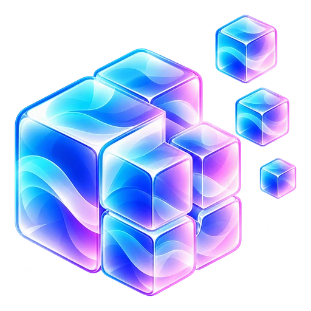
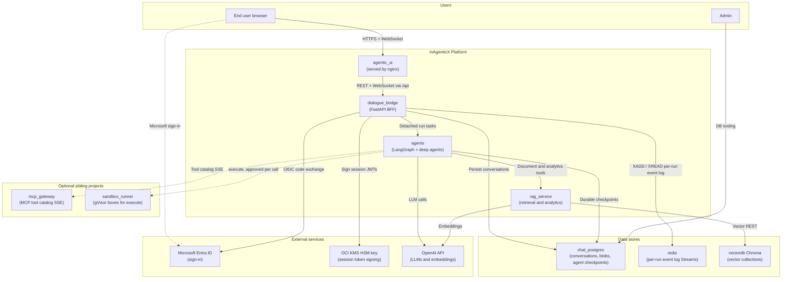
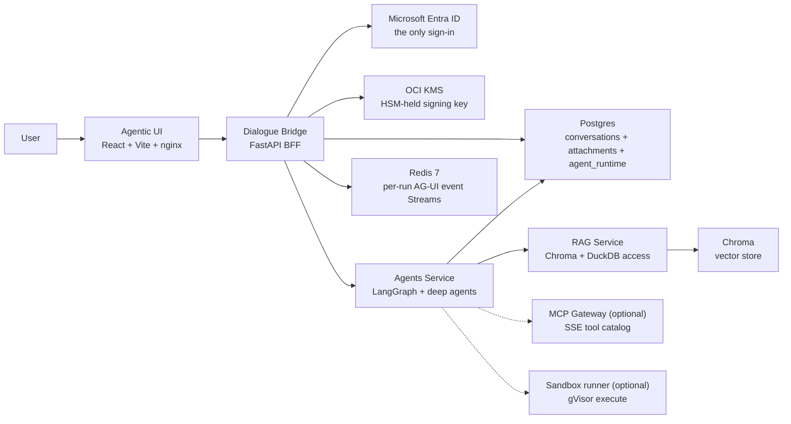
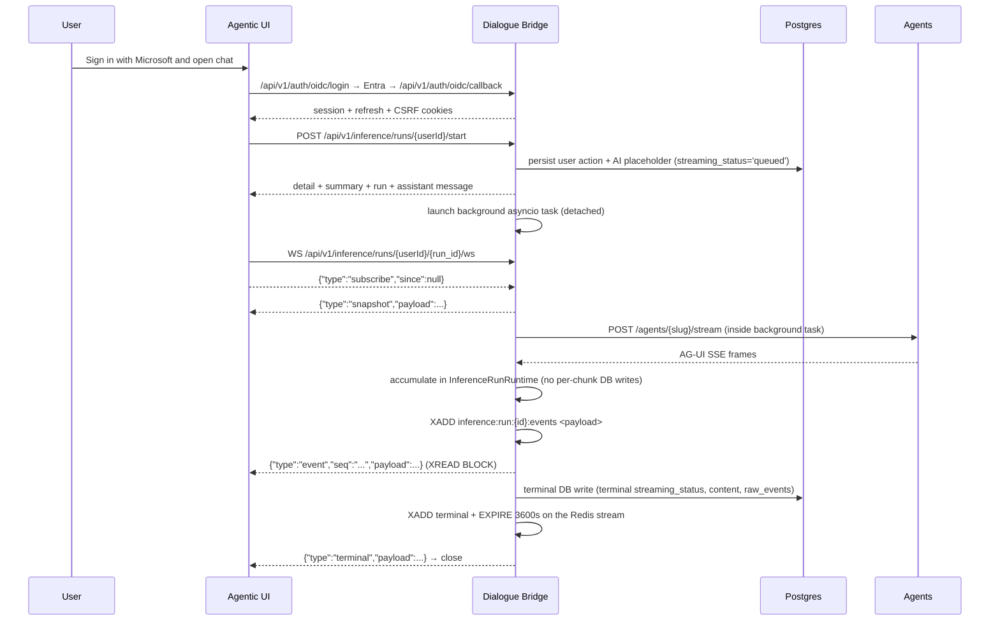
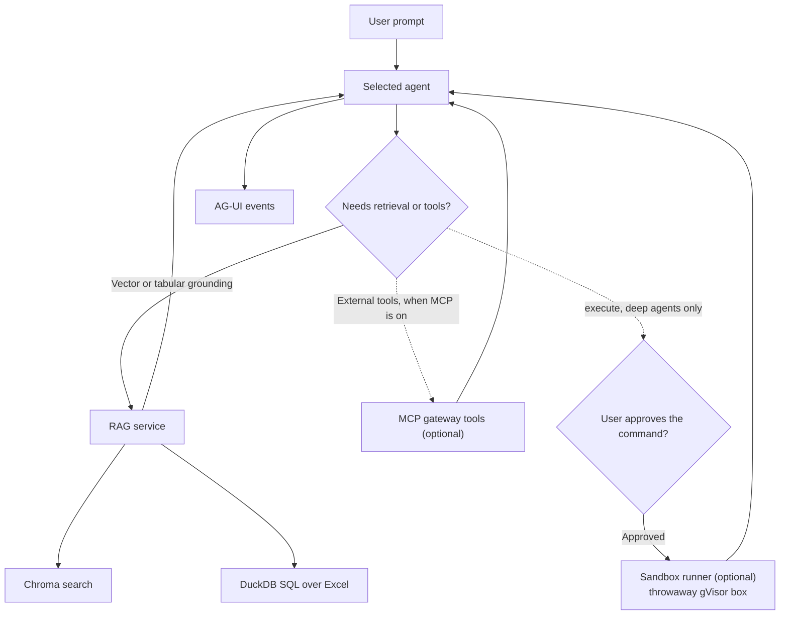
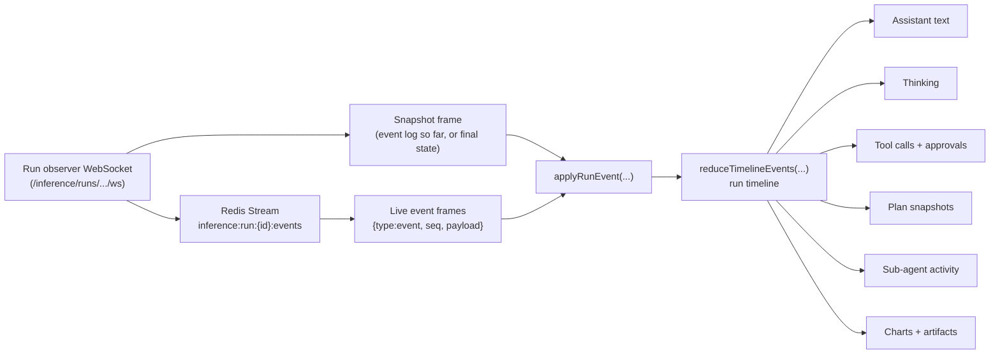
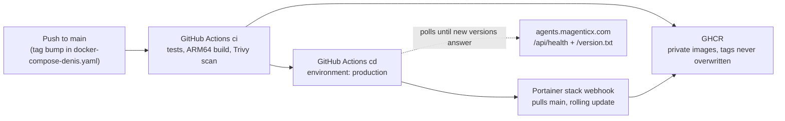
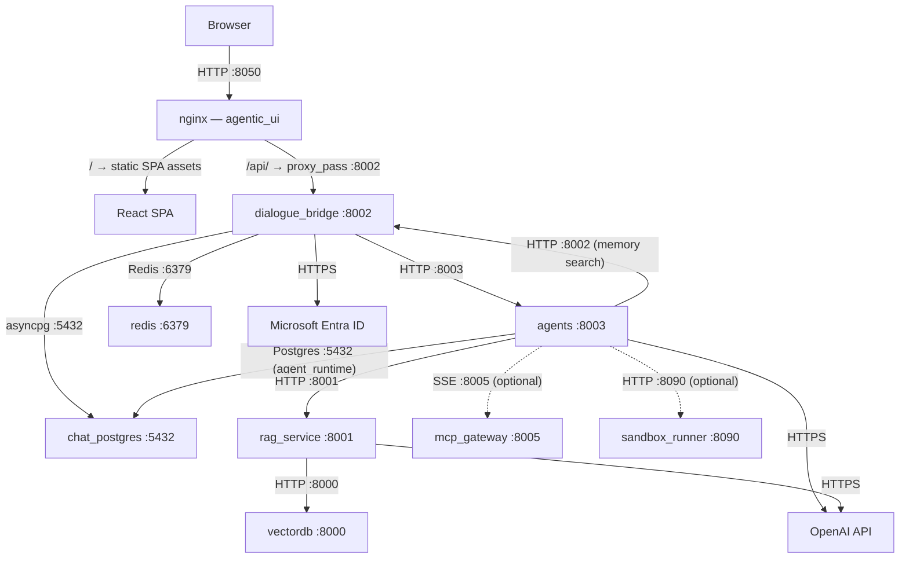
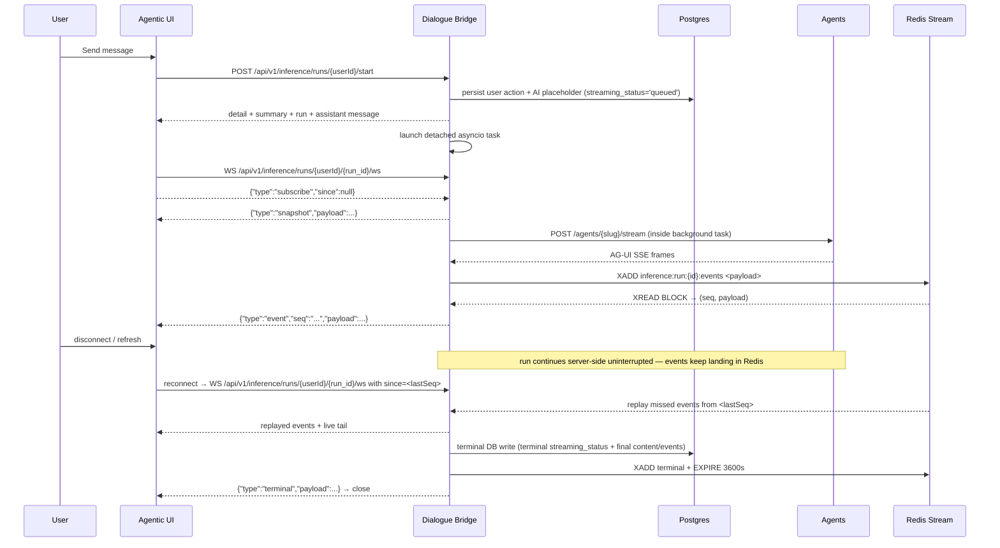
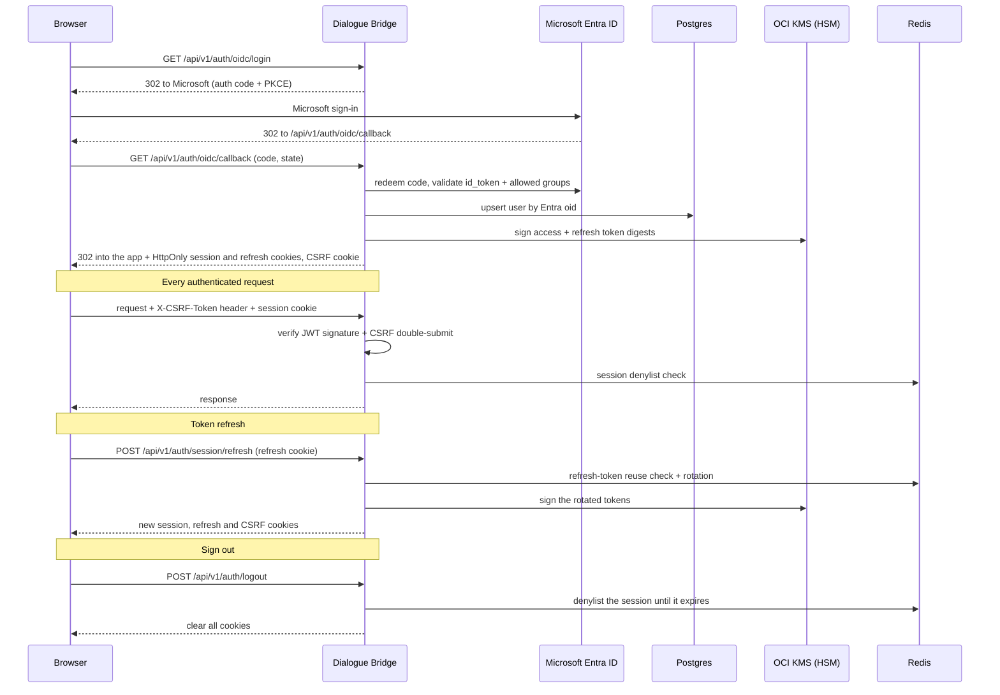

<p align="center">
    <picture>
        <source media="(prefers-color-scheme: dark)" srcset="magenticx/agentic_ui/public/brand/logos/magenticx/midnight-mark.webp" />
        
    </picture>
</p>

<h1 align="center">mAgenticX</h1>

<p align="center">
    A production-shaped agentic platform — multi-agent orchestration, retrieval, tool use, and a full chat workspace with observable reasoning.
</p>

<p align="center">
    <a href="#quick-start">Quick Start</a> •
    <a href="#architecture-at-a-glance">Architecture</a> •
    <a href="#services">Services</a> •
    <a href="#documentation-hub">Docs</a> •
    <a href="https://agents.magenticx.com">Live site</a>
</p>



## What mAgenticX Is

mAgenticX is a full-stack agentic system built around a browser chat experience, an authenticated backend-for-frontend, a streaming agent runtime, and a dedicated retrieval layer. It is designed for environments where you need more than plain chat: tool execution, retrieval grounding, attachments, dictation, observability, and visible reasoning artifacts such as plans, sub-agent activity, and tool traces.

The repository is split into focused services, each with its own implementation README. This root document is the landing page for the project: it explains how the platform fits together, where to start, and where to go next. It runs in production at [agents.magenticx.com](https://agents.magenticx.com).

## Table of Contents

- [What mAgenticX Is](#what-magenticx-is)
- [Why It Exists](#why-it-exists)
- [Architecture at a Glance](#architecture-at-a-glance)
- [Core Flows](#core-flows)
- [Examples](#examples)
- [Services](#services)
- [Repository Map](#repository-map)
- [Quick Start](#quick-start)
- [Deployment](#deployment)
- [Screens and Diagrams](#screens-and-diagrams)
- [Documentation Hub](#documentation-hub)
- [Development Notes](#development-notes)
- [License](#license)

## Why It Exists

- To provide a production-shaped agentic chat stack instead of a single demo script.
- To separate concerns cleanly across UI, auth/persistence, agent execution, retrieval, and tool discovery.
- To expose agent runtime behavior in the UI through AG-UI events rather than hiding everything behind a plain text stream.
- To support both retrieval-backed domain agents and more general deep-agent orchestration patterns in the same project.
- To keep each major subsystem independently understandable and deployable.

## Architecture at a Glance



The MCP gateway, the sandbox runner and the monitoring stack are separate projects ([mcp_gateway](https://github.com/konstantinosmpouros/mcp_gateway), [sandbox](https://github.com/konstantinosmpouros/sandbox), [monitoring](https://github.com/konstantinosmpouros/monitoring)). mAgenticX boots and runs without them: no MCP tools, no `execute`, no dashboards.

## Core Flows

### Authenticated Chat Flow

The browser talks only to the dialogue bridge. Users sign in with Microsoft Entra ID; the bridge then issues its own stateless session tokens, persists conversation state, and owns the inference run as a persistent server-side asyncio task. The browser can disconnect and reconnect freely without interrupting the run.



### Retrieval and Tooling Flow

The agents service can combine model reasoning with vector retrieval, spreadsheet analytics, MCP tools and sandboxed command execution, then emit the resulting activity back to the UI as structured events. A run never depends on the optional siblings: with the gateway unreachable (or `MCP_GATEWAY_URL` empty) a run goes ahead with the agent's own tools, and without a sandbox runner (`SANDBOX_RUNNER_URL` empty) deep agents simply have no `execute` tool.



### Browser Rendering Flow

The UI does not just append streamed text. It receives events over a WebSocket from the run observer endpoint and folds them into a run timeline: assistant text, thinking, tool calls and approvals, plan snapshots, sub-agent activity, charts and artifacts. A fresh subscribe first gets a snapshot (the full event log so far, or the final state of a finished run). The run continues on the server even if the browser disconnects; reconnect with `since=<lastSeenSeq>` replays missed events from the per-run Redis stream (1 h post-terminal TTL) before resuming live events. The bridge, not the browser, writes the finished run to Postgres.



## Examples

Representative use cases supported by the current codebase:

- HR policy support: ask policy or workplace questions against the HR retrieval workflow and surface grounded answers with cited context.
- Orthodox domain support: route religious and theological prompts through the Orthodox workflow with domain-specific retrieval logic.
- Retail and spreadsheet analysis: query tabular business data through the RAG service’s DuckDB-backed Excel layer.
- General agentic orchestration: use the Omni/deep-agent path for planning, delegation, tool use, sandboxed code execution, and sub-agent event rendering.
- Custom agents: build your own deep agent in the agent builder, with version history and YAML import.

## Services

| Service | Role | Default Port | Main Stack | Docs |
| --- | --- | ---: | --- | --- |
| `agentic_ui` | Browser chat app and reverse proxy entrypoint | `8050` | React, Vite, nginx | [UI README](magenticx/agentic_ui/README.md) |
| `dialogue_bridge` | Authenticated BFF (Entra sign-in, KMS-signed sessions), persistence layer, detached run manager | `8002` | FastAPI, SQLAlchemy, Postgres | [Bridge README](magenticx/dialogue_bridge/README.md) |
| `agents` | Streaming agent runtime and AG-UI normalization | `8003` | FastAPI, LangGraph, deepagents, OpenAI | [Agents README](magenticx/agents/README.md) |
| `rag_service` | Retrieval and SQL over spreadsheet-backed data | `8001` (internal) | FastAPI, Chroma, DuckDB | [RAG README](magenticx/rag_service/README.md) |
| `vectordb` | Persistent vector storage for retrieval | `8000` (internal) | Chroma 0.6.3 | integrated |
| `chat_postgres` | Durable chat state, attachments, feedback, the `streaming_*` inference-run lifecycle on `messages`, and the agents' `agent_runtime` database | `5432` | PostgreSQL 16 + pgvector | integrated |
| `redis` | Per-run AG-UI event log (Redis Streams) backing the WebSocket observer's cursor-based replay; session denylist | `6379` (internal) | Redis 7.4 alpine | integrated |
| `mcp_gateway` | Tool catalog and MCP SSE endpoint (Tavily, arXiv) — optional sibling project | `8005` (internal) | docker/mcp-gateway | [mcp_gateway](https://github.com/konstantinosmpouros/mcp_gateway) |
| `sandbox_runner` | Runs `execute` calls in throwaway gVisor boxes — optional sibling project | `8090` (internal) | FastAPI, dind, gVisor | [sandbox](https://github.com/konstantinosmpouros/sandbox) |

## Repository Map

```text
.
├── README.md
├── LICENSE
├── SECURITY.md
├── .github/workflows/       CI/CD pipeline, security scans, code review
├── docs/
│   ├── architecture/        services, ports, schema, secrets, deployment, configuration
│   ├── development/         service references, AG-UI protocol, tool harness, observability
│   └── flows/               one doc per feature flow (auth, inference, sharing, ...)
├── notebooks/               exploratory and analysis notebooks
├── tests/                   per-service test suites + integration tests
└── magenticx/
    ├── agentic_ui/          React SPA, nginx proxy, AG-UI rendering
    ├── dialogue_bridge/     FastAPI BFF, auth, persistence, detached inference runs
    ├── agents/              Agent runtime, deep agents, AG-UI event output
    ├── rag_service/         Retrieval and DuckDB-backed analytics
    ├── tls/                 Internal-CA cert generation + TLS entrypoints (Dennis)
    ├── secrets/             Local dev signing key (gitignored)
    ├── vectorstores/        Chroma persistence (gitignored)
    ├── docker-compose.yaml        local stack, built from source
    └── docker-compose-denis.yaml  production Swarm stack (GHCR images, mTLS)
```

## Quick Start

### Prerequisites

- Docker and Docker Compose for the containerized stack
- A Microsoft Entra ID app registration (sign-in is Entra-only; there is no username/password login)
- OpenAI API access for the configured models
- Node.js 22 and Python 3.12 only for running tests or tooling outside the containers

### Core Stack

1. Create `magenticx/.env`:

    ```bash
    OPENAI_API_KEY=sk-...
    SESSION_TOKEN_SECRET=<openssl rand -hex 32>
    TRUSTED_PROXY_SECRET=<openssl rand -hex 32>
    INTERNAL_SERVICE_SECRET=<openssl rand -hex 32>   # must differ from TRUSTED_PROXY_SECRET
    ENTRA_TENANT_ID=...
    ENTRA_CLIENT_ID=...
    ENTRA_CLIENT_SECRET=...
    ENTRA_REDIRECT_URI=http://localhost:8050/api/v1/auth/oidc/callback
    ENTRA_ALLOWED_GROUP_IDS=<group id(s) allowed to sign in>
    ```

    Register the same redirect URI on the Entra app. The bridge refuses to start without the Entra tenant, client and secret.

2. Generate the local session-signing key once. Production signs with an OCI KMS HSM key; a laptop signs with this file (gitignored):

    ```bash
    mkdir -p magenticx/secrets
    openssl genpkey -algorithm RSA -pkcs8 -pkeyopt rsa_keygen_bits:2048 -out magenticx/secrets/dev_session_signing_key.pem
    ```

3. Start the stack, defined in `magenticx/docker-compose.yaml`:

    ```bash
    docker compose -f magenticx/docker-compose.yaml up --build
    ```

This core stack includes `agentic_ui`, `dialogue_bridge`, `agents`, `rag_service`, `vectordb`, `chat_postgres` and `redis`. Database migrations run automatically when the bridge starts.

### Optional Sibling Projects

Each is its own repository, started from its own folder after this stack (they join its `mcp_net` / `sandbox_net` networks):

| Project | Adds | Turn on in `magenticx/.env` |
| --- | --- | --- |
| [mcp_gateway](https://github.com/konstantinosmpouros/mcp_gateway) | MCP tools (Tavily, arXiv) | `MCP_GATEWAY_URL=http://mcp_gateway:8005/sse` |
| [sandbox](https://github.com/konstantinosmpouros/sandbox) | The `execute` tool | `SANDBOX_RUNNER_URL=http://sandbox_runner:8090` |
| [monitoring](https://github.com/konstantinosmpouros/monitoring) | Grafana, Prometheus, Loki on `http://localhost:3000` | `LOG_FORMAT=json` (for the log panels) |

Without them mAgenticX runs with no MCP tools and no `execute`.

### Main URLs

When the default Compose setup is running (local hops are plain HTTP):

- UI: `http://localhost:8050`
- Dialogue Bridge: `http://localhost:8002`
- Agents: `http://localhost:8003`
- Postgres: `localhost:5432`
- RAG Service: `http://rag_service:8001` (internal only — not host-bound)
- Chroma: `http://vectordb:8000` (internal only — not host-bound)
- Redis (inference event log): `redis://redis:6379/0` (internal only — not host-bound)
- MCP Gateway (when running): `http://mcp_gateway:8005/sse` (internal only — reached by agents on `mcp_net`)
- Sandbox runner (when running): `http://sandbox_runner:8090` (internal only — reached by agents on `sandbox_net`)

### Local Development

For service-by-service detail, use the implementation READMEs:

- [UI local development](magenticx/agentic_ui/README.md#development)
- [Dialogue bridge setup](magenticx/dialogue_bridge/README.md)
- [Agents setup](magenticx/agents/README.md)
- [RAG service setup](magenticx/rag_service/README.md)

## Deployment

Production runs on an Oracle Cloud ARM64 VM as a Docker Swarm stack managed by Portainer, at [agents.magenticx.com](https://agents.magenticx.com). The image tags in `magenticx/docker-compose-denis.yaml` are the release.



On the VM every service hop is HTTPS with mutual TLS against an internal CA, Postgres and Redis use verified TLS, and only `agentic_ui` sits behind Cloudflare and Nginx Proxy Manager. Session tokens are signed by an HSM-held key in OCI KMS that only the VM may use. Full runbook: [docs/architecture/deployment.md](docs/architecture/deployment.md).

## Screens and Diagrams

### Network and Request Flow

Ports and protocols of the local stack. On Dennis the same hops run over HTTPS with mTLS (`agents → mcp_gateway` stays plain HTTP), and the browser arrives through Cloudflare and Nginx Proxy Manager.



### Platform Overview


### Chat Lifecycle



### Authentication

Microsoft Entra ID is the only way in. The bridge mints its own RS256 session JWTs and verifies them by signature alone, against public keys loaded at boot — no database or KMS call on the request path. In production the signature comes from an HSM key in OCI KMS; locally from a file key.



## Documentation Hub

Use the root README for orientation, then jump into the service manuals and the `docs/` reference:

- [Agentic UI](magenticx/agentic_ui/README.md)
- [Dialogue Bridge](magenticx/dialogue_bridge/README.md)
- [Agents Service](magenticx/agents/README.md)
- [RAG Service](magenticx/rag_service/README.md)
- [Architecture overview](docs/architecture/overview.md), [Deployment](docs/architecture/deployment.md), [Configuration](docs/architecture/configuration.md)
- [Authentication and sessions](docs/flows/authentication-and-session.md), [Inference streaming](docs/flows/inference-streaming.md), [Sandboxed execution](docs/flows/sandboxed-execution.md)
- [MCP Gateway](https://github.com/konstantinosmpouros/mcp_gateway), [Sandbox runner](https://github.com/konstantinosmpouros/sandbox), [Monitoring](https://github.com/konstantinosmpouros/monitoring) (sibling projects)

## Development Notes

- If you are working on the browser experience, start with `magenticx/agentic_ui`.
- If you are changing auth, sessions, chat persistence, or detached inference run observation, start with `magenticx/dialogue_bridge`.
- If you are changing agent workflows, tools, or AG-UI stream behavior, start with `magenticx/agents`.
- If you are changing retrieval collections, Excel analytics, or DuckDB behavior, start with `magenticx/rag_service`.
- If you are changing the MCP server catalog or the sandbox runner, work in the [mcp_gateway](https://github.com/konstantinosmpouros/mcp_gateway) or [sandbox](https://github.com/konstantinosmpouros/sandbox) repository.

## License

This repository is licensed under the [MIT License](LICENSE).
