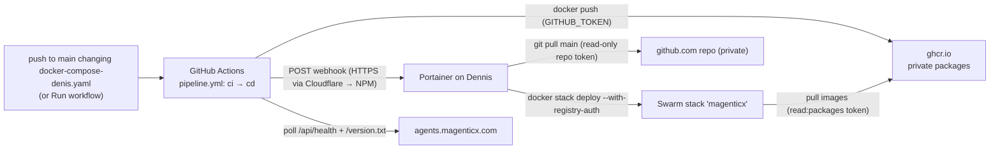

# Deployment — GitHub CD to Dennis

Production runs on **Dennis** (Oracle Cloud ARM64 VM, Docker Swarm), and every application release reaches it the same way: the image tags in [`magenticx/docker-compose-denis.yaml`](../../magenticx/docker-compose-denis.yaml) are the release, and [`.github/workflows/pipeline.yml`](../../.github/workflows/pipeline.yml) turns them into running services in two jobs: **`ci`** tests, then builds and publishes the images; **`cd`** only deploys. A release starts when a push to `main` changes `docker-compose-denis.yaml` (merging a pull request included), or when the repository owner clicks **Actions → CI/CD → Run workflow** on `main`; once the tests are green, the image steps of `ci` build each new tag natively on an ARM64 GitHub runner (one step per service), scans it, and publishes it to the **GitHub Container Registry** (`ghcr.io`, private packages). Only when every image is published does `cd` run: it calls a **Portainer stack webhook** — Portainer, which manages the stack, pulls `main` from the private repository itself and runs the Swarm rolling update — and watch the public site until the new versions answer. GitHub never connects to Dennis over SSH (port 22 only accepts the operator's home IP), and Portainer stays the one thing that deploys, so the stack remains fully Portainer-managed. The webhook URL can do exactly one thing — redeploy what `main` already holds — which is why it is the trigger rather than a Portainer API key, which would be admin over the whole VM.

---

## Services Involved



---

## A Release — Full Sequence

The workflow has two jobs. **`ci`** is one job with a step per service: it runs on every push and pull request (on `ubuntu-24.04-arm`, since the images are built there), works out whether the change touched `docker-compose-denis.yaml`, tests every service, and — only when every test is green and the yml changed — runs one image step per service: it **publishes** the new tags (build, scan, push) for a push to `main` or a manual run, and **checks** them (build + scan, nothing pushed) for a pull request. **`cd`** deploys and builds nothing: it runs only after `ci` has published — never for a pull request — and tells Portainer to deploy.

```mermaid
sequenceDiagram
    participant Y as You
    participant CI as ci (arm64)
    participant G as GHCR
    participant CD as cd
    participant PT as Portainer (Dennis)
    participant S as Swarm

    Y->>CI: push to main changing the yml (or Run workflow)
    CI->>CI: tests green
    CI->>CI: refuse unless the repository owner started the run
    loop one step per service
        CI->>G: manifest inspect <tag>
        alt tag already published
            G-->>CI: exists → skip (never overwritten)
        else new tag
            CI->>CI: docker build --platform linux/arm64 --build-arg APP_VERSION=<tag>
            CI->>CI: Trivy: fixable CRITICAL? → job fails, nothing pushed, nothing deployed
            CI->>G: docker push
        end
    end
    CI->>G: anonymous pull of every image must be refused (private)
    CI-->>CD: every image published
    CD->>CD: refuse unless the repository owner started the run
    CD->>PT: POST stack webhook
    PT->>PT: git pull main
    PT->>S: stack deploy (new tags → Swarm pulls them)
    S->>S: rolling update, start-first; unhealthy → automatic rollback
    loop every 20 s, up to 15 min
        CD->>S: GET /api/health (.version) + /version.txt
    end
    CD-->>CD: green when both report the compose tags
```

---

## Phase 1 — Trigger: the yml changed

`docker-compose-denis.yaml` is the release, so a change to it is what starts the image steps of `ci` (and after them `cd`). The `ci` job works that out with `git diff` over the push range (`before..sha`) or the pull request's range (`base..merge`) — GitHub's push payload for Actions carries no file lists — and sets `release=true|false` for the image steps (and `deploy` for `cd`). A manual run always counts as a release.

| Event | `ci`'s image steps / `cd` do |
| --- | --- |
| Push to `main` that changed the yml (merging a PR included) | **publish** — `ci` builds and pushes, then `cd` deploys and verifies. Automatic |
| **Run workflow** on `main` | **publish** — whether or not the yml changed (without a new tag it changes nothing) |
| Pull request that changes the yml | **check** — `ci` builds + scans each new tag; nothing pushed, `cd` does not run |
| Anything else (docs-only push, PR not touching the yml, Run workflow on another branch) | nothing — CI only |

A pull request never publishes: Portainer only ever deploys `main`, so its images could not go live before the merge anyway, and publishing would permanently take the tag (tags are never overwritten) with code that is not merged yet. The merge is a push to `main`, and that releases. A publish run **fails closed** unless the repository owner (`github.triggering_actor`) pushed or started it, so a collaborator given write access later still cannot ship. One `ci` run per branch at a time (`ci-<ref>`, so two releases never build the same tag at once) and one deploy at a time (`deploy-production`); a PR's run is superseded by the PR's next push. GitHub keeps only the newest *waiting* run of a group, so if a release push is still waiting when another push to `main` lands, it is cancelled — re-run it with **Run workflow**.

---

## Phase 2 — Build: one step per service

Each service is one step running [`.github/scripts/release_image.sh`](../../.github/scripts/release_image.sh) on `ubuntu-24.04-arm` (native ARM64 — no QEMU; private repositories get these runners too, with 2 vCPUs, billed against the plan's Actions minutes). It reads the service's tag from the compose file and asks GHCR whether it already exists. **Tags are immutable**: an existing tag is never rebuilt or pushed again, so a tag always names the same bytes, a re-run is harmless, and rolling back to an old tag is always possible. If the registry answer is ambiguous (network trouble rather than "not found"), the step fails instead of guessing, because a wrong guess would overwrite a published tag. Any failed step stops the job, and `cd` needs `ci`, so a half-built release never deploys.

The tag is baked in as `APP_VERSION`: the Python services stamp it on every log line (`"version"`), the bridge reports it on `/health`, and the UI serves it as `/version.txt`. A Trivy scan rejects any image with a **fixable** CRITICAL vulnerability — the image is never pushed. After the builds, every image named in the compose file is pulled with **no credentials**; if that works the image is public, and the job fails before deploying.

| Key fact | Value / detail |
| --- | --- |
| Image name | `ghcr.io/konstantinosmpouros/magenticx_<service>:vX.Y.Z` — prefixed like OrthodoxAI's `orthodoxai_<service>`, since GHCR packages share one account-wide namespace |
| Push credential | the workflow's own `GITHUB_TOKEN` (`packages: write`) — nothing stored |
| Labels | `org.opencontainers.image.source` (links the package to this repo), `.revision` (commit), `.version` (tag) |
| Scanner | `ghcr.io/aquasecurity/trivy:0.75.0`, pinned by digest; `--severity CRITICAL --ignore-unfixed` |
| Third-party actions | only `actions/checkout`, pinned to a commit SHA — everything else is the runner's own `docker`, `curl`, `python3` |

---

## Phase 3 — Deploy and verify

The `cd` job builds nothing: it POSTs the webhook stored as the repository secret `PORTAINER_WEBHOOK_URL`. Portainer pulls `main` (with its read-only repository token) and redeploys; Swarm resolves each tag to its digest and only restarts services whose image or spec actually changed. The webhook returns before Swarm finishes, and the old tasks keep answering until the new ones are healthy, so a plain 200 proves nothing: the job polls `https://agents.magenticx.com/api/health` (`version`) and `/version.txt` until they equal the `dialogue_bridge` and `agentic_ui` tags in the compose file, for up to 15 minutes. `agents` and `rag_service` are internal and not reachable from outside; they are guarded by their Swarm healthchecks and the automatic rollback.

| Key fact | Value / detail |
| --- | --- |
| Update order | `start-first` — the old task serves until the new one is healthy |
| Failed update | `failure_action: rollback` on all four app services — an image that never turns healthy reverts by itself |

---

## Day to Day

| You do | What happens |
| --- | --- |
| Open a pull request that bumps a tag in `docker-compose-denis.yaml` — **patch only** (`v1.21.14 → v1.21.15`) | `ci` **check**: the new image builds and passes the scan, nothing is published |
| Merge it (or push the bump straight to `main`) | `ci` tests and **publishes** the new tag, then `cd` has Portainer pull `main` and deploy, and goes green when the new versions answer |
| **Actions** → **CI/CD** → **Run workflow** → `main` | re-runs a release by hand (e.g. after a failed one) |
| **Roll back** | revert the tag in the compose file and push / merge — the old image is still in GHCR. For an emergency, Portainer → Services → *service* → **Rollback** |

---

## One-Time Cutover from Docker Hub (runbook)

Do these in order. The first run publishes the images; the stack moves to Git + GHCR in step 7.

**1. Make the repository private.** Repo → **Settings** → **General** → **Danger Zone** → **Change repository visibility** → **Change visibility** → **Make private** → confirm. Read GitHub's dialog before confirming — it lists what changes for a public repository (for example stars and watchers).

**2. Push the CD change to `main`.** This runs `ci` only.

**3. Run CD.** **Actions** → **CI/CD** (left list) → **Run workflow** → Branch `main` → **Run workflow**. After the tests, the four image steps of `ci` publish `magenticx_dialogue_bridge v2.17.17`, `magenticx_agents v1.21.14`, `magenticx_rag_service v1.4.3`, `magenticx_agentic_ui v0.15.14`, and the privacy check passes; then `cd`'s webhook step **fails on purpose** — `PORTAINER_WEBHOOK_URL` does not exist yet. Expected: the images are what this run is for.

**4. Check the packages** at `github.com/konstantinosmpouros?tab=packages`: four `magenticx_*` packages, **Private**, each linked to `mAgenticX`.

**5. GitHub — a GHCR pull token for Dennis.** Avatar → **Settings** → **Developer settings** → **Personal access tokens** → **Tokens (classic)** → **Generate new token (classic)** (fine-grained tokens cannot read GHCR):

| Field | Value |
| --- | --- |
| Note | `Dennis Portainer — GHCR pull` |
| Expiration | 1 year — record the date in [secrets.md § Expiry dates](secrets.md) |
| Scopes | **only** `read:packages` |
| | **Generate token** → copy it once |

**6. GitHub — a repository read token for Portainer** (the repository is private, so Portainer needs one to pull `main`). Avatar → **Settings** → **Developer settings** → **Personal access tokens** → **Fine-grained tokens** → **Generate new token**:

| Field | Value |
| --- | --- |
| Token name | `Dennis Portainer — mAgenticX read` |
| Description | `Portainer pulls docker-compose-denis.yaml from main` |
| Resource owner | `konstantinosmpouros` |
| Expiration | 1 year (custom date) — record it in [secrets.md § Expiry dates](secrets.md) |
| Repository access | **Only select repositories** → `mAgenticX` |
| Repository permissions | **Contents** → **Read-only** (Metadata: Read-only is added automatically). Nothing else |
| | **Generate token** → copy it once |

**7. Portainer — registry, stack.**

a) **Registries** → **Add registry** → **Custom registry**:

| Field | Value |
| --- | --- |
| Name | `ghcr` |
| Registry URL | `ghcr.io` |
| Authentication | ☑ — Username `konstantinosmpouros`, Password = the token from step 5 |
| | **Add registry** |

b) Back up both databases if they hold anything worth keeping (on Dennis):

```bash
PG=$(sudo docker ps -q -f name=magenticx_chat_postgres)
sudo docker exec "$PG" pg_dump -U admin -d chat_db -Fc > ~/chat_db_$(date +%F).dump
sudo docker exec "$PG" pg_dump -U admin -d agent_runtime -Fc > ~/agent_runtime_$(date +%F).dump
```

c) **Stacks** → `magenticx` → **Delete this stack**. Services and stack networks go; external secrets, external networks (`proxy`, `mcp_gateway`) and named volumes (`chat_convs`, `vectorstore`, `magenticx_data`) stay. The site is down from here until step e) finishes.

d) **Wait until the stack's networks are gone** — Swarm removes them a few seconds after the services, and deploying earlier fails with "network already exists". On Dennis, `sudo docker network ls | grep magenticx_` must print nothing.

e) **Stacks** → **Add stack**:

| Field | Value |
| --- | --- |
| Name | `magenticx` — **the same name**, so the existing volumes and secrets re-attach |
| Build method | **Repository** |
| Authentication | ☑ — Username `konstantinosmpouros`, Personal Access Token = the token from step 6 (tick **Save credential** if offered, name it `mAgenticX read`) |
| Repository URL | `https://github.com/konstantinosmpouros/mAgenticX` |
| Repository reference | `refs/heads/main` |
| Compose path | `magenticx/docker-compose-denis.yaml` |
| GitOps updates | ☑ → Mechanism **Webhook** → **copy the webhook URL** |
| Re-pull image / Force redeployment | leave **off** — Business Edition only, and not needed: every release is a new tag (so the service spec changes and Swarm pulls it) and a new commit (so Portainer has something to deploy) |
| Skip TLS Verification | **off** |
| Environment variables | none |
| | **Deploy the stack** |

Labels can differ slightly between Portainer versions. If GitOps updates offers only **Polling**, stop there — the `cd` job assumes a webhook and needs adjusting first.

**8. Verify:** `sudo docker service ls` shows every `magenticx_*` service `1/1`; `https://agents.magenticx.com/api/health` returns `"version":"v2.17.17"`; `https://agents.magenticx.com/version.txt` returns `v0.15.14`; Microsoft sign-in works.

**9. GitHub — add the webhook and finish the run.** Repo → **Settings** → **Secrets and variables** → **Actions** → **Repository secrets** → **New repository secret**: Name `PORTAINER_WEBHOOK_URL`, Secret = the URL from step 7e → **Add secret**. Then open the run from step 3 → **Re-run jobs** → **Re-run failed jobs**. Only `cd` re-runs (the images are published), the webhook redeploys (a no-op now) and the job goes green — the pipeline is proven end to end.

**10. Clean up:** delete the `production` environment if one was created earlier (Settings → Environments — it is unused), and, once Dennis has run on GHCR for a while, the four `konstantinosmpouros/<service>` repositories on Docker Hub (not the `orthodoxai_*` ones).

---

## Sharp Edges and Behavioral Notes

- **No tag bump, no release** — a code change without a tag bump is never built (the existing tag is skipped). A Run workflow then only redeploys what is already there. Bump the tag in the same change as the code.
- **Images are private, and every release proves it** — they exist only in GHCR (the runner is a throwaway VM; Dennis keeps its pulled copies locally). GHCR creates packages private, and the `Verify every image is private` step fails the release if any of them can be pulled anonymously — e.g. someone flipped a package to public in its settings.
- **Tags are never overwritten** — to rebuild a service, bump its tag. Deleting a package version in GHCR is the only way to reuse a tag; don't.
- **Portainer CE redeploys only on a new commit** — without the Business-only *Force redeployment*, a webhook call when `main` hasn't moved since the last deploy is a no-op. Harmless: a release always carries a new commit (the tag bump). It is also why tags must change per release — *Re-pull image* (Business) is what a reused tag would need.
- **The compose file is edited in git only** — a Git-based stack has no editor in Portainer. Stack environment variables set in Portainer survive redeploys; anything in the file comes from `main`.
- **Actions minutes are metered** — a private repository spends the plan's monthly Actions minutes (GitHub Free: 2,000) on every CI run and every release; ARM64 runners for private repositories have 2 vCPUs, so builds take longer than on a public repository.
- **A push that changes the yml goes straight to production** — there is no approval step (required reviewers are public-repo-only on GitHub Free). The pull request's `ci` check is the review point: it proves the images build and pass the scan before you merge.
- **Destructive migrations run on the bridge's start** — read any new file under `core/database/migrations/versions/` before you push or merge the tag bump.
- **Three tokens expire** — the GHCR pull token (Swarm can no longer pull new images), the repository read token (Portainer can no longer pull `main`, so redeploys fail) and, if rotated, the webhook. Running tasks keep running either way; rotate before the dates recorded in [secrets.md](secrets.md).
- **Cloudflare sits in front of both calls** — the webhook (`portainer.magenticx.com`) and the smoke check (`agents.magenticx.com`) go through Cloudflare. If Bot Fight Mode or "Under Attack" is ever enabled, GitHub's runners get challenged and the job fails; add a WAF skip rule for the webhook path rather than turning the protection off.
- **A leaked webhook URL** can only redeploy what `main` already holds. Still: regenerate it in Portainer (stack → GitOps → webhook) and update the repository secret.
- **Still manual** — mTLS entrypoint scripts (bind-mounted files, staged rollout in CLAUDE.md § Internal mTLS), the MCP gateway (plain Docker Compose with dind, not Swarm), and creating or rotating Swarm secrets.
- **MCP is set in the compose file, not in Portainer** — MCP is an opt-in add-on (`MCP_GATEWAY_URL` defaults to empty = off in the code), and `docker-compose-denis.yaml` sets `MCP_GATEWAY_URL=http://mcp_gateway:8005/sse`, so production runs it with the gateway from `docker-compose-denis-mcp.yaml`. To run production without MCP, change that line to `- MCP_GATEWAY_URL=` and release: no gateway calls, an empty tool catalog, declared MCP tools listed unavailable. On but the gateway down: chats still run — each run waits up to `MCP_CONNECT_TIMEOUT_SECONDS` (default 10) and continues without MCP tools (`mcp_session_unavailable` in the agents logs) — while the tool catalog returns 502. The external `mcp_gateway` overlay network stays required either way: it was created once by hand and is shared with the gateway's compose.
- **Package name collisions** — GHCR packages live in the account namespace. The images are prefixed `magenticx_` so they cannot clash with OrthodoxAI's same-named services. A pre-existing package of the same name linked to a different repository makes the push fail with `denied` (never an overwrite).

---

## File Map

| Concept | File | What to look for |
| --- | --- | --- |
| CI + CD jobs | [.github/workflows/pipeline.yml](../../.github/workflows/pipeline.yml) | `ci` (its *Is this a release?* step, `RELEASE_MODE`, the owner check, one test step and one image step per service, the privacy check), `cd` (its `if:`, owner check, webhook, wait for live) |
| Build, scan, push one service | [.github/scripts/release_image.sh](../../.github/scripts/release_image.sh) | tag lookup, "already published?" check, Trivy gate |
| The release (tags + stack config) | [magenticx/docker-compose-denis.yaml](../../magenticx/docker-compose-denis.yaml) | `image: ghcr.io/...`, `deploy.update_config` / `rollback_config` |
| Version baked into images | `magenticx/<service>/Dockerfile` | `ARG APP_VERSION` |
| Bridge version on `/health` | [magenticx/dialogue_bridge/main.py](../../magenticx/dialogue_bridge/main.py) | `health()` |
| UI version file | [magenticx/agentic_ui/Dockerfile](../../magenticx/agentic_ui/Dockerfile) | `/usr/share/nginx/html/version.txt` |
| Deployment credentials | [docs/architecture/secrets.md](secrets.md) | § Deployment credentials |
