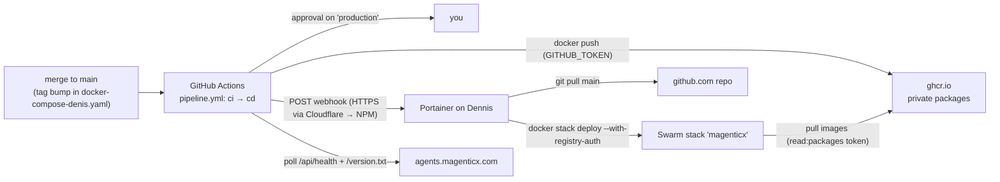

# Deployment — GitHub CD to Dennis

Production runs on **Dennis** (Oracle Cloud ARM64 VM, Docker Swarm), and every application release reaches it the same way: the image tags in [`magenticx/docker-compose-denis.yaml`](../../magenticx/docker-compose-denis.yaml) are the release, and the single **`cd` job** of [`.github/workflows/pipeline.yml`](../../.github/workflows/pipeline.yml) turns a merged tag bump into a running service. Once the `ci` job is green, `cd` waits for a required approval on the `production` environment, then — one step per service — builds each new tag natively on an ARM64 GitHub runner, scans it, and publishes it to the **GitHub Container Registry** (`ghcr.io`, private packages). Its last steps call a **Portainer stack webhook** — Portainer, which manages the stack, pulls `main` from GitHub itself and runs the Swarm rolling update — and watch the public site until the new versions answer. GitHub never connects to Dennis over SSH (port 22 only accepts the operator's home IP), and Portainer stays the one thing that deploys, so the stack remains fully Portainer-managed. The webhook URL can do exactly one thing — redeploy what `main` already holds — which is why it is the trigger rather than a Portainer API key, which would be admin over the whole VM.

---

## Services Involved



---

## A Release — Full Sequence

The workflow has two jobs, `ci` and `cd`, each one job with a step per service. `cd` runs only for `main`, only after `ci` is green, and only when the push touched `docker-compose-denis.yaml` or on a manual run.

```mermaid
sequenceDiagram
    participant CI as ci
    participant CD as cd (arm64)
    participant Y as You
    participant G as GHCR
    participant PT as Portainer (Dennis)
    participant S as Swarm

    CI-->>CD: green, and the push touched docker-compose-denis.yaml
    CD->>Y: approval requested (environment 'production')
    Y-->>CD: Approve
    CD->>CD: refuse if 'production' has no required reviewer
    loop one step per service
        CD->>G: manifest inspect <tag>
        alt tag already published
            G-->>CD: exists → skip (never overwritten)
        else new tag
            CD->>CD: docker build --platform linux/arm64 --build-arg APP_VERSION=<tag>
            CD->>CD: Trivy: fixable CRITICAL? → job fails, nothing pushed, nothing deployed
            CD->>G: docker push
        end
    end
    CD->>PT: POST stack webhook
    PT->>PT: git pull main
    PT->>S: stack deploy (re-pull images)
    S->>S: rolling update, start-first; unhealthy → automatic rollback
    loop every 20 s, up to 15 min
        CD->>S: GET /api/health (.version) + /version.txt
    end
    CD-->>CD: green when both report the compose tags
```

---

## Phase 1 — Trigger: is this a release?

A merge that does not touch `docker-compose-denis.yaml` changes nothing on Dennis, so it should not ask anyone for an approval. The `cd` job's `if:` looks for that path in the files the push event lists for its commits; a manual run (**Actions → CI/CD → Run workflow** on `main`) always starts it. Because the approval belongs to the job, it is asked **before** anything is built — the approval screen links the run, so the compose diff is one click away.

| Key fact | Value / detail |
| --- | --- |
| Compose edits that are not tag bumps | still a release — env vars, limits, healthchecks all live in that file |
| A push the check misses | (e.g. a very large push whose file lists GitHub truncates) — start CD by hand with **Run workflow** |

---

## Phase 2 — Approval gate

`cd` targets the `production` environment, so GitHub holds the job until a required reviewer approves. Its first step **fails closed** if the environment has no required reviewer — GitHub silently creates a missing environment with no protection, which would otherwise let a release run unapproved.

| Key fact | Value / detail |
| --- | --- |
| Concurrency | one release at a time (`deploy-production`); a newer merge queues, never cancels a running one |
| Who can trigger | only this job, with your approval; PRs and forks never reach it, so they never see the secret or a push-capable token |

---

## Phase 3 — Build: one step per service

Each service is one step running [`.github/scripts/release_image.sh`](../../.github/scripts/release_image.sh) on `ubuntu-24.04-arm` (native ARM64, free for public repositories — no QEMU). It reads the service's tag from the compose file and asks GHCR whether it already exists. **Tags are immutable**: an existing tag is never rebuilt or pushed again, so a tag always names the same bytes, a re-run is harmless, and rolling back to an old tag is always possible. If the registry answer is ambiguous (network trouble rather than "not found"), the step fails instead of guessing, because a wrong guess would overwrite a published tag. Any failed step stops the job, so a half-built release never deploys.

The tag is baked in as `APP_VERSION`: the Python services stamp it on every log line (`"version"`), the bridge reports it on `/health`, and the UI serves it as `/version.txt`. A Trivy scan then rejects any image with a **fixable** CRITICAL vulnerability — the image is never pushed.

| Key fact | Value / detail |
| --- | --- |
| Image name | `ghcr.io/konstantinosmpouros/magenticx_<service>:vX.Y.Z` — prefixed like OrthodoxAI's `orthodoxai_<service>`, since GHCR packages share one account-wide namespace |
| Push credential | the workflow's own `GITHUB_TOKEN` (`packages: write`) — nothing stored |
| Labels | `org.opencontainers.image.source` (links the package to this repo), `.revision` (commit), `.version` (tag) |
| Scanner | `ghcr.io/aquasecurity/trivy:0.75.0`, pinned by digest; `--severity CRITICAL --ignore-unfixed` |
| Third-party actions | only `actions/checkout`, pinned to a commit SHA — everything else is the runner's own `docker`, `curl`, `python3` |
| Privacy check | after the builds, every image named in the compose file is pulled with **no credentials**; if that succeeds the image is public and the job fails before deploying |

---

## Phase 4 — Deploy and verify

The job POSTs the webhook stored as the `production` environment secret `PORTAINER_WEBHOOK_URL`. Portainer pulls `main` and redeploys; Swarm resolves each tag to its digest and only restarts services whose image or spec actually changed. The webhook returns before Swarm finishes, and the old tasks keep answering until the new ones are healthy, so a plain 200 proves nothing: the job polls `https://agents.magenticx.com/api/health` (`version`) and `/version.txt` until they equal the `dialogue_bridge` and `agentic_ui` tags in the compose file, for up to 15 minutes. `agents` and `rag_service` are internal and not reachable from outside; they are guarded by their Swarm healthchecks and the automatic rollback.

| Key fact | Value / detail |
| --- | --- |
| Update order | `start-first` — the old task serves until the new one is healthy |
| Failed update | `failure_action: rollback` on all four app services — an image that never turns healthy reverts by itself |

---

## Day to Day

| You do | What happens |
| --- | --- |
| Bump the changed service's tag in `docker-compose-denis.yaml` — **patch only** (`v1.21.14 → v1.21.15`) | nothing yet; CI runs on the PR |
| Merge / push to `main` | `ci` runs; then `cd` asks for approval |
| Approve the `production` deployment in GitHub (Actions run, or the notification) | `cd` publishes the new tag, Portainer pulls `main` and deploys, `cd` goes green when the new versions answer |
| **Roll back** | revert the tag in the compose file, merge, approve — the old image is still in GHCR. For an emergency, Portainer → Services → *service* → **Rollback** |

---

## One-Time Cutover from Docker Hub (runbook)

Do these in order. The first push of the CD code publishes the images; the stack moves to Git + GHCR in step 5.

**1. GitHub — create the `production` environment first** (so the first run waits for you instead of failing). Repo → **Settings** → **Environments** → **New environment**:

| Field | Value |
| --- | --- |
| Name | `production` → **Configure environment** |
| Required reviewers | ☑, add `konstantinosmpouros` |
| Prevent self-review | **☐ unchecked** — you are the only reviewer and also the one who pushes; checked, you could never approve your own release |
| Wait timer | ☐ |
| Allow administrators to bypass configured protection rules | ☐ unchecked |
| Deployment branches and tags | **Selected branches and tags** → **Add deployment branch or tag rule** → `main` |
| | **Save protection rules** |

**2. Push the CD change to `main`, then approve `cd`.** After `ci`, the `cd` job asks for approval (run → **Review deployments** → ☑ `production` → **Approve and deploy**). Its four service steps publish `dialogue_bridge v2.17.17`, `agents v1.21.14`, `rag_service v1.4.3`, `agentic_ui v0.15.14`; then the webhook step **fails on purpose** — `PORTAINER_WEBHOOK_URL` does not exist yet. Expected: the images are what this step is for.

**3. Check the packages** at `github.com/konstantinosmpouros?tab=packages`: four packages, **Private**, each linked to `mAgenticX`.

**4. GitHub — a pull token for Dennis.** Avatar → **Settings** → **Developer settings** → **Personal access tokens** → **Tokens (classic)** → **Generate new token (classic)** (fine-grained tokens cannot read GHCR):

| Field | Value |
| --- | --- |
| Note | `Dennis Portainer — GHCR pull` |
| Expiration | 1 year — record the date in [secrets.md § Expiry dates](secrets.md) |
| Scopes | **only** `read:packages` |
| | **Generate token** → copy it once |

**5. Portainer — registry, backup, stack.**

a) **Registries** → **Add registry** → **Custom registry**:

| Field | Value |
| --- | --- |
| Name | `ghcr` |
| Registry URL | `ghcr.io` |
| Authentication | ☑ — Username `konstantinosmpouros`, Password = the token from step 4 |
| | **Add registry** |

b) **Back up both databases** (on Dennis, as yourself):

```bash
PG=$(sudo docker ps -q -f name=magenticx_chat_postgres)
sudo docker exec "$PG" pg_dump -U admin -d chat_db -Fc > ~/chat_db_$(date +%F).dump
sudo docker exec "$PG" pg_dump -U admin -d agent_runtime -Fc > ~/agent_runtime_$(date +%F).dump
```

c) Note any **environment variables** set on the current stack (Stacks → `magenticx` → Editor → Environment variables) — none are expected; the compose file holds the config.

d) **Stacks** → `magenticx` → **Delete this stack**. Services and stack networks go; external secrets, external networks (`proxy`, `mcp_gateway`) and named volumes (`chat_convs`, `vectorstore`, `magenticx_data`) stay. The site is down from here until step e) finishes (a few minutes).

e) **Stacks** → **Add stack**:

| Field | Value |
| --- | --- |
| Name | `magenticx` — **the same name**, so the existing volumes and secrets re-attach |
| Build method | **Repository** |
| Authentication | ☐ (the repository is public) |
| Repository URL | `https://github.com/konstantinosmpouros/mAgenticX` |
| Repository reference | `refs/heads/main` |
| Compose path | `magenticx/docker-compose-denis.yaml` |
| GitOps updates | ☑ → Mechanism **Webhook** → **copy the webhook URL** |
| Re-pull image | ☑ |
| Environment variables | whatever step c) found (normally none) |
| | **Deploy the stack** |

Labels can differ slightly between Portainer versions. If your version offers only **Polling** under GitOps updates, use it (interval 5 m) — the stack is still Portainer-managed, but deploys happen on Portainer's schedule, not on your approval.

**6. Verify:** `sudo docker service ls` shows every `magenticx_*` service `1/1`; `https://agents.magenticx.com/api/health` returns `"version":"v2.17.17"`; `https://agents.magenticx.com/version.txt` returns `v0.15.14`; Microsoft sign-in works.

**7. GitHub — add the webhook and approve.** Settings → Environments → `production` → **Environment secrets** → **Add environment secret**: Name `PORTAINER_WEBHOOK_URL`, Value = the URL from step 5e → **Add secret**. **Not** a repository secret: only the environment's protection keeps it behind your approval. Then open the run from step 2 → **Re-run jobs** → **Re-run failed jobs**, and approve again. The service steps skip (the tags are published), the webhook redeploys (a no-op now) and the job goes green — the pipeline is proven end to end.

**8. Retire Docker Hub:** delete the four `konstantinosmpouros/<service>` repositories on Docker Hub (not the `orthodoxai_*` ones) once Dennis has run on GHCR for a while.

---

## Sharp Edges and Behavioral Notes

- **No tag bump, no release** — a code change merged without bumping its tag is never built (the existing tag is skipped) and never deployed. Bump the tag in the same PR as the change.
- **Images are private, and every release proves it** — they exist only in GHCR (the runner is a throwaway VM; Dennis keeps its pulled copies locally). GHCR creates packages private, and the `Verify every image is private` step fails the release if any of them can be pulled anonymously — e.g. someone flipped a package to public in its settings.
- **Tags are never overwritten** — to rebuild a service, bump its tag. Deleting a package version in GHCR is the only way to reuse a tag; don't.
- **The compose file is edited in git only** — a Git-based stack has no editor in Portainer. Stack environment variables set in Portainer survive redeploys; anything in the file comes from `main`.
- **`Prevent self-review` must stay off** while you are the only reviewer, or no release can ever be approved.
- **Destructive migrations run on the bridge's start** — the approval is the moment to read any new file under `core/database/migrations/versions/` in the release.
- **The pull token expires** — when it lapses, Swarm can no longer pull new images and updates fail (the running tasks keep running). Rotate it before the recorded date: new token → Portainer → Registries → `ghcr` → update.
- **Cloudflare sits in front of both calls** — the webhook (`portainer.magenticx.com`) and the smoke check (`agents.magenticx.com`) go through Cloudflare. If Bot Fight Mode or "Under Attack" is ever enabled, GitHub's runners get challenged and the deploy job fails; add a WAF skip rule for the webhook path rather than turning the protection off.
- **A leaked webhook URL** can only redeploy what `main` already holds. Still: regenerate it in Portainer (stack → GitOps → webhook) and update the environment secret.
- **Still manual** — mTLS entrypoint scripts (bind-mounted files, staged rollout in CLAUDE.md § Internal mTLS), the MCP gateway (plain Docker Compose with dind, not Swarm), and creating or rotating Swarm secrets.
- **Package name collisions** — GHCR packages live in the account namespace. The images are prefixed `magenticx_` so they cannot clash with OrthodoxAI's same-named services. A pre-existing package of the same name linked to a different repository makes the push fail with `denied` (never an overwrite).

---

## File Map

| Concept | File | What to look for |
| --- | --- | --- |
| CI + CD jobs | [.github/workflows/pipeline.yml](../../.github/workflows/pipeline.yml) | `ci`, `cd` (its `if:`, `environment: production`, one step per service) |
| Build, scan, push one service | [.github/scripts/release_image.sh](../../.github/scripts/release_image.sh) | tag lookup, "already published?" check, Trivy gate |
| The release (tags + stack config) | [magenticx/docker-compose-denis.yaml](../../magenticx/docker-compose-denis.yaml) | `image: ghcr.io/...`, `deploy.update_config` / `rollback_config` |
| Version baked into images | `magenticx/<service>/Dockerfile` | `ARG APP_VERSION` |
| Bridge version on `/health` | [magenticx/dialogue_bridge/main.py](../../magenticx/dialogue_bridge/main.py) | `health()` |
| UI version file | [magenticx/agentic_ui/Dockerfile](../../magenticx/agentic_ui/Dockerfile) | `/usr/share/nginx/html/version.txt` |
| Deployment credentials | [docs/architecture/secrets.md](secrets.md) | § Deployment credentials |
