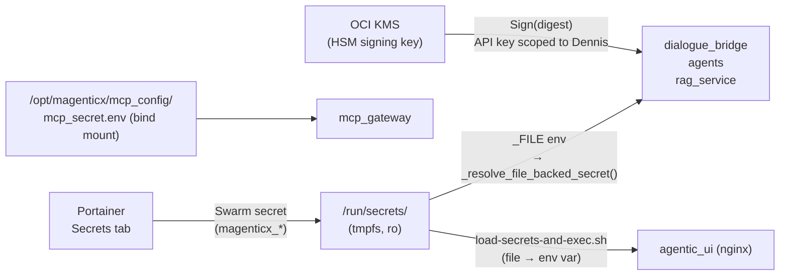

# Secrets — What Each One Is and Where It Belongs

Every sensitive value the production stack needs is delivered as a **file**, never as a plaintext environment variable in the compose YAML or the Portainer "Environment variables" dropdown. The core stack uses **Docker Swarm secrets** (namespaced `magenticx_*`, mounted read-only at `/run/secrets/<alias>` on a tmpfs); the MCP gateway uses a **bind-mounted `.env` file**; and the session-signing private key is **never delivered at all** — it lives in an OCI KMS HSM. This document is the authoritative inventory of every secret across the `docker-compose-denis*.y*ml` files — what it is, which services consume it, and what breaks without it. It does **not** contain any secret values; those live only in Portainer's Secrets tab, OCI, Microsoft Entra, or the operator's offline notes. (HashiCorp Vault was removed in plan 29; it no longer holds anything.)

---

## Services Involved

---

## How a secret reaches a service

There are four delivery paths; a single service may use more than one.

| Mechanism | Used by | How it works |
| --- | --- | --- |
| **Swarm secret → `*_FILE` env** | the three Python services | The compose `secrets:` list mounts `/run/secrets/<alias>`. A `<NAME>_FILE` env var points at that path; `_resolve_file_backed_secret()` in each `core/settings.py` reads the file, strips it, and feeds the value into a Pydantic `SecretStr`. If `*_FILE` is unset it falls back to the plain env var (this is what local `.env` dev uses). |
| **Swarm secret → env via shim** | `agentic_ui` (nginx) | nginx's `envsubst` can only read env vars, not files. `load-secrets-and-exec.sh` reads `/run/secrets/trusted_proxy_secret` into `$TRUSTED_PROXY_SECRET`, then exec's the TLS entrypoint. |
| **Swarm secret → file path in config** | `chat_postgres`, `redis`, `grafana`, `alertmanager` | The service's own config consumes the file directly: Postgres `POSTGRES_PASSWORD_FILE`, Redis `$(cat /run/secrets/redis_password)` in its command, Grafana `GF_SECURITY_ADMIN_PASSWORD__FILE`, Alertmanager `password_file:` in `alertmanager.yml`. |
| **Bind-mounted file** | `mcp_gateway` | The gateway is plain `docker compose` (not Swarm), so it can't use Swarm secrets. Upstream MCP-server API keys live in `mcp_secret.env`, bind-mounted and passed via `--secrets`. |
| **Key held in an HSM (never delivered)** | `dialogue_bridge` | The session-JWT signing key lives in OCI KMS and is **never delivered to any service**. The bridge holds only an API key (Swarm secret) permitted to request signatures over a digest, from Dennis only. |

The in-container **alias** (e.g. `openai_api_key`) is intentionally fixed so application code never changes when the external Swarm name is bumped during rotation.

---

## Core stack secrets — `docker-compose-denis.yaml`

Nine Swarm secrets, declared at the bottom of the compose with `external: true` and a `magenticx_`-prefixed `name:`. The alias column is both the `secrets:` entry name and the `/run/secrets/<alias>` path.

| External Swarm name | Alias / path | Resolved via | Consumed by | Purpose / functionality |
| --- | --- | --- | --- | --- |
| `magenticx_openai_api_key` | `openai_api_key` | `OPENAI_API_KEY_FILE` | `rag_service`, `agents` | OpenAI key for embeddings (rag), every LLM/agent call, and STT / TTS / realtime voice. |
| `magenticx_trusted_proxy_secret` | `trusted_proxy_secret` | `TRUSTED_PROXY_SECRET_FILE` (Python); shim (nginx) | `rag_service`, `agents`, `dialogue_bridge`, `agentic_ui` | The internal-caller shared secret sent as the `X-Internal-Proxy-Secret` header. `require_internal_caller` validates it on every internal hop; the UI's nginx injects it. **Missing it = 403 on all internal calls, and the Python services refuse to start.** |
| `magenticx_session_token_secret` | `session_token_secret` | `SESSION_TOKEN_SECRET_FILE` | `dialogue_bridge` | General-purpose HMAC key (e.g. short-lived DOCX-preview tokens). **No longer the auth-session secret** — auth is stateless KMS-signed JWTs. |
| `magenticx_redis_password` | `redis_password` | `REDIS_PASSWORD_FILE` (bridge); `cat` in command (redis) | `dialogue_bridge`, `redis` | Redis AUTH password. Redis holds the per-run inference event-log streams; the bridge reads/writes them over `rediss://`. |
| `magenticx_postgres_password` | `postgres_password` | `POSTGRES_PASSWORD_FILE` (pg); `DATABASE_PASSWORD_FILE` (bridge); `AGENT_RUNTIME_DATABASE_PASSWORD_FILE` (agents) | `chat_postgres`, `dialogue_bridge`, `agents` | Password for the `admin` Postgres role. The bridge connects to `chat_db`; agents connects to the separate `agent_runtime` DB (LangGraph checkpointer) on the same instance. Spliced into each password-less `DATABASE_URL` at settings load. |
| `magenticx_agent_runtime_aes_key` | `agent_runtime_aes_key` | `LANGGRAPH_AES_KEY_FILE` | `agents` | AES key for the LangGraph `EncryptedSerializer` — at-rest encryption of checkpoint blobs in `agent_runtime`. Empty ⇒ no encryption, so this is what makes stored conversation state ciphertext. |
| `magenticx_log_redaction_secret` | `log_redaction_secret` | `LOG_REDACTION_SECRET_FILE` | `dialogue_bridge`, `agents`, `rag_service` | Shared HMAC key so the hashed `client_ip` (`h:<16hex>`) correlates across services. Absent ⇒ each process falls back to a random per-process key (correlation degrades, logs stay private). See [observability.md](../development/observability.md). |
| `magenticx_oci_signer_key` | `oci_signer_key` | `OCI_API_PRIVATE_KEY_FILE` | `dialogue_bridge` | API private key of the dedicated OCI principal whose **only** permission is `use keys` on the session-signing HSM key, **and only from Dennis** (IAM network-source condition). It cannot read, export or rotate the key — only request a signature over a digest. **Has an expiry: record it and rotate before it lapses**, or new logins and refreshes stop. |
| `magenticx_entra_client_secret` | `entra_client_secret` | `ENTRA_CLIENT_SECRET_FILE` | `dialogue_bridge` | Microsoft Entra app-registration **client secret** for the OIDC relying-party (auth-code + PKCE) sign-in — **the only way into the platform**. The bridge refuses to start without it. **Expires on a calendar date: record it below and rotate before it lapses**, or nobody can sign in. |

> `dialogue_bridge`, `agents`, and `rag_service` **refuse to start** without `trusted_proxy_secret`. Outside `development`/`test`, the bridge additionally requires a `session_token_secret`. In **every** environment it requires the Entra config (`entra_client_secret` + tenant/client ids) and the session-signing config (`oci_signer_key` + the KMS settings, or the local-dev file key).

---

## Monitoring stack secrets — `docker-compose-denis-monitoring.yml`

Two Swarm secrets, in their own Portainer stack (`magenticx_monitoring`).

| External Swarm name | Alias / path | Resolved via | Consumed by | Purpose / functionality |
| --- | --- | --- | --- | --- |
| `magenticx_grafana_admin_password` | `grafana_admin_password` | `GF_SECURITY_ADMIN_PASSWORD__FILE` | `grafana` | Grafana admin login password. The admin username comes from the non-secret `GRAFANA_USER` stack env var. **Only seeds on first `grafana-data` volume init** — changing it later requires wiping the volume or resetting in-app. |
| `magenticx_alert_smtp_password` | `alert_smtp_password` | `password_file:` in `alertmanager.yml` | `alertmanager` | SMTP password so Alertmanager can email alerts to the configured recipient (host/from/to are set in `alertmanager.yml`). |

---

## MCP gateway secret — `docker-compose-denis-mcp.yaml`

The MCP gateway runs as **plain `docker compose`** (the dind variant can't run under Swarm), so it cannot consume Swarm secrets. Its upstream API keys are a bind-mounted file.

| Source file (on VM) | Mount → flag | Consumed by | Purpose / functionality |
| --- | --- | --- | --- |
| `/opt/magenticx/mcp_config/mcp_secret.env` | `→ /app/mcp_secret` (`--secrets`) | `mcp_gateway` | API keys for the upstream MCP servers the gateway spawns (e.g. the **Tavily** API key for web search; `arxiv-mcp-server` needs none). The gateway injects these into the per-server containers it launches. |

> Treat `mcp_secret.env` like any other secret: `chmod 600`, never commit it. It is the one secret in the production stack not managed by Swarm, so it won't appear in Portainer's Secrets tab.

---

## Material outside Swarm — OCI KMS and Microsoft Entra

| Secret material | Where it lives | Purpose / functionality |
| --- | --- | --- |
| **OCI KMS signing key** | Key `DenisSessionSigningKey` in vault `MpourosVault` (a default/virtual vault — free tier), protection mode HSM | The RSA-2048 private key that signs every session JWT. **Never exported, never in any container.** Its public key per version is exported to `/opt/magenticx/dialogue_bridge/signing_keys/<kid>.pem` (public, not secret; version 1 of the key is `kid 100`). Rotate by adding a key version — see [authentication-and-session.md § Phase 3](../flows/authentication-and-session.md#phase-3--token-minting-kms-signed-jwts). |
| **The signing principal** | OCI IAM user `DenisTokenSigner` in group `DenisTokenSigners` (Default domain) | Capabilities: **API keys only** — no console password, auth tokens, SMTP, DB or secret keys. One API key, fingerprint `e1:52:33:d4:7c:83:bb:ac:45:1f:ad:29:ee:b8:93:8f` (created 2026-09-26); its private half is `magenticx_oci_signer_key`. |
| **The signing key's IAM policy** | OCI IAM policy `DenisTokenSignerPolicy` + network source `DenisEgress` | `use keys` on the one key, for the one group, with `request.permission = 'KEY_SIGN'` and `request.networkSource.name = 'DenisEgress'` — the network source holds only Denis's reserved public IP (`DenisPublicIP`). Not a value, but security-critical: a policy that drops the network-source condition makes a leaked `magenticx_oci_signer_key` usable from anywhere. Proven 2026-09-26: a Sign call with the real key from outside Denis is refused (`404 NotAuthorizedOrNotFound`). **Denis's egress IP must stay `DenisPublicIP`** — a rebuilt VM with a new IP cannot sign, so nobody can log in. |
| **Entra app registration** | Microsoft Entra ID | Tenant, client id, redirect URIs (production + `http://localhost:8050/...` for local dev), and the client secret surfaced as `magenticx_entra_client_secret`. The allowed security group (`ENTRA_ALLOWED_GROUP_IDS`) decides who may sign in at all. |

### Expiry dates — calendar these

The Entra client secret expires on a date nobody will remember, and its lapsing stops **every new sign-in** (existing sessions keep working until they need to refresh). The OCI API key has no expiry date of its own (OCI API signing keys don't carry one), but it is listed with its rotation procedure because rotating it is the response to any suspected leak:

| Credential | Expires | Rotate by |
| --- | --- | --- |
| `magenticx_entra_client_secret` | *record the date from the Entra app registration* | create a new client secret, create the Swarm secret under a versioned name, bump the compose, redeploy |
| `magenticx_oci_signer_key` | no expiry date (created 2026-09-26) | add a second API key to `DenisTokenSigner`, create the new Swarm secret under a versioned name, update `OCI_API_KEY_FINGERPRINT`, redeploy, then delete the old key |
| GHCR pull token (Portainer registry `ghcr`) | *record the date chosen when generating it* | generate a new classic token with only `read:packages`, update Portainer → Registries → `ghcr`, then delete the old token. A lapsed token stops every image update (running tasks keep running) |

**Retired with plan 29.** HashiCorp Vault — its unseal keys, root token, userpass users, AppRole identity (`magenticx_vault_role_id` / `magenticx_vault_secret_id`) and Transit key — is no longer used. The Transit key's *public* half survives for 20 days after the cutover as the verify-only `kid 1` public key file, so pre-cutover sessions stayed valid; then it is deleted. The Swarm secrets and the Vault Portainer stack are deleted during the plan 29 decommission.

---

## Deployment credentials — GitHub and Portainer

The CD pipeline ([deployment.md](deployment.md)) needs two credentials, and neither lives in Swarm. Pushing images needs none at all: the workflow's own short-lived `GITHUB_TOKEN` (`packages: write`) publishes to GHCR.

| Credential | Where it lives | Purpose / functionality |
| --- | --- | --- |
| **`PORTAINER_WEBHOOK_URL`** | GitHub → repo Settings → Environments → `production` → **environment** secret (never a repository secret) | The `magenticx` stack's GitOps webhook. Calling it makes Portainer pull `main` and redeploy — nothing else, so a leak can only redeploy what is already on `main`. Kept on the environment so only the approved `cd` job can read it; PRs and forks never see it. Regenerate in Portainer (stack → GitOps → webhook) if exposed. |
| **GHCR pull token** | Portainer → Registries → `ghcr` (password field) | Classic GitHub token with **only** `read:packages`, so Swarm can pull the private images. Cannot push, cannot read code. **Expires — record the date above.** |

---

## TLS private keys — bind-mounted, not Swarm secrets

Every service authenticates with an internal CA-signed certificate. The **private keys** are sensitive but are delivered as bind-mounted files from `/opt/magenticx/<service>/tls/`, not as Swarm secrets, because the TLS entrypoints need them on a predictable path before the app starts.

| File | Sensitivity | Notes |
| --- | --- | --- |
| `tls.key` / `server.key` | **Private** (mode `600`, owner UID 1000) | Per-service private key. An unreadable key under the fail-closed `REQUIRE_TLS=true` crash-loops the container — see the production TLS file-permissions guidance. |
| `tls.crt` / `server.crt` | Public | The service's certificate. |
| `ca.crt` | Public | The shared internal CA used to verify peers (and, under mTLS, client certs). |

Rotation of a key/cert is a file copy + `chown 1000:1000` + container restart — never replace a key in place while the container runs.

---

## Sharp Edges and Operational Notes

- **Never put a secret value in the Portainer "Environment variables" dropdown.** That field is for non-sensitive config only (log level, feature flags). Secrets go in the **Secrets** sub-tab and are referenced by `external: true` name.
- **Swarm secrets are immutable — rotation uses a versioned name + fixed alias.** Bump the `name:` (e.g. `magenticx_openai_api_key_2026q3`), keep the alias (`openai_api_key`) constant, create the new secret in Portainer, redeploy (rolling update), then delete the old one. Application code never changes because `/run/secrets/openai_api_key` is stable.
- **`POSTGRES_PASSWORD_FILE` only takes effect on first data-dir init.** To move an existing cluster onto the secret, `ALTER USER admin WITH PASSWORD '<new>'` from the container console **before** deploying the revision that switches the bridge/agents to the file-backed password.
- **An unreadable `*_FILE` is fail-loud.** `_resolve_file_backed_secret()` raises if the `*_FILE` path is set but unreadable, rather than silently falling through to a plain env var — so a permission slip surfaces as a startup crash, not a silent wrong-value boot.
- **The log-redaction secret is fail-safe, not fail-loud.** Without it each service hardens to a random per-process key; logs stay private but the `client_ip` hash stops correlating across services/restarts. Provision it.
- **Blast radius, highest first:** `magenticx_postgres_password` (all chat + agent state), the OCI signing principal's API key and the KMS key's IAM policy (every session JWT — a policy that drops the network-source condition makes a leaked key usable from anywhere), `magenticx_openai_api_key` (cost + data egress), `magenticx_trusted_proxy_secret` (internal trust boundary), `magenticx_agent_runtime_aes_key` (checkpoint confidentiality). Rotate these first on any suspected exposure.
- **Local dev needs none of this.** With no `*_FILE` vars set, settings fall back to plain env vars from `magenticx/.env`, and the dev defaults fill in the rest (random session/redaction secrets). Local dev still needs two things of its own: the `ENTRA_*` values for the shared app registration, and a gitignored file signing key in `magenticx/secrets/`. See `CLAUDE.md` § Local Development Setup.

---

## File Map

| Concept | File | What to look for |
| --- | --- | --- |
| Core stack secret declarations | [magenticx/docker-compose-denis.yaml](../../magenticx/docker-compose-denis.yaml) | top-level `secrets:` block, per-service `secrets:` lists |
| Monitoring stack secrets | [magenticx/docker-compose-denis-monitoring.yml](../../magenticx/docker-compose-denis-monitoring.yml) | `grafana_admin_password`, `alert_smtp_password` |
| MCP gateway secret file | [magenticx/docker-compose-denis-mcp.yaml](../../magenticx/docker-compose-denis-mcp.yaml) | `--secrets` flag + `mcp_secret.env` bind mount |
| File-backed secret resolution | [magenticx/dialogue_bridge/core/settings.py](../../magenticx/dialogue_bridge/core/settings.py) | `_resolve_file_backed_secret` |
| nginx secret shim | [magenticx/agentic_ui/load-secrets-and-exec.sh](../../magenticx/agentic_ui/load-secrets-and-exec.sh) | `/run/secrets/trusted_proxy_secret` → env |
| Session signing keys | [magenticx/dialogue_bridge/core/auth/signing.py](../../magenticx/dialogue_bridge/core/auth/signing.py) | KMS signer, public-key loading, the self-check |
| Env var reference | [docs/architecture/configuration.md](configuration.md) | which env var points at each secret |
| `PARKED_TOKEN_KEY` | dialogue_bridge | AES-GCM key (**at least** 32 bytes, base64 or hex; longer is condensed with HKDF) encrypting the refresh tokens of *parked* accounts in Redis, so a Redis-only compromise yields no usable credential. On Dennis it is the Swarm secret **`magenticx_parked_token_key`**, consumed as `PARKED_TOKEN_KEY_FILE=/run/secrets/parked_token_key`. Dedicated rather than derived from `session_token_secret` so it rotates on its own — rotating it signs every parked account out, which must not be a side effect of rotating an unrelated key. Omitted locally: the bridge then derives it from `SESSION_TOKEN_SECRET` (HKDF) rather than ever storing tokens unencrypted. |
