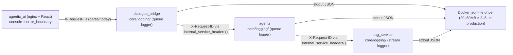
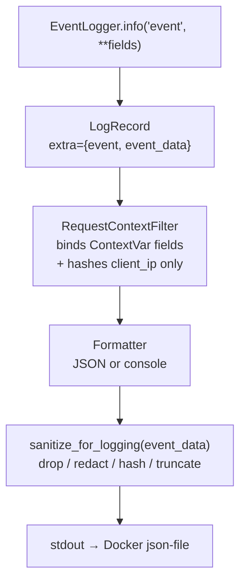
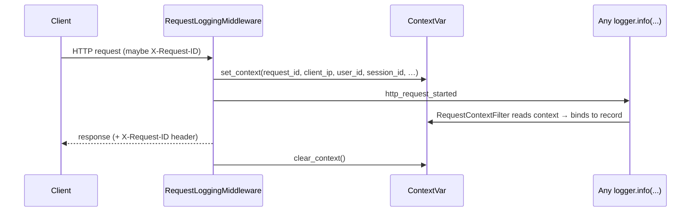
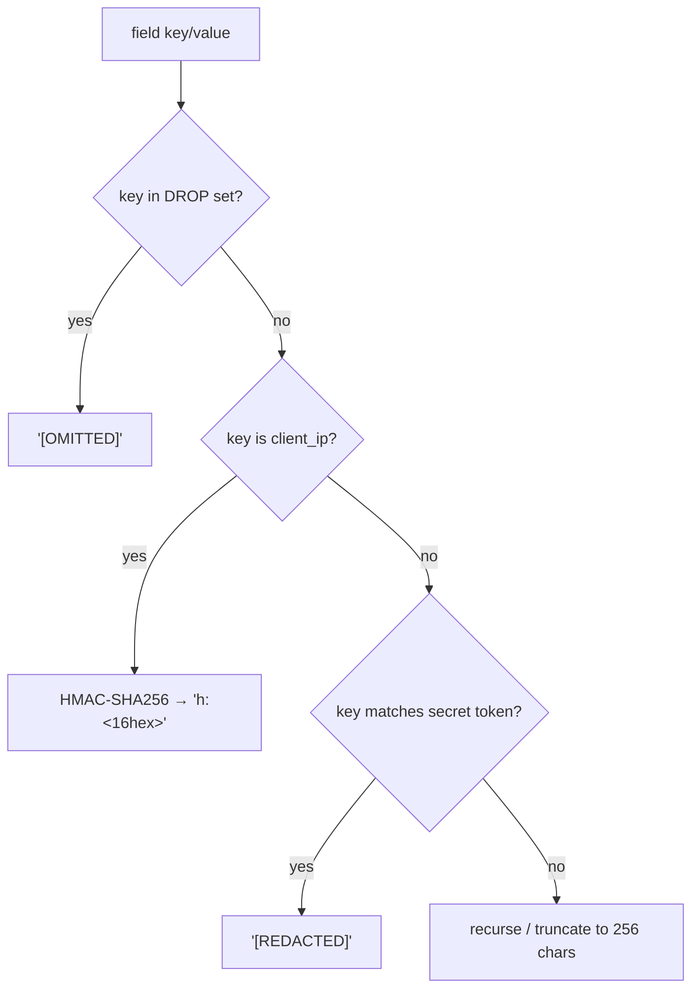
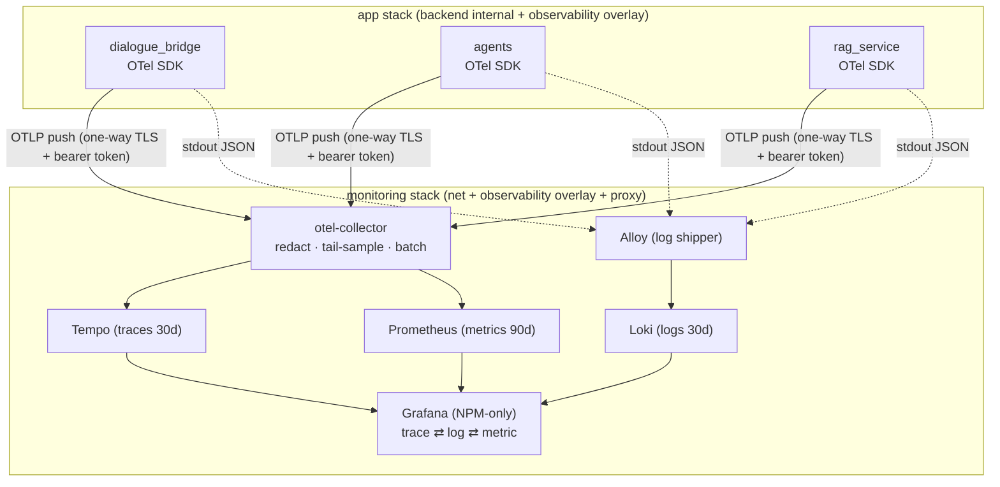
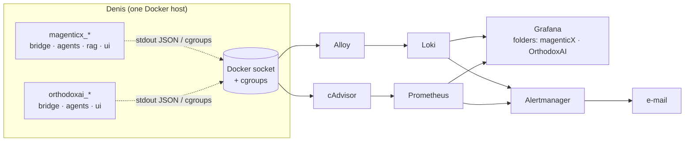

# Observability — Logging, Redaction, and the Traceability Roadmap

Every mAgenticX service emits **structured, event-oriented logs** through an in-house `core/logging/` package that is intentionally near-identical across `dialogue_bridge`, `agents`, and `rag_service`. Each log line is a single JSON object (or a human-readable console line in dev) carrying a stable `event` name, the request context (`request_id`, **raw** `user_id`/`session_id` that match the database, `conversation_id`, …), and an arbitrary `fields` payload that is **sanitized before it is written** — secrets redacted, content omitted, and the **client IP** HMAC-hashed. Logs go to stdout only; on the production VM Docker's `json-file` driver rotates them on disk. This document is the authoritative reference for what each service logs today, how PII is kept out of the logs, and the phased plan to layer full OpenTelemetry traces + metrics on top of the existing Grafana/Prometheus stack so that one user action can be followed end-to-end. **Phases 0 and 1 of that plan are implemented; Phases 2–7 are the roadmap.**

---

## Services Involved



The three Python services share the same package layout: `config.py` (handler/formatter wiring), `context.py` (a request-scoped `ContextVar`), `middleware.py` (`RequestLoggingMiddleware`), `events.py` (the `EventLogger` API), `filters.py` (`RequestContextFilter`, which binds context onto every record), `formatters.py` (JSON vs console), `redaction.py` (sanitization), and `exception_handlers.py`. `dialogue_bridge` and `agents` additionally use a queue-based async handler (`QueueHandler` → `SimpleQueue` → listener) so logging never blocks the event loop; `rag_service` uses a simpler direct `StreamHandler`. `dialogue_bridge` also has `stream_metrics.py` for streaming responses.

---

## Phase A — The shared logging pipeline

A log call (`logger.info("event_name", **fields)`) flows through the same stages in every service. Understanding this pipeline is the prerequisite for everything below: redaction happens **inside** it, and the future trace correlation will hook **into** it.



| Key fact | Value / detail |
| --- | --- |
| Log API | `get_logger(__name__)` → `EventLogger`; `.info/.warning/.error/.exception(event, message=None, **fields)` |
| Record shape | `extra={"event": <name>, "event_data": <fields dict>}` |
| Context binding | `RequestContextFilter.filter()` attaches `service`, `env`, `version`, `request_id`, `user_id`, `session_id`, … to every record |
| Format switch | `LOG_FORMAT=json` (prod) or `console` (dev default) |
| Level | `LOG_LEVEL` (default `INFO`); `uvicorn.access` and `httpx` pinned to `WARNING` |
| Destination | stdout only — no file sink in app code; Docker captures it |
| Bridge/agents | non-blocking `QueueHandler` + listener, flushed on shutdown via `shutdown_logging()` / `atexit` |
| rag_service | direct `StreamHandler(sys.stdout)` (no queue) |

---

## Phase B — Request context & cross-service correlation

Each service stores a per-request dict in a `ContextVar` (`context.py`), populated by `RequestLoggingMiddleware` from the inbound request and path params, and cleared in a `finally`. `RequestContextFilter` stamps that context onto every log record, so any log emitted while handling a request is automatically attributed.



**Context fields by service** (defaults shown where the field is missing):

| Field | dialogue_bridge | agents | rag_service |
| --- | --- | --- | --- |
| `request_id` | ✅ (header or UUID) | ✅ | ✅ |
| `client_ip` | ✅ (hashed) | ✅ (hashed) | ❌ |
| `http_method` / `http_path` | ✅ | ✅ | ✅ |
| `user_id` | ✅ (raw, else `anonymous`) | ✅ (raw, from `X-User-Id`) | ✅ (raw, from `X-User-Id`) |
| `session_id` | ✅ (raw, else `no-session`) | ✅ (raw, from `X-Session-Id`) | ✅ (raw, from `X-Session-Id`) |
| `conversation_id` / `message_id` | ✅ | ✅ | ❌ |
| `agent_slug` / `thread_id` | ❌ | ✅ | ❌ |
| `status_code` | ✅ (post-response) | ✅ | ✅ |

> **Both identities are logged raw — by design, so logs join to the database.** `user_id` and `session_id` are the two correlation identities and are written **verbatim** (the exact value stored in Postgres), so any log line pivots straight to its DB row. **`client_ip` is the only context identifier still HMAC-hashed** to `h:<16hex>`. `anonymous`/`no-session` are the blank sentinels (logged as-is). Filter "everything for a user" with `user_id="<uuid>"`, "everything for a session" with `session_id="<uuid>"`. (Earlier revisions hashed both ids; that was reversed so the *User flow* and *Users & Sessions* dashboards can be keyed by the real DB id. The human-readable `username` is still **dropped** entirely — only the opaque id is logged.)

**Cross-service `X-Request-ID` propagation** is the correlation seam, and as of the correlation fix it is **end-to-end**: one id, originated at the browser, flows through every hop so a single `X-Request-ID` traces a whole request `agentic_ui → dialogue_bridge → agents → rag_service`. The id is **untrusted input** — every service validates it via `sanitize_request_id()` (charset `[A-Za-z0-9._-]`, ≤128 chars) and regenerates a server-side UUID if it's missing or malformed, so a forged/oversized value cannot inject into the logs. It is correlation-only, never an auth input.

| Hop | Propagated? | How |
| --- | --- | --- |
| `agentic_ui` → `dialogue_bridge` | ✅ | `withSessionRequest` mints `X-Request-ID` (`crypto.randomUUID()`) on every API call; nginx forwards it (or generates `$request_id` at the edge if absent) |
| `dialogue_bridge` main inference stream → `agents` | ✅ | the detached run inherits the request context (via `asyncio.create_task` copy); `_do_stream`/`_do_resume` pass `internal_service_headers(get_context().get("request_id"))` |
| `dialogue_bridge` agent-sync / thread-reap → `agents` | ✅ | passes `get_context().get("request_id")` |
| `agents` retail-agent → `rag_service` | ✅ | passes `get_context().get("request_id")` |

**Cross-service `session_id` AND `user_id` propagation** mirrors it, so a single `session_id="<uuid>"` (or `user_id="<uuid>"`) traces the whole flow too. The bridge resolves the session/user from the auth cookie and forwards them **raw** as `X-Session-Id` / `X-User-Id` headers (`bridge → agents → rag`); agents/rag set them in context at request start, so every line (access + business) carries both. The forwarding is automatic: `internal_service_headers()` auto-derives session + user from the current request context, so **every** internal hop carries them (inference, title generation, catalog/agent sync, tools/skills fetch, voice, suggestions, and the HR/orthodox/retail rag retrievals) — not just inference. **One exception:** the unauthenticated global skills catalog endpoint `GET /api/v1/skills` (`get_skills`) has no auth dependency, so it has no session/user in context and its `skills_listed`/`skills_list_cache_hit` lines log `no-session`/`anonymous`. These headers are honored **only** from callers that clear the internal-proxy-secret gate (`require_internal_caller`), and the ids are server-issued (JWT `sub`/`sid`, DB UUIDs) — so logging them verbatim is safe and joins straight to the database; they are correlation/audit context, never an authorization input. The bridge's own `http_request_started` line is the one exception (logged pre-auth → `no-session`); its paired `completed` line carries the session via `request.state`.

> A single inference now carries the same `request_id`, `session_id`, **and** `user_id` across both `dialogue_bridge` (`/start` + access line) and `agents` (`/stream` lifecycle) — all three written raw, so the chain joins directly to the DB conversation/session rows. The remaining step — upgrading these `X-Request-ID` / `X-Session-Id` headers to a W3C `traceparent` so the flow also draws a span tree in Tempo — is **Phase 3**.

---

## Phase C — What each service logs (event catalog)

Every event name below is a stable string emitted via `EventLogger`. The `http_request_*` triplet is common to all three (from `RequestLoggingMiddleware`); the rest are service-specific.

### Common (all services) — `RequestLoggingMiddleware`

| Event | Level | Key fields |
| --- | --- | --- |
| `http_request_started` | INFO | `query` (sanitized params, bridge/agents) |
| `http_request_completed` | INFO | `duration_ms`, `response_class`, `content_type` |
| `http_request_failed` | ERROR | `duration_ms`, exc traceback |
| `http_exception` | WARN/ERROR | `status_code`, `detail` (5xx only) |
| `request_validation_failed` | WARN | validation `errors` (no input) |
| `unhandled_exception` | ERROR | `exception_type`, traceback |
| `/health` | — | **silenced** (never logged) |

### dialogue_bridge

| Event | Level | Notes |
| --- | --- | --- |
| `service_startup` / `service_shutdown` | INFO | lifespan |
| `database_migrations_started` / `database_migrations_completed` | INFO | alembic subprocess around app start |
| `redis_sdk_settings_primed` | INFO | fastapi-redis-sdk initialized (`prefix`, `tls`, `tls_verified`, `fail_closed`) — never the credentials. `tls=true` with `tls_verified=false` means the internal CA never reached the connection: the handshake is being checked against the system trust store and every Redis call is failing. Rate limiting is fail-open, so nothing else surfaces it. |
| SDK `ratelimit_backend` warnings | WARN | Redis unreachable → decision degraded + **failed open**; watch for sustained bursts (limits silently unenforced) |
| `upstream_request_retrying` | WARN | `UpstreamErrorHandler`, `upstream_service`, `operation`, `attempt`, `failure_reason` |
| `blob_download_completed` / `_aborted` / `_error` | INFO/WARN | from `StreamMetrics`: `chunk_count`, `bytes_forwarded`, `first_byte_latency_ms`, `total_stream_duration_ms`, `served_bytes`, `partial` |
| `logged_db_operation` success/failure events | INFO/ERROR | per-call `success_event`/`failure_event`, `duration_ms`, auto-rollback on failure |

### agents

| Event | Level | Notes |
| --- | --- | --- |
| `service_startup` / `service_shutdown` | INFO | lifespan (durable checkpointer pool) |
| `agent_stream_request_received` | INFO | `agent_slug`, `input_messages` |
| `agent_initialization_started` / `_completed` / `_failed` | INFO/WARN | per-run agent build |
| `agent_stream_started` / `agent_stream_completed` | INFO | run lifecycle |
| `agent_stream_failed` | ERROR | traceback |
| `mcp_session_connected`, `mcp_tools_loaded`, `agent_tools_attached` | INFO | tool wiring, `attached_tool_count` |
| `checkpoint_committed` | INFO | durable LangGraph head (`thread_id`, `checkpoint_id`) |
| `checkpoint_commit_emit_failed`, `checkpoint_interrupt_probe_failed`, `checkpoint_release_failed` | WARN | checkpointer edge cases |
| `tool_call_error` | WARN | tool raised → encoded as `ToolMessage(status=error)`, `exception_type` |
| `agent_run_error` | ERROR | encoded as SSE `RUN_ERROR` frame |
| `event_loop_exception` | ERROR | non-cancellation loop errors (uvloop noise suppressed) |

### rag_service

| Event | Level | Key fields |
| --- | --- | --- |
| `service_startup` / `service_shutdown` | INFO | `loaded_tables` |
| `retrieval_started` | INFO | `collection_name`, `k`, `query_length` |
| `retrieval_completed` | INFO | `collection_name`, `k`, `document_count`, **`duration_ms`** (added in Phase 1) |
| `retrieval_no_results` | WARN | `collection_name`, `k`, **`duration_ms`** |
| `retrieval_failed` | WARN | `failure_reason=dependency_failed`, **`duration_ms`**, → 503 |
| `schema_served` / `schema_table_not_found` | INFO/WARN | `table`, `column_count` |
| `sql_query_started` | INFO | `table`, `sql_length` (never the SQL text) |
| `sql_query_completed` | INFO | `table`, `row_count`, `column_count`, **`duration_ms`** (added in Phase 1) |
| `sql_query_failed` / `sql_table_not_found` | WARN | `failure_reason=operation_failed`, **`duration_ms`**, → 400/404 |

---

## Phase D — Redaction & PII (the privacy contract)

`sanitize_for_logging()` runs over every `event_data` payload (and `sanitize_context_value()` over context fields) **before** it reaches stdout. It applies four tiers, plus recursion into dicts/lists and a 256-char string cap. This is enforced in **all three** services. The one hashed identifier, `client_ip`, uses the **same secret** everywhere, so a given IP hashes to the same `h:<16hex>` token across services — correlatable without ever storing the raw IP. (`user_id`/`session_id` are deliberately **not** hashed — they are logged raw to match the database; see the privacy note below.)



| Tier | Trigger (exact-match unless noted) | Result |
| --- | --- | --- |
| **Drop** | `username, title, file_name, filename, message_content, content, history, messages, prompt, completion, query, answer, text, input, output, delta, chunk, sql, page_content, documents` | `[OMITTED]` |
| **Hash** | `client_ip` only | `h:<HMAC-SHA256 prefix>` (one-way, correlatable) |
| **Redact** | key *contains* `password, token, authorization, cookie, secret, csrf, datab64, data_b64` | `[REDACTED]` |
| **Truncate** | any string | first 256 chars + `...<truncated>` |

> **Why `user_id`/`session_id` are not in the Hash tier.** They were originally hashed alongside `client_ip`, but that made the logs impossible to reconcile with the database (where those ids are stored raw) and broke the per-user / per-session Grafana dashboards (*User flow*, *Users & Sessions*). Hashing was removed for those two fields in `_should_hash_field` (now `return k == "client_ip"`); `client_ip` stays hashed — it is genuinely sensitive and never needs a DB join. The `username` field is still **dropped** entirely (`[OMITTED]`), so a human-readable handle never leaks; only the opaque DB id is logged.

| Key fact | Value / detail |
| --- | --- |
| Shared secret | `magenticx_log_redaction_secret` Swarm secret → `LOG_REDACTION_SECRET_FILE=/run/secrets/log_redaction_secret` on all 3 services |
| Resolution | each `core/settings.py` `LoggingSettings.redaction_secret` reads the file, then env `LOG_REDACTION_SECRET`, then falls back to a **random per-process key** (one-way; correlation disabled) |
| Local dev | set `LOG_REDACTION_SECRET` in `magenticx/.env` to make the `client_ip` hash correlate across the three local containers (optional) |
| Content stance | LLM prompts/completions and retrieved documents are **never** logged — the drop set blocks the field names and the upstream services don't pass raw content as log fields |

---

## Phase 0 — Deploy safety (implemented)

**Goal:** make every subsequent observability rollout downtime-free on the single-replica Swarm services before changing anything else.

`rag_service`, `agents`, and `dialogue_bridge` had **no `deploy:` block**, so Swarm used the default `stop-first` update order — the old task is killed before the new one is healthy, a real gap on `replicas: 1`. Phase 0 adds a start-first update policy that **pauses** (not rolls back) on failure. These services publish no host ports, so start-first cannot cause a port collision, and Swarm ignores the (now redundant) `container_name`/`restart` keys.

**Why `failure_action: pause`, not `rollback`.** Swarm's automatic rollback acts on a *single service in isolation*. For a lockstep multi-service deploy (e.g. a bridge↔agents protocol change), if one service's new task fails its health window while the others go healthy, auto-rollback would revert just that one — leaving the stack in a split state (`agents=new`, `bridge=old`) that is *more* broken than a clean halt. `pause` stops the rollout with the previous version still serving and surfaces it to the operator, who then makes a coordinated fix-forward or whole-stack rollback decision deliberately. Rollback stays a human, all-or-nothing action.

| Key fact | Value / detail |
| --- | --- |
| File | [magenticx/docker-compose-denis.yaml](../../magenticx/docker-compose-denis.yaml) |
| Added per service | `deploy.update_config.order: start-first`, `monitor: 30s`, `failure_action: pause` |
| Services | `rag_service`, `agents`, `dialogue_bridge` |
| On a bad rollout | the update **pauses**, old version keeps serving; operator decides fix-forward vs a coordinated manual rollback |
| Risk | none — additive, no port conflict, no automatic version skew, reversible by removing the block |

---

## Phase 1 — Redaction parity & shared-secret correlation (implemented)

**Goal — the hard gate before any log is centralized:** every service must redact identically and hash identifiers with the *same* key, or centralized logs would either leak PII (rag) or be impossible to correlate per user/session (random per-process keys).

Three defects were closed:

1. **`rag_service` had no redaction at all** — it logged `event_data` verbatim. Phase 1 ports `redaction.py` into it and routes both the JSON and console formatters through `sanitize_for_logging()`.
2. **The HMAC key diverged across services** — `agents` used a random per-process key, `dialogue_bridge` fell back to the session-token secret, `rag_service` had none — so the same user hashed to three different tokens (or none). Phase 1 introduces a shared `magenticx_log_redaction_secret`, mounted as `LOG_REDACTION_SECRET_FILE` on all three, read by each `LoggingSettings`. With it provisioned, the hashed identifier(s) hash identically everywhere (verified: same secret → identical `h:…`, divergent random keys → different). (At the time Phase 1 hashed `user_id`/`session_id`/`client_ip`; those first two were later **unmasked** — only `client_ip` is hashed today, so the shared secret now governs `client_ip` correlation alone. See Phase D.)
3. **`rag_service` retrieval had no timing** — Chroma and DuckDB latency were invisible. Phase 1 adds `duration_ms` to `retrieval_completed`/`sql_query_completed` (and the failure paths) via a backported `elapsed_ms`/`logged_operation` helper.

The content drop-set was also expanded in all three services to cover LLM/RAG content keys (`prompt, completion, query, answer, text, input, output, delta, chunk, sql, page_content, documents`).

| Concept | File | Change |
| --- | --- | --- |
| rag redaction (new) | [magenticx/rag_service/core/logging/redaction.py](../../magenticx/rag_service/core/logging/redaction.py) | ported `sanitize_for_logging` / `sanitize_context_value` |
| rag operations (new) | [magenticx/rag_service/core/logging/operations.py](../../magenticx/rag_service/core/logging/operations.py) | `elapsed_ms`, `logged_operation` |
| rag formatters | [magenticx/rag_service/core/logging/formatters.py](../../magenticx/rag_service/core/logging/formatters.py) | sanitize `event_data` in JSON + console |
| rag settings | [magenticx/rag_service/core/settings.py](../../magenticx/rag_service/core/settings.py) | `LoggingSettings.redaction_secret` + random-fallback hardening |
| rag retrieval/SQL timing | [magenticx/rag_service/main.py](../../magenticx/rag_service/main.py) | `duration_ms` on retrieval + DuckDB events |
| bridge secret resolution | [magenticx/dialogue_bridge/core/settings.py](../../magenticx/dialogue_bridge/core/settings.py) | `_load_redaction_secret` reads `LOG_REDACTION_SECRET_FILE` |
| drop-set expansion | [magenticx/dialogue_bridge/core/logging/redaction.py](../../magenticx/dialogue_bridge/core/logging/redaction.py), [magenticx/agents/core/logging/redaction.py](../../magenticx/agents/core/logging/redaction.py) | content keys added |
| compose wiring | [magenticx/docker-compose-denis.yaml](../../magenticx/docker-compose-denis.yaml) | `LOG_REDACTION_SECRET_FILE` env + `log_redaction_secret` secret on all 3 |

> **Operator step:** create the Swarm secret `magenticx_log_redaction_secret` (32-byte hex) in Portainer **before** deploying this stack revision, exactly like the other `magenticx_*` secrets.

---

## Roadmap — Phases 2–7 (target: full traceability)

The end state pushes OpenTelemetry traces + metrics + logs from each service to an OTel Collector that fans out to **Tempo** (traces), **Loki** (logs), and the **existing Prometheus** (metrics), all visualized in the **existing Grafana**. From any alert, error, or metric spike you click straight to the distributed trace (UI → bridge → agents → LangGraph nodes → OpenAI/MCP/rag → Chroma/DuckDB → Postgres) and its correlated logs, filtered by `user_id`/`session_id`/`run_id`/`trace_id`.



**Locked decisions:** OTel-native SDK (keep the bespoke logger as transport); **push** OTLP (never scrape `/metrics` — it would sit behind mTLS); one neutral attachable `observability` overlay bridges the `internal: true` backend to the monitoring `net`; OTLP secured with one-way TLS + bearer token; **head-sample 15% + 100% of errors/slow**; LLM/retrieval **content capture OFF**; high-cardinality ids live on traces/logs **only, never as metric labels** (jump via exemplars); retention **metrics 90d / logs 30d / traces 30d**; Grafana host port removed, NPM-only.

| Phase | Goal | Gated behind |
| --- | --- | --- |
| **2** | Stand up OTel Collector + Tempo + Loki + Alloy in the monitoring stack (inert) | new `observability` overlay + configs in Portainer |
| **3** | Ship the OTel SDK + W3C `traceparent` propagation + RED/LLM/retrieval metrics in all 3 images, `OTEL_ENABLED=false` | start-first (Phase 0) |
| **4** | Flip `OTEL_ENABLED=true` | collector reachable & accepting |
| **5** | Centralize logs via Alloy → Loki, correlated by `trace_id` | Phase 1 redaction (done) |
| **6** | Frontend RUM: originate `traceparent`, beacon errors + Web Vitals, gate `console.*` | NPM forwards `traceparent` |
| **7** | Grafana dashboards (RED, run explorer, per-user/session, LLM/cost, retrieval, streaming) + alerts + SLOs | all signals flowing |

> None of Phases 2–7 touch the mTLS entrypoints or `REQUIRE_MTLS`; they are standard Portainer stack updates. SSH stays inspection-only.

---

## Two stacks, one monitoring stack — mAgenticX and OrthodoxAI

The monitoring stack watches **both** app stacks that share Denis: mAgenticX (Swarm stack `magenticx`) and **OrthodoxAI** (Swarm stack `orthodoxai`), the Greek parish kiosk forked from mAgenticX and kept in its own repo (`orthodox-ai`). Its configs live here because the monitoring stack does. Each project gets its own Grafana folder, **magenticX** and **OrthodoxAI**, and every query selects one project by its `stack` label (Loki) or its `<stack>_` service-name prefix (cAdvisor). The two sets never mix.



### How each signal reaches it

| Signal | Path | What selects the stack |
| --- | --- | --- |
| Logs | Alloy tails the Docker socket | keep rule on `com.docker.stack.namespace` = `magenticx\|orthodoxai`. The regex is anchored, so `magenticx_monitoring` itself is dropped |
| Container metrics | cAdvisor reads host cgroups | panels filter `container_label_com_docker_swarm_service_name` on `magenticx_.*` / `orthodoxai_.*` |
| Host metrics | node-exporter | shared by both stacks |
| Alerts | one Alertmanager, one inbox | Loki rules group `by (stack)`; container rules add a `project` label. Prometheus's external label is `monitor: dennis` (was `stack: magenticx`, which would have stamped every OrthodoxAI alert as mAgenticX) |

**Isolation holds.** OrthodoxAI's rule is to share no network, volume, database or secret with mAgenticX, and the monitoring stack joins none of its networks. It sees OrthodoxAI only through the Docker socket and cgroups, the same read-only path it uses for every container on the host. OrthodoxAI hashes `client_ip` with its **own** redaction secret (`orthodoxai_log_redaction_secret`), so a hashed IP never correlates across the two stacks. OrthodoxAI has no sign-in, so its logs carry **no user identity**: `conversation_id` and `request_id`, both raw, are its correlation keys.

### The OrthodoxAI dashboards

Every panel counts an event the OrthodoxAI services actually emit (verified against the `orthodox-ai` source and live Denis logs on 2026-09-28).

| Dashboard (uid) | Answers | Built on |
| --- | --- | --- |
| **Overview** (`orthodoxai-overview`) | Is the kiosk up and used? What does it cost the host next to mAgenticX? | `inference_run_started`, `realtime_voice_session_created`, `kiosk_access_denied`, cAdvisor. *Host share* compares both stacks (OrthodoxAI has no CPU/memory limits yet) |
| **Service detail** (`orthodoxai-service-detail`) | One service's CPU, memory, restarts, network, logs | cAdvisor + `{stack="orthodoxai", service="$service"}` |
| **API & Streaming** (`orthodoxai-api`) | Bridge rate, status, p50/p95/p99, slowest routes, WebSocket runs | `http_request_completed` (`fields.duration_ms`, UUIDs in `http_path` collapsed to `:id`), `ws_*`, `upstream_request_retrying`, `event_log_*` |
| **Agent runs** (`orthodoxai-agent`) | Runs started / completed / cancelled / failed, approval pauses, tool errors, titles, charts | `agent_stream_*`, `agent_resume_*`, `tool_call_error` (`fields.tool`), `inference_run_*`, `title_generation_*`, `chart_rendered` |
| **Voice & speech** (`orthodoxai-voice`) | Live voice, push-to-talk and read-aloud volume and failures | `realtime_voice_*`, `dictation_*`, `read_aloud_*` / `message_read_aloud_generated` |
| **Kiosk access & security** (`orthodoxai-access`) | What the access gate refuses, 403/429/CSRF/422, distinct (hashed) clients, most-probed routes | `kiosk_access_denied`, `csrf_validation_failed`, `request_validation_failed`, `ws_connect_rate_limit_degraded`, `status_code` |
| **Conversations & usage** (`orthodoxai-conversations`) | Conversations, answers per conversation, usage by hour across the week, longest conversations | `conversation_created`, `inference_run_started` (`fields.conversation_id`, `fields.forked`), `message_created`. Each row of the longest-conversations table links to the flow dashboard |
| **Conversation flow** (`orthodoxai-conversation-flow`) | Every bridge + agents line for one conversation or one request | line filter on the pasted id |

### Alert rules that cover OrthodoxAI

| Rule | File | Fires on |
| --- | --- | --- |
| `ContainerCrashLooping`, `ContainerHighMemory` | `alert.rules.yml` | both stacks; `project` label names which |
| `HighErrorLogRate`, `ServiceErrorBurst`, `UnhandledException`, `AgentRunErrors` | `loki-rules.yml` | both stacks, grouped `by (stack)` |
| `OrthodoxAIVoiceFailures` | `loki-rules.yml` | >3 voice / dictation / read-aloud upstream failures in 10m. A kiosk that stops speaking produces no complaint anyone can file |
| `OrthodoxAIAccessDeniedSurge` | `loki-rules.yml` | >50 `kiosk_access_denied` in 10m. Costs nothing (refused before any provider call), but something is hammering the gate |

### Rolling it out on Denis

The configs are bind-mounted from `/opt/magenticx/monitoring/`, so the rollout is a copy plus a restart of four monitoring services. `docker-compose-denis-monitoring.yml` is unchanged and there is no image to build. The user runs every step (SSH stays inspection-only for Claude). From the repo root:

```bash
M=magenticx/monitoring; D=kostas@132.226.210.158:/opt/magenticx/monitoring
scp $M/alloy-config.alloy $M/prometheus.yml $M/alert.rules.yml $M/loki-rules.yml $D/
scp $M/grafana/dashboards.yml $D/grafana/
scp -r $M/grafana/dashboards/magenticx $M/grafana/dashboards/orthodoxai $D/grafana/dashboards/
# the flat copies no provider reads any more
ssh kostas@132.226.210.158 'rm /opt/magenticx/monitoring/grafana/dashboards/magenticx-*.json'
# providers, Alloy's keep rule and the rule files are read at start
ssh kostas@132.226.210.158 'for s in grafana alloy prometheus loki; do sudo docker service update --force magenticx_monitoring_$s; done'
```

Then verify: Grafana shows the **magenticX** (8) and **OrthodoxAI** (8) folders. Explore `{stack="orthodoxai"}` returns lines. Prometheus → Alerts lists the seven rules with no errors. Alloy reads a newly discovered container's log from the start, so OrthodoxAI's history since its first deploy (2026-09-27) is backfilled; Loki accepts up to 7 days back.

> Between the `scp` and the Grafana restart, the still-running old provider (which scanned `/etc/grafana/dashboards` recursively) can briefly list the OrthodoxAI dashboards under **magenticX**. The restart moves them into their own folder. The magenticX dashboards keep their uids, links and folder throughout (rehearsed on the local stack against a volume provisioned with the old flat layout).

---

## Running the monitoring stack locally

[`docker-compose-monitoring.yaml`](../../magenticx/docker-compose-monitoring.yaml) is the laptop twin of the Denis monitoring stack: Grafana, Prometheus, Loki, Alloy, cAdvisor and a **silent** Alertmanager, watching the local `magenticx` project and, when it is running, OrthodoxAI's `orthodoxai` project. It reuses the production dashboards, Grafana provisioning, Loki config and alert rules **unchanged** — only target discovery differs, in `magenticx/monitoring/local/`, because local containers carry Compose labels (`com.docker.compose.project=magenticx`, `…service=dialogue_bridge`) where Swarm ones carry `com.docker.stack.namespace` / `com.docker.swarm.service.name`. Prometheus (`metric_relabel_configs`) and Alloy (`discovery.relabel`) rebuild the Swarm names (`magenticx_<service>`, `orthodoxai_<service>`), so every panel's query works as-is.

```bash
# once: a local Grafana admin password (gitignored)
python -c "import secrets; open('magenticx/secrets/grafana_admin_password','w').write(secrets.token_urlsafe(24))"

# start (its own project — it can never recreate an app container)
docker compose -p magenticx-monitoring -f magenticx/docker-compose-monitoring.yaml up -d
# stop
docker compose -p magenticx-monitoring -f magenticx/docker-compose-monitoring.yaml down
```

Grafana is at **<http://localhost:3000>** (user `admin`, the password from that file), bound to `127.0.0.1` only. Dashboards are in the **magenticX** and **OrthodoxAI** folders.

| Differs from Denis | Why |
| --- | --- |
| Plain HTTP, no NPM, host port `127.0.0.1:3000` | The local stack is HTTP-only; nothing is exposed beyond the laptop |
| Alertmanager has a `null` receiver | Rules still evaluate end-to-end, but a laptop must never e-mail production alert recipients |
| No node-exporter | Locally it would only describe Docker Desktop's VM; no dashboard uses host metrics (the host alert rules simply never fire) |
| Only the `magenticx` and `orthodoxai` Compose projects' logs are shipped | The monitoring containers and any other local projects are dropped |
| Prometheus keeps 15d, not 90d | A laptop |

**Log panels need JSON logs.** Local services default to `LOG_FORMAT=console`; the log panels parse JSON with `| json`. Set `LOG_FORMAT=json` in `magenticx/.env` and recreate the three app services (`docker-compose -p magenticx -f magenticx/docker-compose.yaml up -d --no-deps dialogue_bridge agents rag_service`) to fill them; raw log lines are searchable in Explore either way. OrthodoxAI's local compose logs in console format and does not pass `LOG_FORMAT` through, so locally only its raw-log panels (and the conversation-flow stream) fill. On Denis it logs JSON and every panel works.

---

## Sharp Edges and Behavioral Notes

- **The redaction secret must be provisioned in prod, or `client_ip` correlation silently degrades.** Without `magenticx_log_redaction_secret`, each service hardens to a *random per-process* key — the `client_ip` hash no longer matches across services or survives a restart (`user_id`/`session_id` are unaffected — they are logged raw). This is fail-safe (never the reversible default), not fail-loud; provision the secret.
- **The inference hop inherits the id from the request task, not an explicit hand-off.** `_run`/`_do_stream` run in `asyncio.create_task` children of the `/start` request, so they inherit a *copy* of its context (including `request_id`) — that's why `get_context().get("request_id")` returns the right id in the detached run even though it executes after `/start` has returned and the middleware cleared its own context. If a run were ever launched outside a request context, `get_context()` returns `{}` and `internal_service_headers(None)` falls back to agents minting its own id (graceful degradation, not a crash).
- **The correlation id is untrusted and validated everywhere.** `sanitize_request_id()` rejects anything outside `[A-Za-z0-9._-]{1,128}` (newlines, the `|` console delimiter, oversized values) and regenerates a server-side UUID — verified: a request with `X-Request-ID: evil|injected …` is dropped and replaced, never written to the log. The id is for correlation only and is never consulted for auth.
- **`query`, `sql`, and `text` are in the drop set.** rag only ever logs `query_length`/`sql_length`, so nothing useful is lost there; in the bridge, request query-params logged under `query` now show as `[OMITTED]`. This is deliberate — those fields can carry user content or preview tokens.
- **Exact-match drop keys.** The drop set matches the *whole* lowercased key, so `output_tokens` or `input_size` are **not** dropped — only a field literally named `output`/`input` is. Redact tokens (`password`, `secret`, …) use *substring* match instead.
- **rag_service uses a direct StreamHandler, not the queue.** Its log volume is low and it has no long-lived event loop pressure like the streaming services, so it skips the `QueueHandler` indirection that bridge/agents use.
- **`/health` is never logged** in any service — healthchecks would otherwise dominate the log at 30s intervals.
- **Locally, cAdvisor can't see individual containers when Docker Desktop stores images with containerd.** With `docker info` → *Storage Driver: overlayfs* (the containerd snapshotter), every cAdvisor release up to v0.52.1 fails with "failed to identify the read-write layer ID" and reports only the whole machine, so the per-service CPU/memory panels are empty; logs and all Loki panels still work. Unticking Docker Desktop → Settings → General → *Use containerd for pulling and storing images* switches to overlay2 and fixes it (images must then be rebuilt or re-pulled). Denis uses overlay2 and is unaffected.
- **Docker `json-file` is the only sink today.** Logs rotate at 20–50MB × 3–5 files in production and are lost on volume loss; there is no aggregation until Phase 5 (Loki).
- **OrthodoxAI's event names are a cross-repo contract.** Its dashboards and two alert rules match literal event strings emitted in the `orthodox-ai` repo (`kiosk_access_denied`, `inference_run_started`, `realtime_voice_*`, …). Renaming one there silently empties a panel here, and nothing fails. Grep `magenticx/monitoring/` before renaming an OrthodoxAI event.
- **OrthodoxAI panels that cannot exist yet.** It logs no run duration and no token counts, so there are no answer-latency or cost panels (its Phase 8 telemetry). Its knowledge pipeline (plan 04) emits nothing yet, so there is no scrape dashboard and no "scrape did not run" alert (R-43). Add both when those events exist; a dashboard for events nobody emits would only show an empty screen.
- **Dashboard provider paths must not overlap.** A Grafana file provider scans its path recursively, so a provider pointed at `/etc/grafana/dashboards` would load both projects' dashboards a second time.
- **`agents` suppresses uvloop cancellation noise.** The event-loop exception handler swallows `CancelledError`/`BrokenPipeError`/`ConnectionResetError` (normal on client disconnect mid-stream) and only logs genuine `event_loop_exception`s.

---

## File Map

| Concept | File | What to look for |
| --- | --- | --- |
| Logging setup (bridge) | [magenticx/dialogue_bridge/core/logging/config.py](../../magenticx/dialogue_bridge/core/logging/config.py) | `configure_logging`, queue handler |
| Event API | [magenticx/dialogue_bridge/core/logging/events.py](../../magenticx/dialogue_bridge/core/logging/events.py) | `EventLogger`, `get_logger`, `log_event` |
| Request context | [magenticx/dialogue_bridge/core/logging/context.py](../../magenticx/dialogue_bridge/core/logging/context.py) | `set_context` / `get_context` / `clear_context` |
| Request middleware | [magenticx/dialogue_bridge/core/logging/middleware.py](../../magenticx/dialogue_bridge/core/logging/middleware.py) | `RequestLoggingMiddleware`, `duration_ms` |
| Context binding | [magenticx/dialogue_bridge/core/logging/filters.py](../../magenticx/dialogue_bridge/core/logging/filters.py) | `RequestContextFilter.filter` |
| Formatters | [magenticx/dialogue_bridge/core/logging/formatters.py](../../magenticx/dialogue_bridge/core/logging/formatters.py) | `JsonFormatter`, `ConsoleFormatter` |
| Redaction | [magenticx/dialogue_bridge/core/logging/redaction.py](../../magenticx/dialogue_bridge/core/logging/redaction.py) | `sanitize_for_logging`, `_stable_hash`, drop set |
| DB operation timing | [magenticx/dialogue_bridge/core/logging/operations.py](../../magenticx/dialogue_bridge/core/logging/operations.py) | `logged_db_operation`, `elapsed_ms` |
| Stream metrics | [magenticx/dialogue_bridge/core/logging/stream_metrics.py](../../magenticx/dialogue_bridge/core/logging/stream_metrics.py) | `StreamMetrics`, `first_byte_latency_ms` |
| Cross-service headers | [magenticx/dialogue_bridge/core/security/internal_trust.py](../../magenticx/dialogue_bridge/core/security/internal_trust.py) | `internal_service_headers` (X-Request-ID injection) |
| agents run-lifecycle logs | [magenticx/agents/router/inference.py](../../magenticx/agents/router/inference.py) | `agent_stream_*`, mcp + checkpoint events |
| agents redaction | [magenticx/agents/core/logging/redaction.py](../../magenticx/agents/core/logging/redaction.py) | drop set, `_harden_redaction_secret` (settings) |
| rag redaction (Phase 1) | [magenticx/rag_service/core/logging/redaction.py](../../magenticx/rag_service/core/logging/redaction.py) | ported sanitizer |
| rag retrieval/SQL logging | [magenticx/rag_service/main.py](../../magenticx/rag_service/main.py) | `retrieval_*`, `sql_query_*`, `duration_ms` |
| Redaction secret (all) | [magenticx/dialogue_bridge/core/settings.py](../../magenticx/dialogue_bridge/core/settings.py) | `LoggingSettings.redaction_secret` |
| Deploy + secret wiring | [magenticx/docker-compose-denis.yaml](../../magenticx/docker-compose-denis.yaml) | `deploy.update_config`, `log_redaction_secret` |
| Monitoring stack | [magenticx/docker-compose-denis-monitoring.yml](../../magenticx/docker-compose-denis-monitoring.yml) | Grafana, Prometheus, cAdvisor, node-exporter (+ Phase 2 additions) |
| Monitoring configs (Denis) | [magenticx/monitoring/](../../magenticx/monitoring/) | dashboards, datasources, Prometheus/Loki/Alloy/Alertmanager configs, alert rules — bind-mounted from `/opt/magenticx/monitoring/` |
| Dashboard provisioning | [magenticx/monitoring/grafana/dashboards.yml](../../magenticx/monitoring/grafana/dashboards.yml) | one provider per project, non-overlapping paths |
| mAgenticX dashboards | [magenticx/monitoring/grafana/dashboards/magenticx/](../../magenticx/monitoring/grafana/dashboards/magenticx/) | the **magenticX** folder |
| OrthodoxAI dashboards | [magenticx/monitoring/grafana/dashboards/orthodoxai/](../../magenticx/monitoring/grafana/dashboards/orthodoxai/) | the **OrthodoxAI** folder; queries select `stack="orthodoxai"` / `orthodoxai_.*` |
| Local monitoring stack | [magenticx/docker-compose-monitoring.yaml](../../magenticx/docker-compose-monitoring.yaml) | laptop twin; own project `magenticx-monitoring`, Grafana on `127.0.0.1:3000` |
| Local discovery configs | [magenticx/monitoring/local/](../../magenticx/monitoring/local/) | `prometheus.yml` + `alloy-config.alloy` (Compose → Swarm label mapping), silent `alertmanager.yml` |
