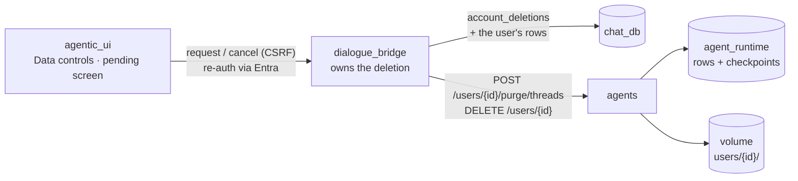
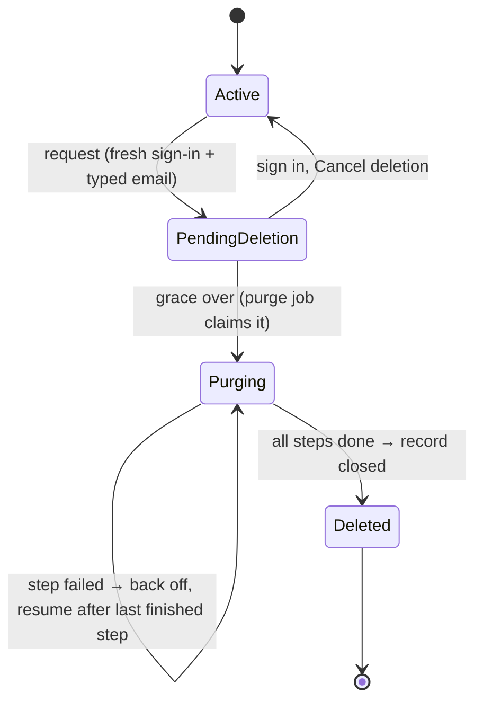
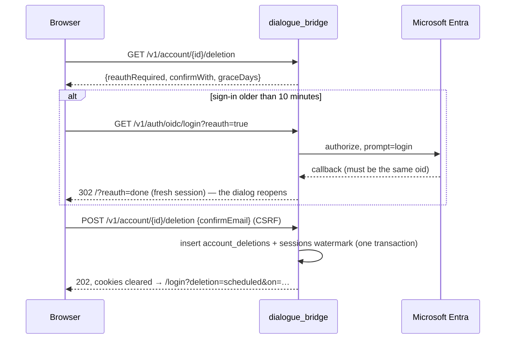

# Delete Account

A user can permanently delete their account — every conversation, message, attachment, embedding, share, scheduled task, preference, custom agent, skill, memory and checkpoint, across `chat_db`, the agents service's `agent_runtime` database and the workspace volume — from Settings → Data controls. The mental model is **request, grace, purge**. A request needs a fresh Microsoft sign-in and the account's email typed back; it signs every device out at once and freezes the account for 14 days, during which signing in can cancel it. When the grace period ends, a background job in the **dialogue_bridge** removes everything in small, resumable, rate-limited steps, asking the **agents** service to remove its part, and leaves only a non-identifying record that it happened. Nothing is deleted at request time; nothing about the user survives the purge. `ACCOUNT_DELETION_ENABLED` (on by default) is the kill switch.

---

## Services Involved

---

## Lifecycle

One table, `account_deletions`, is both the state machine and the record (see [database-schema](../architecture/database-schema.md)). One open request per user (partial unique index); `step` is the last purge step that finished.

---

## Phase 1 — The request

- **Fresh sign-in.** The session's `lat` (sign-in time, on every token since plan 32) must be at most `ACCOUNT_DELETION_REAUTH_MAX_AGE_SECONDS` (10 min) old. A token without `lat` counts as too old. Re-authentication goes through Entra with `prompt=login`, so Microsoft asks for the credentials again; the callback compares the returned `oid` with the session's user **before** the user table is touched, so a re-authentication can neither switch accounts nor create one.
- **Typed confirmation.** The account's email (or username, without one) — trimmed, case-insensitive, compared in constant time on the server.
- **Effects, in one transaction:** the `account_deletions` row (`scheduled_for = now + ACCOUNT_DELETION_GRACE_DAYS`) and `users.sessions_revoked_at = now` — every device is signed out, this one included ([authentication-and-session](authentication-and-session.md), *Log out of all devices*). A run already in flight finishes on its own; nothing it writes survives the purge.
- **Guards:** CSRF, a per-user rate limit (`ACCOUNT_DELETION_RATE_LIMIT_*`, after auth), 409 if a request is already open.

---

## Phase 2 — The grace period

Nothing is deleted; everything is **gated**, so a cancel restores the account exactly as it was.

| Thing | During the grace period |
| --- | --- |
| Existing sessions | dead (the watermark) |
| Signing in | allowed — the token carries `pdl` (pending deletion), set from the database at sign-in, refresh and account switch |
| API calls | `require_current_user` refuses a `pdl` session with 403, from the token alone (no database read on the hot path) |
| Still open | deletion status and cancel, the [data export](data-export.md), sign-out — via `require_current_user_even_if_pending` / `validate_userId_even_if_pending` |
| Live run streams (WebSocket) | refused |
| Scheduled tasks | skipped by the scheduler's claim query, not modified |
| Public share links | answer 404, not revoked |
| The UI | the start-up bootstrap loads nothing and the shell shows only the pending screen: the date, *Cancel deletion*, *Download my data*, *Sign out* |

**Cancel** (`DELETE /v1/account/{id}/deletion`) is one conditional `UPDATE … WHERE started_at IS NULL`; the purge job claims under a row lock, so a cancel and a purge cannot both win — once the purge has started, cancel answers 409. The session's `pdl` marker drops at the next refresh, which re-reads the row; the UI refreshes and reloads.

---

## Phase 3 — The purge

`run_account_purger` runs in the bridge lifespan beside the scheduler. Every `ACCOUNT_PURGE_INTERVAL_SECONDS` it claims one due request (`FOR UPDATE SKIP LOCKED`; the claim is a 15-minute lease on `next_attempt_at`, renewed after every batch) and runs the remaining steps:

| Step | What | Bound |
| --- | --- | --- |
| `sessions` | set the watermark again — the purge does not rely on the request having done it | — |
| `agent_threads` | per page of conversations, the distinct `checkpoint_thread_id`s → agents `POST /users/{id}/purge/threads` | 200 ids / call |
| `agent_runtime` | agents `DELETE /users/{id}`: memories, skill pool + files + assignments, custom agent definitions + files, then the `users/{id}/` folder (in a worker thread) and the per-user agent cache | one transaction per store |
| `conversations` | per 25 conversations: attachment blobs, remaining attachments, messages + embeddings, reports, shares, then the conversations | ≤ 20 blobs **and** ≤ 64 MiB per transaction, ≤ 32 MiB/s; 1000 messages per transaction |
| `user` | **stop** if another user's conversation uses one of this user's custom agents; else preferences, tool prefs, tasks, reports, shares, custom agents and the user row — with the step recorded in the same transaction | one transaction |

Then the record is closed: `completed_at`, `counts` (rows and bytes removed per store), and an `account_purged` log line with the hashed id.

- **Resumable and idempotent.** Each step deletes "whatever is still there" and is recorded when it finishes, so a crash, redeploy or failed call resumes after the last finished step. Running totals are saved after every batch.
- **Children before parents.** Deleting explicitly, rather than relying on `ON DELETE CASCADE`, is what keeps each transaction small — and makes the purge independent of the database enforcing foreign keys at all.
- **The agents service before chat_db.** A failure there never leaves chat_db already emptied with orphans elsewhere.
- **Failures** back off (60 s doubling, capped by `ACCOUNT_PURGE_RETRY_MAX_SECONDS`) and log `account_purge_step_failed` with the exception class only.

### Why the purge is rate-limited

Deleting a blob writes about its own size to the WAL (full-page images after each checkpoint): purging 50 GiB wrote 51 GB. Unpaced, that saturates the disk — the load test measured 17 s transactions waiting on WAL writes and requests from other users stalling — and on Dennis the disk is shared by every stack. Batching by bytes (`ACCOUNT_PURGE_BLOB_BATCH_BYTES`) and pacing (`ACCOUNT_PURGE_MAX_BYTES_PER_SECOND`) brought the longest transaction to 0.11 s with other users' latency unchanged. A 50 GB account takes about 27 minutes; nobody is waiting for it.

| Load test (2026-10-05, 512 MB cap) | Result |
| --- | --- |
| 50 GiB, 200k messages, 100k threads, unpaced | 500 s; bridge +3 MiB; longest transaction 17.2 s; 6 probe requests lost |
| 5 GiB, paced | 171 s at 29.9 MiB/s; bridge +1 MiB; longest transaction 0.11 s; probe p99 17 ms, none lost |
| Both | no lock waits, no Postgres temp files, nothing left in either database or on disk |

---

## What is kept

The `account_deletions` row, with `user_id` set to `NULL` by the delete itself and `user_ref` — an HMAC of the id under the log-redaction key (`h:<16 hex>`), the same form the logs use — plus dates and counts. It proves the deletion happened and correlates with the logs; it cannot be reversed and holds no email, name or content. Shared copies of **remote** skills stay: they are public content keyed by commit, not the user's.

---

## Sharp Edges and Behavioral Notes

- **Deletion is not a ban.** Signing in again after the purge creates a new, empty account (an unknown Entra `oid` makes a new row). To keep someone out, remove them from the Entra group.
- **Other users' copies stay.** A conversation someone imported from a share is theirs. Continuing a share made with a **private** custom agent is refused, and a run on someone else's private agent is refused at `create_inference_run_record` — before plan 32 both were possible, and deleting the agent's owner would have cascaded into the importer's conversation. The purge still checks and **fails closed** (`CrossUserReferenceError`) if such a conversation exists.
- **Backups.** There are no automated backups today. When there are, deleted data persists in them until they rotate out — say so in any privacy notice.
- **The record outlives the user**, deliberately (`ON DELETE SET NULL`).
- **A token minted in the same second as the request survives the watermark** (it compares whole seconds, as for *log out of all devices*); it is still refused at its next refresh once the purge has removed the user.

---

## File Map

| Concern | File | What to look for |
| --- | --- | --- |
| Request, cancel, status, the purge | [magenticx/dialogue_bridge/utils/account_deletion.py](../../magenticx/dialogue_bridge/utils/account_deletion.py) | `request_deletion`, `cancel_deletion`, `STEPS`, `_pace`, `run_account_purger` |
| "Is a deletion open?" | [magenticx/dialogue_bridge/utils/account_status.py](../../magenticx/dialogue_bridge/utils/account_status.py) | `open_deletion`, `open_deletion_exists_for` |
| Routes | [magenticx/dialogue_bridge/router/account.py](../../magenticx/dialogue_bridge/router/account.py) | status, request, cancel |
| Gating | [magenticx/dialogue_bridge/core/auth/session.py](../../magenticx/dialogue_bridge/core/auth/session.py) | `pending_deletion`, `require_current_user_even_if_pending` |
| Re-authentication | [magenticx/dialogue_bridge/core/auth/oidc.py](../../magenticx/dialogue_bridge/core/auth/oidc.py), [router/auth.py](../../magenticx/dialogue_bridge/router/auth.py) | `reauth_user_id`, `consume_reauth_intent` |
| Table + migration | [magenticx/dialogue_bridge/core/database/migrations/versions/0029_account_deletions.py](../../magenticx/dialogue_bridge/core/database/migrations/versions/0029_account_deletions.py) | `account_deletions` |
| Settings | [magenticx/dialogue_bridge/core/settings.py](../../magenticx/dialogue_bridge/core/settings.py) | `AccountDeletionSettings` |
| Agents service part | [magenticx/agents/utils/account_purge.py](../../magenticx/agents/utils/account_purge.py), [router/account.py](../../magenticx/agents/router/account.py) | `purge_threads`, `purge_user`, each store's `purge_user` |
| UI | [DeleteAccountCard.tsx](../../magenticx/agentic_ui/src/features/settings/components/profile_parts/DeleteAccountCard.tsx), [DeleteAccountDialog.tsx](../../magenticx/agentic_ui/src/features/settings/components/profile_parts/DeleteAccountDialog.tsx), [PendingDeletionScreen.tsx](../../magenticx/agentic_ui/src/features/settings/components/PendingDeletionScreen.tsx) | the two gates; the pending screen |
