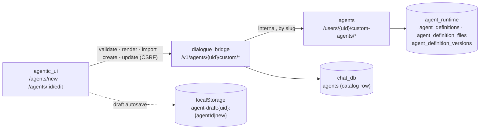
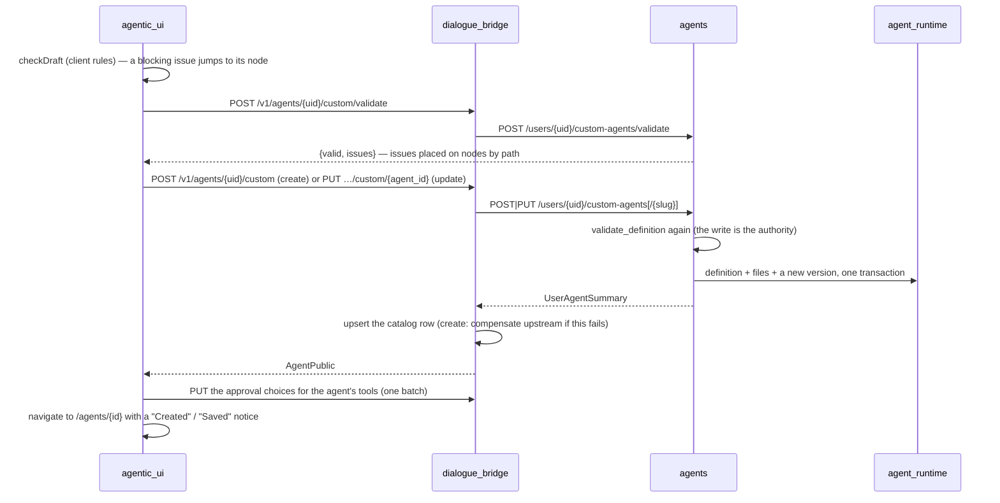
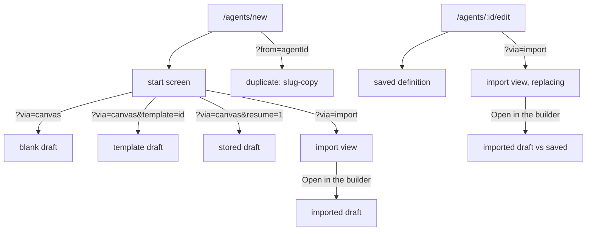

# Agent Builder

The agent builder is where a user creates and edits their own agents: a lead with a nested team of sub-agents, each with its own instructions, model and tools, plus skills, reference files and approval settings. It lives in the **Agents** section of **agentic_ui** (`/agents/new`, `/agents/:agentId/edit`) and is drawn as a canvas: the agent and its team as a tree of nodes, with an inspector for whichever node is picked. Nothing is saved while the user builds. The draft lives in the browser (autosaved to `localStorage`), the builder's own rules check it live, **Try it** runs it uncommitted in a side chat, and only **Create** or **Commit** (a saved agent's save: "Save your changes as a new version") stores it, first through the server's validate and then as a create or update. The **dialogue_bridge** proxies every call under the agent's catalog id and keeps the catalog row (`chat_db.agents`) in step. The **agents** service owns the definition: it validates it (`validate_definition`) and stores it with its files in `agent_runtime`, together with a version for every save ([agent-version-history](agent-version-history.md)). The mental model is **one draft, many ways in**. The blank canvas, a starter template, an imported YAML, a duplicate, an unsaved draft left from an earlier visit, and "Replace from YAML…" on an existing agent all produce the same `AgentDraft`, and from there the builder behaves identically.

---

## Services Involved



---

## Commit — Full Sequence

What Create or Commit does once the builder's own rules pass.



---

## Phase 1 — Where a Draft Comes From

`AgentBuilderPage` gathers the starting draft and hands it to `BuilderWorkspace`. Every way in produces an `AgentDraft`. Some starting points are **unsaved work**: they are guarded and autosaved from the first render. Others are only a starting point and leave no trace until the user changes something.



| Way in | Route | Draft | Unsaved from the start? |
| --- | --- | --- | --- |
| Blank canvas | `/agents/new?via=canvas` | `emptyDraft(defaultModel)` | No |
| Starter template | `…?via=canvas&template=<id>` | `template.draft(defaultModel)`: one of twelve, from `lib/agentTemplates/` | No. Opening one and leaving writes nothing |
| Continue unsaved | `…?via=canvas&resume=1` | The stored draft, opened directly on the canvas | Yes |
| Import a YAML | `…?via=import`, then Create or "Open in the builder" | `draftFromImport(result)` with the server's issues placed | Yes |
| Duplicate | `/agents/new?from=<agentId>` | `duplicateDefinition`: slug `<slug>-copy`, name `<name> copy` | Yes |
| Edit | `/agents/:agentId/edit` | `draftFromDetail(saved)`; offers to restore a draft an earlier visit stored | No |
| Replace from YAML | `/agents/:agentId/edit?via=import` | The import, checked as an update of this agent | Yes, measured against the saved agent (`savedDraft`) |

The start screen offers the canvas and the import as two cards. Below them is "Continue the agent you left unsaved" (only when a stored draft exists), and below that the starter templates. A template is an ordinary filled-in draft: a lead with five to seven sub-agents (at least one nested), instructions built on the shared `LEAD_RULES`, and two or three guides under `guides/` that the prompts read at `/reference/guides/…`. Tools are left empty on purpose, because MCP tools depend on what each account has connected.

---

## Phase 2 — Building on the Canvas

The canvas draws the draft as a tree (`@xyflow/react`). Clicking a node opens it in the inspector. The lead has tabs (`?section=identity|instructions|tools|skills|files|approvals`); a sub-agent has its name, description, instructions, model and tools. The team is edited on the canvas itself: add a child, delete a node (asking first when it has a team of its own). The builder's own rules (`checkDraft` in `agentRules.ts`) run on every change and mirror the server's table, so most mistakes show on their node before anything is sent.

| Rule | Limit (client and server) |
| --- | --- |
| Team depth | At most 3 levels below the lead |
| Sub-agent name | A slug (`fact-checker`), ≤ 48 characters, unique among siblings, not repeated down its branch |
| Name / description | Lead name ≤ 80 characters, description ≤ 500; sub-agent description ≤ 1,000 and required (the lead picks sub-agents by it) |
| Instructions | Required at every node; ≤ 64 KiB each (lead and every sub-agent) |
| Tools | A sub-agent's tools only narrow what the agent above it has |
| Files | ≤ 20 in all (the generated prompt files included), ≤ 256 KiB each, ≤ 1 MiB total, `.md .txt .yaml .yml`, folders ≤ 3 deep |
| How many agents / versions | No cap on either |

The server checks what only it can know (the model allowlist, the MCP gateway's catalog, the user's skill pool, reserved slugs) when the user saves, not on a timer. Its issues are placed on the nodes of the draft that was sent (by `uid`), and a node's server issues are dropped as soon as that node is edited.

---

## Phase 3 — Unsaved Work: Autosave and the Leave Guard

The draft is written to `localStorage` under `agent-draft:{userId}:{agentId|new}` about 700 ms after a change, but only while it differs from where it started. When edits are undone back to the start, the copy that this visit wrote is removed, so a template or an edit opened and left untouched leaves nothing behind. Editing an agent offers to restore a draft an earlier visit stored for it. A new agent's stored draft is offered as "Continue the agent you left unsaved" on the start screen. Leaving with unsaved changes asks first, both inside the app (`guardedLeave`) and on tab close (`beforeunload`).

| Key fact | Value / detail |
| --- | --- |
| Storage key | `agent-draft:{userId}:{agentId}`, or `…:new` for a new agent |
| Autosave delay | 700 ms (`AUTOSAVE_DELAY_MS`) |
| Cleared | On a successful save, and when the draft is back to its starting point |

---

## Phase 4 — YAML: View, Import, Replace

An agent can also be written as an `agent.yaml` with its `.md` files. The **YAML** button in the builder's bar opens the draft rendered by the server (`…/render`), read-only and kept up to date as the user builds, with **Copy**, **Download .zip** (a saved agent's export, which imports back unchanged) and, on an existing agent, **Replace from YAML…**.

The import (`…/import`) takes pasted text, `agent.yaml` with its files, or one `.zip`. The bridge unpacks and size-checks the upload (`build_import_payload`). The agents service parses it (`parse_agent_yaml`: an inline `prompt:` becomes a generated file, a missing `slug` comes from the name, `model: x` means `model: {main: x}`) and runs `validate_definition`. It never saves. The result is drawn on the same canvas, read-only, beside a summary and its issues. From there the user can **Create** it as it is, **Open in the builder** to change or fix it, or choose another file.

**Replace from YAML** is the same import with `replacing=<agentId>`. The bridge checks ownership and sends the agent's slug upstream. A YAML without `slug:` takes that slug, and one with a different slug is an issue, because slugs never change. Create becomes **Replace ‹name›**, confirmed first, and is an update of the agent. "Open in the builder" opens the YAML as unsaved changes measured against the saved agent. The replaced definition stays in the agent's History.

| Key fact | Value / detail |
| --- | --- |
| Import rate limit | `AGENT_IMPORT_RATE_LIMIT_MAX_ATTEMPTS` / `_WINDOW_SECONDS`, 10 per 60 s per user |
| Upload bounds (bridge) | One `.zip` or a manifest with its files; ≤ 1.25 MiB together; no symlinks, nothing outside the folder |
| YAML size | ≤ 256 KiB |

---

## Phase 5 — Commit

Create (a new agent) or Commit (a saved one) runs the client rules, then the server's validate, then the create or update, then the approval choices. The approvals are a separate call: they are the user's per-account preferences for the agent's tools, not part of the definition. If that last call fails, the agent already exists, so the builder stays on **Approvals** with **Retry**, and a later save is an update. A successful save clears the stored draft and lands on the agent's page with a notice. The agents service records a version only when the definition actually changed.

---

## Phase 6 — Try it: Chat With the Uncommitted Draft

**Try it** in the builder's bar opens a side chat that runs the draft as it is now. Nothing is saved as the agent and no version is created. Each message sends the current draft (`buildAgentPayload`) and the draft's Approvals choices, so the user can change instructions and keep chatting; a "Draft changed" divider marks a turn whose draft differs from the turn before. The builder's own rules must pass before a message is sent, and a server 422 places its issues on the nodes, as Commit does.

```mermaid
sequenceDiagram
    participant UI as agentic_ui (TryItPanel)
    participant B as dialogue_bridge
    participant R as Redis
    participant A as agents

    UI->>B: POST /v1/agents/{uid}/custom/try {agentId?, conversationId?, message, draft, approvals}
    B->>A: POST /users/{uid}/custom-agents/validate (422 → issues)
    B->>B: trial conversation (is_trial, is_private) + run record
    B->>R: trial:draft:{run_id} (TTL 2 h)
    B-->>UI: InferenceStartResponse (observed over the run WebSocket)
    B->>A: POST /agents/{slug}/stream {definition, config} (and every /resume leg)
    A->>A: build_trial_definition — uncached; /reference/ from the draft's files
```

The bridge reuses the whole run pipeline (event log, WebSocket frames, approvals and ask-user, Stop, usage), with the definition sent inline instead of loaded from the database. A trial of a saved agent runs under that agent's catalog row, so it uses the agent's real memory, skills and saved tool rows, with the draft's approvals laid over them for that run only. A never-created draft has no catalog row: its trial conversation has `agent_id` NULL (allowed only when `is_trial`), runs as a transient agent built from the draft, and has memory off.

| Key fact | Value / detail |
| --- | --- |
| Visibility | Hidden everywhere: conversation lists and routes (404), search, suggestions, embeddings, run lists, data export, the Usage conversation list. Tokens still count in the daily rollups |
| Lifetime | Reset or leaving the builder deletes the trial conversation (checkpoints and files reaped). The sweeper deletes trials older than `AGENT_TRIAL_CONVERSATION_TTL_HOURS` (24) |
| Draft stash | Redis `trial:draft:{run_id}`, `AGENT_TRIAL_DRAFT_TTL_SECONDS` (7200); missing → the run fails with "draft expired" |
| Rate limit | `AGENT_TRIAL_RATE_LIMIT_MAX_ATTEMPTS` / `_WINDOW_SECONDS`, 30 per 60 s per user |
| Modes | New and continue only: no edit, retry, fork, branch or share |
| Cache | A trial definition never enters `_USER_AGENT_CACHE`; a normal run of the same slug gets the saved agent |

---

## Sharp Edges and Behavioral Notes

- **The slug is fixed at creation.** It comes from the name when the agent is created and never changes after that. A rename on edit keeps the slug, the server refuses a different slug on an update (or a replacing import), and a duplicate gets `<slug>-copy`.
- **Unknown fields cannot reach a stored agent.** Every spec model is `extra="forbid"`, so a YAML with a field the server doesn't know is refused, not stored. The builder writes back every field the server has (name, description, icon, prompt, model, memory, tools, skills, team, approval defaults, files). Only `version` (always `1.0.0`) and `id` (`<slug>-v1`) are normalised on a builder save. If `AgentSpec` gains a field, `buildAgentPayload` must learn it too, or a builder save will drop it.
- **The UI reads specs fail-open.** `AgentSpecSchema` (zod, `.passthrough()`) types the spec on reads. A malformed field becomes absent rather than breaking the page.
- **A save rewrites the whole folder.** `draftFromDetail` must account for every file: generated prompt files fold back into their nodes, and everything else becomes a reference file. A file it dropped would be deleted by the next save.
- **Replace skips the approval step.** Replacing directly from the import screen updates the definition only. The user's approval preferences stay as they were. "Open in the builder" then Commit applies them as usual.
- **The model list comes only from the server.** `GET /v1/catalog/models` drives the pickers and the labels (`useAgentCatalogs` in the builder, `useModelOptions` in the gallery and on an agent's page). The UI keeps no list of its own: when the read fails, the Model field says so with **Try again**, a new draft has no model ("Choose a model."), and labels fall back to the id without its provider prefix.

---

## File Map

| Concept | File | What to look for |
| --- | --- | --- |
| Page: ways in, edit, replace | [magenticx/agentic_ui/src/features/agents/pages/AgentBuilderPage.tsx](../../magenticx/agentic_ui/src/features/agents/pages/AgentBuilderPage.tsx) | `via`, `template`, `resume`, `from`, `createImported`, `openImported` |
| Builder: draft, checks, save, autosave | [magenticx/agentic_ui/src/features/agents/components/builder/BuilderWorkspace.tsx](../../magenticx/agentic_ui/src/features/agents/components/builder/BuilderWorkspace.tsx) | `save`, `applyApprovals`, `savedDraft`, `unsaved`, `offerRestore` |
| Start screen | [magenticx/agentic_ui/src/features/agents/components/builder/StartScreen.tsx](../../magenticx/agentic_ui/src/features/agents/components/builder/StartScreen.tsx) | the cards, the leftover link, `TemplateCard` |
| Import / replace view | [magenticx/agentic_ui/src/features/agents/components/builder/ImportView.tsx](../../magenticx/agentic_ui/src/features/agents/components/builder/ImportView.tsx) | `replacing`, `ImportResult`, the confirm |
| YAML view | [magenticx/agentic_ui/src/features/agents/components/builder/YamlPanel.tsx](../../magenticx/agentic_ui/src/features/agents/components/builder/YamlPanel.tsx) | Copy, Download .zip, Replace from YAML… |
| Client rules and limits | [magenticx/agentic_ui/src/features/agents/lib/agentRules.ts](../../magenticx/agentic_ui/src/features/agents/lib/agentRules.ts) | `checkDraft`, `MAX_*`, `draftFiles` |
| Draft ↔ spec | [magenticx/agentic_ui/src/features/agents/lib/agentSpec.ts](../../magenticx/agentic_ui/src/features/agents/lib/agentSpec.ts) | `buildAgentPayload`, `draftFromDetail`, `draftFromImport`, `duplicateDefinition` |
| Spec schema (reads) | [magenticx/agentic_ui/src/shared/lib/schemas.ts](../../magenticx/agentic_ui/src/shared/lib/schemas.ts) | `AgentSpecSchema` |
| Starter templates | [magenticx/agentic_ui/src/features/agents/lib/agentTemplates/](../../magenticx/agentic_ui/src/features/agents/lib/agentTemplates/) | `index.ts` (`AGENT_TEMPLATES`), `shared.ts` (`LEAD_RULES`) |
| Autosave | [magenticx/agentic_ui/src/features/agents/hooks/useDraftAutosave.ts](../../magenticx/agentic_ui/src/features/agents/hooks/useDraftAutosave.ts) | `AUTOSAVE_DELAY_MS`, the `wrote` ref |
| Server validate on save | [magenticx/agentic_ui/src/features/agents/hooks/useServerValidation.ts](../../magenticx/agentic_ui/src/features/agents/hooks/useServerValidation.ts) | `validateNow` |
| Bridge routes and proxy | [magenticx/dialogue_bridge/router/user_agents.py](../../magenticx/dialogue_bridge/router/user_agents.py), [utils/user_agents.py](../../magenticx/dialogue_bridge/utils/user_agents.py) | `import_my_agent` (`replacing`), `create_custom_agent`, `update_custom_agent` |
| Upload unpacking | [magenticx/dialogue_bridge/utils/agent_import.py](../../magenticx/dialogue_bridge/utils/agent_import.py) | `build_import_payload` |
| Agents routes | [magenticx/agents/router/user_agents.py](../../magenticx/agents/router/user_agents.py) | `validate_custom_agent`, `import_custom_agent`, `create_custom_agent`, `update_custom_agent` |
| Validation, YAML parse/render | [magenticx/agents/harness/abstractions/user_agents.py](../../magenticx/agents/harness/abstractions/user_agents.py) | `validate_definition`, `parse_agent_yaml`, `render_agent_yaml`, `_MAX_*` |
| Try it (UI) | [magenticx/agentic_ui/src/features/agents/components/builder/TryItPanel.tsx](../../magenticx/agentic_ui/src/features/agents/components/builder/TryItPanel.tsx), [hooks/useAgentTrial.ts](../../magenticx/agentic_ui/src/features/agents/hooks/useAgentTrial.ts) | the panel, the trial run hook, "Draft changed" |
| Try it (bridge) | [magenticx/dialogue_bridge/utils/agent_trials.py](../../magenticx/dialogue_bridge/utils/agent_trials.py), [utils/trial_drafts.py](../../magenticx/dialogue_bridge/utils/trial_drafts.py) | start, reset, sweeper; `TrialAgent`, the Redis stash, `overlay_approvals` |
| Try it (agents) | [magenticx/agents/router/inference.py](../../magenticx/agents/router/inference.py), [utils/agents.py](../../magenticx/agents/utils/agents.py) | `_run_definition`, `build_trial_definition`, `DraftDefinitionStore` |
| Spec models | [magenticx/agents/harness/abstractions/agent_spec.py](../../magenticx/agents/harness/abstractions/agent_spec.py) | `AgentSpec`, `SubAgentSpec` (`extra="forbid"`) |
