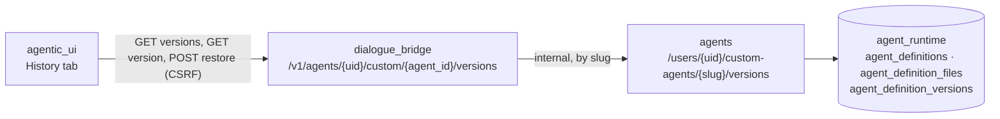
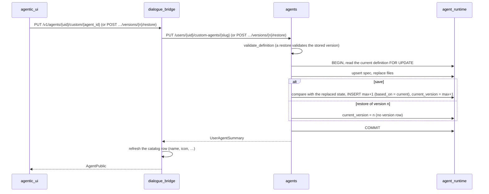
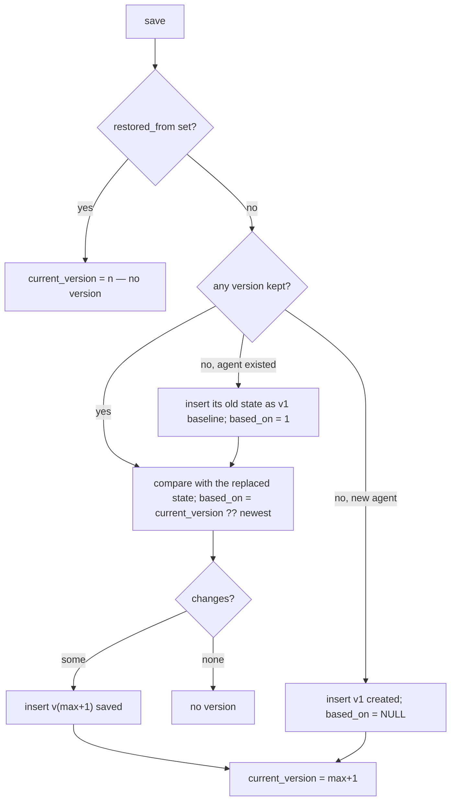
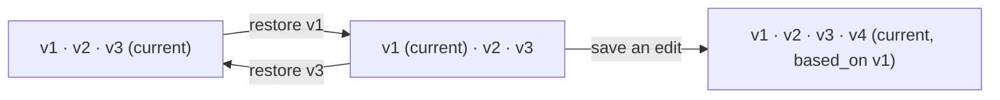

# Agent Version History

Every save of a user-authored agent keeps a whole copy of the agent as it stood afterwards: its spec and every authored file. The **agents** service writes that copy in the same transaction as the save, into `agent_definition_versions` in `agent_runtime`. The **dialogue_bridge** proxies the list, the read and the restore under the agent's catalog id, and the **agentic_ui** shows them on a custom agent's **History** tab, where each version is a one-line timeline row that opens onto a diff and a Restore button. The mental model is **snapshots, not deltas, plus a pointer**. A version is the complete agent, so reading or restoring one never replays a chain. "What changed" is a short label list computed once, when the version is written. The agent's **current version** is a pointer (`agent_definitions.current_version`): a restore writes an old snapshot back as the agent and moves the pointer to it, **without adding a version**, so restoring the version that was current undoes it. The next save after a restore becomes `max + 1`, records the restored version as its `based_on`, and its changes are measured against the restored state. Platform agents have no history: they ship in the image and are never written at runtime.

---

## Services Involved

---

## Save and Restore — Full Sequence

What one save does, and how a restore shares its write path but records no version.

---

## Phase 1 — Recording a version

`AgentDefinitionStore.save` is the only writer of an agent's definition, so it is also where every version is recorded. It does this in the save's own transaction, which means the history can never miss a save or hold a save that rolled back. The state being replaced is read under the definition row's lock, so two concurrent saves of one agent queue, and each compares against the one before it.

The new state is compared with **the state it replaces** — the current version, which after a restore is the restored one, not the newest. If nothing differs, no version is added. Opening the builder and saving without an edit leaves the history (and the current pointer) alone.

A save that does change something is numbered `max(version_no) + 1`, never reusing a number, and records `based_on`: the version it was made on top of (`current_version`, or the newest when that is NULL). It then becomes current. Every version is kept until the agent is deleted. A save with `restored_from = n` (a restore) skips all of this: it sets `current_version = n` and records nothing.

| Kind | When |
| --- | --- |
| `created` | The agent's first save, always v1 |
| `saved` | Any later save that changed something |
| `baseline` | The agent as it stood **before history existed**, inserted as v1 by the first save after the feature shipped. Without it, that save's own changes could be neither compared nor undone |
| `restored` | **Legacy only.** Restores used to add a version naming its source in `restored_from`. Rows written that way stay valid and are still listed and exported; no new ones are written |

| Column | Meaning |
| --- | --- |
| `agent_definitions.current_version` | The version the agent is now. Set to the new number by every recording save and to `n` by a restore. NULL (rows from before the column existed) means the newest |
| `agent_definition_versions.based_on` | The version a save was made on top of: the previous current version, so after a restore it is the restored one. NULL for `created` and `baseline` |
| `current` (API only) | `list_versions` marks exactly one row: the version `current_version` names if it is still kept, else the newest |

| Key fact | Value / detail |
| --- | --- |
| Cap | None: every version is kept until the agent is deleted. Histories from before the cap was removed may start above v1, because the old 20-version cap dropped their oldest rows |
| Numbering | 1, 2, 3, … per agent, always `max + 1`, never renumbered, so v7 is always the same snapshot |
| Storage | One row per version: `spec` jsonb, `files` jsonb as `{path: {content, encoding}}` ([database-schema](../architecture/database-schema.md#agent_definition_versions)) |
| Size | Each version is bounded by the definition limits (≤ 20 files, 1 MiB per agent); the number of versions is not |

---

## Phase 2 — What changed

`describe_changes(before, after)` names the parts of the agent that differ, in a fixed order. It is stored on the version as `changes`, so the History list can show "Instructions · Tools" without loading two snapshots. It is never re-derived, because the version it was compared against may be gone from an older, capped history.

| Part | Covers |
| --- | --- |
| `details` | `name`, `description`, `icon` |
| `instructions` | The main prompt: the file `prompt:` points at, or the inline text |
| `model` | `model.main` |
| `tools` | `tools`, `hitl` (approval gates) |
| `skills` | `skills` |
| `team` | `subagents`, `model.subagents`, and every file under `subagents/` |
| `files` | Any other authored file (reference material) |
| `settings` | Every other spec key, e.g. `memory` |

`id`, `version`, `type` and `slug` are bookkeeping the builder may rewrite on any save, and never count as a change. A `created` or `baseline` version has no changes.

---

## Phase 3 — Reading and restoring

The list carries no content, but each row has `based_on` and `current`. The History tab loads a version whole (`GET …/versions/{n}`) only when it is opened, and diffs it in the browser: fields side by side, lists as added and removed, and files line by line.

A **restore** goes through `validate_definition` again, exactly like a `PUT`. A version may name a skill the user has since removed, or break a rule that has since been tightened, and a restore must never store what a save would refuse. A version that no longer passes answers 422 with the same `{message, errors, issues}` body as an invalid save, and nothing is written. A version that passes is written as the agent with `restored_from = n`: **no version is added or deleted**, `current_version` moves to `n`, and the list reads the same apart from which row is current. Restoring the version that was current before undoes the restore exactly.

| Service | Route | Notes |
| --- | --- | --- |
| agents | `GET /users/{uid}/custom-agents/{slug}/versions` | `AgentVersionSummary[]` (`version_no`, `kind`, `changes`, `restored_from`, `based_on`, `current`, `created_at`), newest first; 404 for an unknown agent |
| agents | `GET …/versions/{n}` | `AgentVersionDetail` (+ `spec`, `files`; `current` is always `false` here); 404 when not kept; `n` ≥ 1 |
| agents | `POST …/versions/{n}/restore` | `UserAgentSummary` of the agent now; adds no version; 404 / 422 with issues |
| bridge | `GET /v1/agents/{uid}/custom/{agent_id}/versions` | Owner-checked; camelCase: `versionNo`, `kind`, `changes`, `restoredFrom`, `basedOn`, `current`, `createdAt` |
| bridge | `GET …/versions/{versionNo}` | Adds `spec`, `files` |
| bridge | `POST …/versions/{versionNo}/restore` | CSRF; refreshes the catalog row like an update; returns `AgentPublic` |

**The UI.** A custom agent's page has a **History** tab (`/agents/:agentId?section=history`). It lists the versions as a collapsed graph, newest first: a rail on the left joins each version's dot to the version it was saved on top of (`basedOn`; the row below for a legacy row), laid out like `git log --graph` (`lib/versionGraph.ts`, drawn by `VersionGraphRail.tsx`), so two saves on top of one version show as two branches meeting at it. Each row is one line: number, a **Current** badge on the current version, a kind label ("Created", "Saved", "Saved on top of version 3" when `basedOn` is not the number below it, "Before history began", or "Restored from version 3" for a legacy row), the time, and a one-line summary ("Changed tools and instructions."). Nothing is fetched until a row is opened, and one row is open at a time. Opening a row shows its diff **against the version it was based on** by default (falling back to the row below it when `basedOn` is missing or no longer kept), and a **Compare with** picker switches the comparison to any other kept version. Every row but the current one has **Restore this version**, behind a confirmation that says no version is added or deleted and the current version stays in the history, so restoring it undoes the change. A 422 shows the issues inline. The Overview tab's **Version** row shows the current version number for a custom agent.

---

## Phase 4 — Delete, purge, export

The history belongs to the agent and goes with it.

| Event | What happens to versions |
| --- | --- |
| Delete the agent | `AgentDefinitionStore.delete` removes the definition, its files and its versions in one transaction. Re-creating the slug starts again at v1 `created` |
| Delete the account | `purge_user` deletes every version of the user, reported as `agent_definition_versions` in `PurgeUserResponse` ([account-deletion](account-deletion.md)) |
| Export my data | `agents/versions.ndjson`, one record per kept version with its spec and files inline, paged by `(agent_slug, version_no)` ([data-export](data-export.md)) |

---

## Sharp Edges and Behavioral Notes

- **Agents from before history start empty.** Until its first save after the feature shipped, an older agent lists no versions. That save writes the `baseline` first, then its own version, so the very first edit is already undoable.
- **No-op saves are invisible.** A save whose spec and files match the current state adds nothing and leaves the pointer where it is. A restore never adds a version. Anything that expects "one save = one version" is wrong.
- **The comparison is against the replaced state, not the newest version.** After a restore of v1, an edit is compared with v1 and named `based_on = 1`, even though v2…vN are listed above it. The timeline is therefore not a chain: the version listed below a row is not necessarily the one it was based on.
- **The current pointer can dangle.** `current_version` is not a foreign key. It is NULL on agents from before the column existed, and a version it names could be missing from an older, capped history; in both cases the list falls back to marking the newest as current, and the next save is based on the newest.
- **Schema drift reads as `settings`.** Specs are stored as the validated `model_dump`. If `AgentSpec` gains a field, the first save afterwards may report `settings` against an older snapshot, even though the user changed nothing there.
- **A restore can be refused.** Snapshots are not re-validated when they are stored, only when they are restored. An old version that names a removed skill or a disallowed model shows its diff fine, but its Restore answers 422.
- **The bridge addresses by catalog id, the agents service by slug.** The bridge resolves an owned `agent_id` to its slug, so a version URL can never reach another user's agent.

---

## File Map

| Concept | File | What to look for |
| --- | --- | --- |
| Change parts, kinds | [magenticx/agents/harness/agent_registry/versions.py](../../magenticx/agents/harness/agent_registry/versions.py) | `describe_changes`, `CHANGE_ORDER` |
| Table, recording, reads, purge, export paging | [magenticx/agents/harness/agent_registry/store.py](../../magenticx/agents/harness/agent_registry/store.py) | `_DDL`, `save`, `_record_version`, `list_versions`, `get_version`, `page_versions`, `delete`, `purge_user` |
| List / read / write with `restored_from` | [magenticx/agents/harness/abstractions/user_agents.py](../../magenticx/agents/harness/abstractions/user_agents.py) | `list_user_agent_versions`, `get_user_agent_version`, `write_user_agent` |
| Agents routes | [magenticx/agents/router/user_agents.py](../../magenticx/agents/router/user_agents.py) | `list_custom_agent_versions`, `get_custom_agent_version`, `restore_custom_agent_version` |
| Agents schemas | [magenticx/agents/schema/user_agents.py](../../magenticx/agents/schema/user_agents.py) | `AgentVersionSummary`, `AgentVersionDetail` |
| Export | [magenticx/agents/utils/data_export.py](../../magenticx/agents/utils/data_export.py) | `agents/versions.ndjson` |
| Bridge routes | [magenticx/dialogue_bridge/router/user_agents.py](../../magenticx/dialogue_bridge/router/user_agents.py) | `list_my_agent_versions`, `get_my_agent_version`, `restore_my_agent_version` |
| Bridge proxy | [magenticx/dialogue_bridge/utils/user_agents.py](../../magenticx/dialogue_bridge/utils/user_agents.py) | `list_custom_agent_versions`, `get_custom_agent_version`, `restore_custom_agent_version` |
| History tab | [magenticx/agentic_ui/src/features/agents/components/detail/AgentHistory.tsx](../../magenticx/agentic_ui/src/features/agents/components/detail/AgentHistory.tsx) | timeline rows, `CompareWith`, Restore confirm |
| Diff + labels | [magenticx/agentic_ui/src/features/agents/lib/agentHistory.ts](../../magenticx/agentic_ui/src/features/agents/lib/agentHistory.ts) | `CHANGE_LABELS`, `versionKindLabel`, `versionSummary`, `currentVersion`, `compareVersions` |
| Data hook | [magenticx/agentic_ui/src/features/agents/hooks/useAgentHistory.ts](../../magenticx/agentic_ui/src/features/agents/hooks/useAgentHistory.ts) | `useAgentHistory`, `RestoreFailure` |
| Tests | [tests/agents/test_agent_versions.py](../../tests/agents/test_agent_versions.py), [test_agent_definition_versions.py](../../tests/agents/test_agent_definition_versions.py), [test_custom_agent_version_routes.py](../../tests/agents/test_custom_agent_version_routes.py) | change parts; recording, restore and current-pointer rules on the real store; routes |
