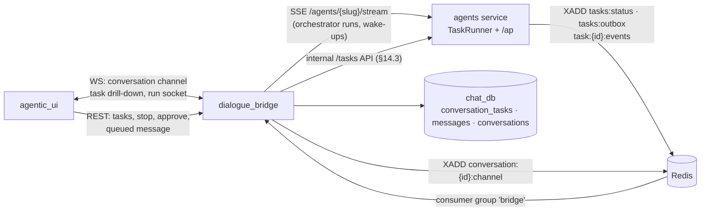
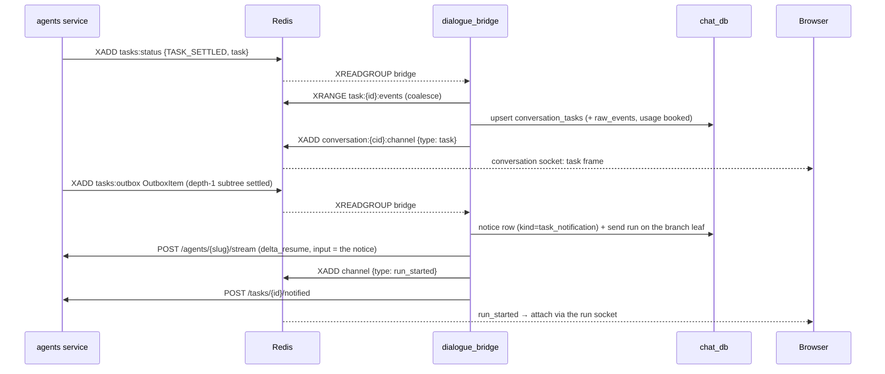
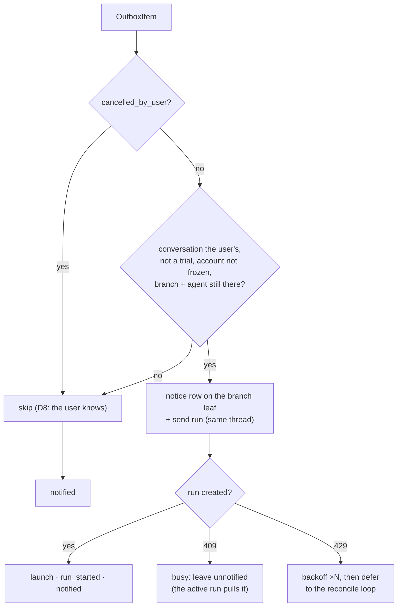
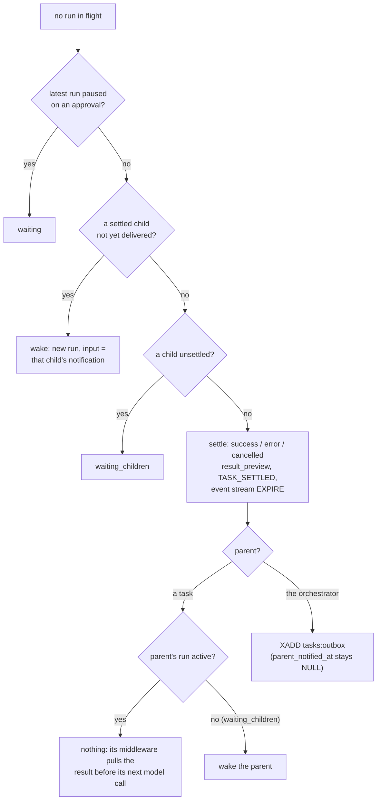

# Async Sub-agents

Since plan 41 every sub-agent runs as a **background task**. The orchestrator calls `start_async_task`, gets a task id back in about a second, and its run ends; the task keeps working in the agents service on its own LangGraph thread, inside our own harness, while the user keeps chatting. A task can start tasks of its own, down to depth 3. When a depth-1 task's whole subtree has settled, the orchestrator is **woken** with a notification and reports the result. The agents service owns the tasks (`agent_runtime.async_tasks`) and runs them; the **dialogue bridge** mirrors them for the UI (`chat_db.conversation_tasks`), relays their events, wakes the orchestrator, holds the composer's one queued message, and fans everything a watching browser needs out on a per-conversation channel. This document is written in two halves: the bridge (Phases 1–6) and the agents service (the three "Agents half" sections).

---

## Services Involved



---

## Full Sequence — a task settles while the orchestrator is idle



---

## Phase 1 — The mirror (`tasks:status` → `conversation_tasks`)

Every status change of every task is an entry on `tasks:status` (`{"event": "TASK_STARTED"|"TASK_STATUS"|"TASK_SETTLED", "task": TaskOut}`). The bridge consumes it with the consumer group `bridge` (`utils/task_consumers.py`) and writes it into `conversation_tasks` (`utils/async_tasks.apply_status_entry`), so the task tree, a reload and a drill-down never need the agents service. Ownership is enforced at write time: a task whose conversation does not exist or belongs to someone other than the user it names is **dropped, never stored** — the mirror row is what every route's ownership check reads.

On a **settle** the same transaction also captures the task's whole event stream into `raw_events` (seq-stamped and coalesced by the run log's own `append_coalesced`, capped at `ASYNC_TASKS_RAW_EVENTS_MAX`) and books the task's spend into the usage breakdown: a `message_usage` row with scope `subagent` and `agent_name = subagent_path`, on the answer that launched the tree (`spawned_by_message_id`), plus the conversation's totals and the daily rollups. `usage_booked` remembers what was booked, so a re-opened task or a re-delivered entry books only the delta. Then the entry is announced on the conversation channel as `{"type": "task", "event", "task"}`.

| Key fact | Value / detail |
| --- | --- |
| Delivery | At least once. Handled → `XACK`. A database or Redis failure → left pending, read again on the next pending pass (every `ASYNC_TASKS_CLAIM_IDLE_MS`); entries a dead replica left pending are `XAUTOCLAIM`ed. Malformed → logged and acked |
| Consumer name | `ASYNC_TASKS_CONSUMER_NAME`, else the host name — overlapping replicas never share pending entries |
| Re-opened task | A non-settled status clears `notified_at`: the next settle needs a new wake-up |

---

## Phase 2 — Waking the orchestrator (`tasks:outbox`)

When a depth-1 task's subtree settles the agents service writes an `OutboxItem` to `tasks:outbox` (the doorbell; the durable truth is its `async_tasks.parent_notified_at`). The bridge handles each one in its own background task (`utils/task_wakeups.handle_outbox_item`, at most `ASYNC_TASKS_WAKE_CONCURRENCY` at once), modelled on the scheduled-task fire:



* **The leaf** is the newest answer on the task's `branch_thread_id` — the branch the task was started from, even if the user has since switched branch.
* **The notice row** is a `messages` row with `sender = user`, `kind = task_notification`, content = the notification's text, and `task_notice = {task_id, name, status, duration_ms, agent_kwargs}`. It is persisted, append-only, forks with branches, and is the orchestrator's input: the history message the bridge sends for it carries `"kind": "task_notification"` and `"additional_kwargs"` (the notification's own), so the agents service rebuilds the exact HumanMessage its middleware recognises. `agent_kwargs` never reaches the browser.
* **The run** is an ordinary `send` (`create_run_and_respond`), so it is a `delta_resume` on the same thread. It inherits the root run's `scheduled_task_id`: a scheduled task's wake-ups stay non-interactive.
* **Notified** (`POST /tasks/{id}/notified`, plus `conversation_tasks.notified_at`) only once the run exists, or the wake-up was deliberately skipped. Never on 409 or 429 — an unnotified row is what the safety nets look for.

---

## Phase 3 — Safety nets: run end and reconcile

**Run end** (`on_run_finished`, a run-finished hook called after every run's terminal frame): the conversation's **queued message is sent first** — the user asked for it, and the run it starts pulls any settled result before its first model call anyway. Only when nothing was queued (or the queued send was refused) does the hook wake the orchestrator, **once**, for a settled depth-1 task the mirror still shows unhandled; it asks the agents service (`GET /tasks/unnotified?user_id=&conversation_id=`) only when the mirror has such a task, so an ordinary run end costs one query.

**Reconcile loop** (at startup — after orphaned runs are failed — and every `ASYNC_TASKS_RECONCILE_INTERVAL_SECONDS`): sends queued messages older than `ASYNC_TASKS_QUEUE_SWEEP_AFTER_SECONDS` whose conversation has no active run (what a restart left behind), then works through `GET /tasks/unnotified`, one wake per conversation per pass. Redis has no persistence; this is why no notification is lost across a bridge or Redis restart.

---

## Phase 4 — The composer queue

While the conversation has an active run (usually a wake-up run reporting results), a `send` with `"queue_if_busy": true` is held in `conversations.queued_message` and answered **202** `{"queued": true, "queued_message": {content, command, effort, agent_id, queued_at}}`. One slot: a second send replaces it. `DELETE /v1/conversations/{user_id}/{conversation_id}/queued-message` cancels it. When the run it waited for ends, it is sent as a normal `send` on that run's leaf (`utils/composer_queue.send_queued_message`).

| Key fact | Value / detail |
| --- | --- |
| What can be queued | Text, a slash command and a reasoning effort, validated when queued (agent usable, command known). A send with **files** keeps the 409 — bytes are never parked in a JSON column |
| Exactly once | Sending locks the row, reads and empties the slot in one transaction; racing senders (run-end hook, loop, the queue route itself) cannot both get it |
| Transient refusal | 409 (another run started first) or 429 (the user's run cap): put back unless a newer message took the slot; sent at the next run end or loop pass |
| Race at queue time | If the run ended between the check and the commit, the queue route sends it at once |
| UI | `queue` frames on the conversation channel (`queued_message` or `null`) |

---

## Phase 5 — The conversation channel and the drill-down

**Conversation channel** — one Redis Stream per conversation, `conversation:{id}:channel` (`ASYNC_TASKS_CHANNEL_MAXLEN` entries, EXPIREd `ASYNC_TASKS_CHANNEL_TTL_SECONDS` after the last frame), tailed by `WS /v1/conversations/{user_id}/{conversation_id}/ws`. A stream rather than pub/sub: a reconnect with `since` loses nothing, and nothing lives in process memory, so it works with one bridge process, several, or across a restart. Frames: `task`, `run_started` (a wake-up, a queued send — then `from_queue: true` —, a scheduled fire; the client attaches through the run socket), `queue` (always `{"queued_message": null}` when the slot is cleared, by a send or a delete); each carries its `seq`. The first frame after `subscribe` is always the queue's current state, read from the database.

**Drill-down** — `WS /v1/tasks/{user_id}/{task_id}/ws`: `snapshot` (the task; `events` only when it carries the full stored log — a settled task with no `since` — then `terminal` at once; without `events` the UI keeps what it has already folded), then one `event` frame per entry of `task:{id}:events` (`seq` = the Redis entry id), then `terminal {status}` once the task has settled and the stream is drained.

Both sockets authenticate exactly like the run socket: session cookie bound to the path's `{user_id}`, the per-user connect rate limit, ownership checked before the handshake completes (`4404`), and a `subscribe` first frame within `INFERENCE_WS_SUBSCRIBE_TIMEOUT_SECONDS`.

| Route (bridge) | Purpose | Limits |
| --- | --- | --- |
| `GET /v1/conversations/{user_id}/{conversation_id}/tasks?limit=` | `[TaskOut]` from the mirror, parents before children | `task_read_rate_limit`; `limit` ≤ `ASYNC_TASKS_LIST_LIMIT_MAX` |
| `POST /v1/tasks/{user_id}/{task_id}/cancel` | Stop: proxies `POST /tasks/{id}/cancel {"user_id", "reason": "user"}`; cascades; never wakes | CSRF, `task_mutate_rate_limit` |
| `POST /v1/tasks/{user_id}/{task_id}/resume` | Approval for a `waiting` task: the run-resume body, `interruptId` required; proxied as `{"user_id", "decisions": {interruptId: item}}` | CSRF, `task_mutate_rate_limit` |
| `DELETE /v1/conversations/{user_id}/{conversation_id}/queued-message` | Cancel the queued message | CSRF, `task_mutate_rate_limit` |
| `POST /v1/inference/runs/{user_id}/start` + `queue_if_busy` | 202 queued instead of 409 | `inference_rate_limit` |

A task not yet in the mirror (its `TASK_STARTED` not consumed yet) is authorised through the agents service (`GET /tasks/{id}?user_id=`, 404 for another user's) and must belong to a conversation the caller owns.

---

## Phase 6 — Delete, purge, export

* **Conversation delete** — the reap outbox (`pending_runtime_reaps`) now lists the conversation's task ids among its threads (a task's thread id is its task id) and, before the reap, calls `POST /tasks/cancel-scope {"user_id", "conversation_id"}` (a 404 — an agents service without the task API — counts as nothing to stop). `conversation_tasks` rows are deleted in the delete's transaction.
* **Account purge** — a new first step `agent_tasks` (`POST /tasks/cancel-scope {"user_id"}`), task ids in the `agent_threads` batches, `conversation_tasks` deleted with each conversation batch and by user in the final step.
* **Export** — `conversations/tasks.ndjson` (the mirror without `raw_events`); `messages.ndjson` gains `kind` and `task_notice`. Forks copy `kind`/`task_notice`; share snapshots carry `kind` and the four public notice keys, revalidated on import.

---

## Agents half — the TaskRunner and `/ap`

With `ASYNC_SUBAGENTS_ENABLED` on (the default in `core/settings.py`; no compose sets it, and `false` is only an emergency switch back to the blocking `task` until the cut-over removes it), `DeepAgent.build_deep_agent` gives the orchestrator `AsyncTaskMiddleware` — deepagents' `AsyncSubAgentMiddleware` with its five tools (`start_async_task`, `check_async_task`, `update_async_task`, `cancel_async_task`, `list_async_tasks`) — instead of the blocking `task`. Every top-level sub-agent, the general-purpose one included, is one `AsyncSubAgent` spec; deepagents' auto-added blocking general-purpose sub-agent is switched off through the model's harness profile. With the flag off, nothing changes. A trial's draft ("Try it") and a tree holding a pre-compiled (`runnable`) sub-agent keep the blocking path: a task run must be able to rebuild its node from a stored definition.

```mermaid
sequenceDiagram
    participant O as Orchestrator run<br/>(AsyncTaskMiddleware)
    participant AP as /ap router<br/>(in process)
    participant TR as TaskRunner
    participant DB as agent_runtime
    participant R as Redis

    O->>AP: threads.create {metadata.subagent_name} + launch token
    AP->>TR: create_task (depth, caps)
    TR->>DB: INSERT async_tasks (status pending)
    TR->>R: XADD tasks:status TASK_STARTED
    O->>AP: runs.create {assistant_id = graph_id, input}
    AP->>TR: create_run → asyncio task
    AP-->>O: run (pending) — the tool returns the task id
    TR->>TR: build the node via build_deep_agent, own MCP session
    loop the run streams
        TR->>R: XADD task:{id}:events (AG-UI event)
    end
    TR->>DB: run success, result stored; settle (§3.5)
    TR->>R: XADD tasks:status TASK_SETTLED (+ tasks:outbox at depth 1)
```

**The six endpoints** (`router/agent_protocol.py`, mounted at `/ap`, logic in `utils/async_tasks.py`, schemas in `schema/agent_protocol.py`) are exactly what `langgraph_sdk` sends: `POST /ap/threads`, `GET /ap/threads/{id}`, `POST /ap/threads/{id}/runs`, `GET /ap/threads/{id}/runs`, `GET /ap/threads/{id}/runs/{run_id}`, `POST /ap/threads/{id}/runs/{run_id}/cancel`. A task is a thread (`task_id` = thread id = its LangGraph checkpoint thread).

| Thread status | When |
| --- | --- |
| `busy` | the task is `pending`, `running` or `waiting_children` — its own run **or a descendant** is unsettled |
| `interrupted` | `waiting`: its run paused on an approval (`interrupts` lists `{id, value}`) |
| `idle` | `success` (then `values.messages` is its final message) or `cancelled` |
| `error` | `error` |

**In process, never over the network.** The middleware's `langgraph_sdk` client uses an in-process ASGI transport onto the app (`harness/async_tasks/client.py`): on Dennis an internal call needs our mTLS client certificate, which deepagents' own transport lacks, and a task's active run is an `asyncio` task in *this* process, which a request routed to another replica could not cancel. The request still goes through the whole router (internal-caller gate, token, task-row authorisation, Pydantic in and out), in its own task (so the caller's log context does not leak) and shielded (a cancelled caller never leaves a half-written task). `url` is still set (`ASYNC_TASKS_SELF_URL`, a name only): deepagents then forwards no context and never tries to wake a parent itself. **One agents replica** is assumed, as on Dennis today.

**The task-launch token** (`harness/async_tasks/token.py`). The caller's identity never comes from the request body. Each agent build that gets task tools mints a token — `base64url(zlib(claims)).HMAC-SHA256` with `ASYNC_TASKS_LAUNCH_SECRET`, or a key derived from `INTERNAL_SERVICE_SECRET` under a domain label — sent as `X-Task-Launch-Token` on every call. It binds the user, conversation, root run (the bridge's assistant message id), branch thread, the caller's task (none for the orchestrator), depth and path, the agent's slug and definition version, and what children inherit (`interactive`, tool choices, `use_memory`, `search_past_convs`, the agent's owner, the turn's slash command). TTL `ASYNC_TASKS_LAUNCH_TOKEN_TTL_SECONDS` (it must outlive the longest run; a new one is minted on every build). Then **every call on a task is authorised against its row**: same user, same conversation, same agent and version, and the caller is the task's parent — the orchestrator on the task's branch for depth 1, the parent task otherwise. Anything else is a **404**, so a task id reveals nothing. A missing, forged or expired token is a 401; a missing internal secret a 403. A client-chosen thread id, a `webhook` (an outbound URL) and a `command` (an approval — the user's, never a model's) are refused.

**`graph_id`** is `<slug>@<definition_version>:<sub>/<subsub>/…` (URL-quoted segments). The version is the definition's fingerprint (`DeepAgent.definition_fingerprint()`: the class and `version` of a code agent, a hash of the spec, prompt and files of a declarative one) at the moment the root run was built. A task run rebuilds that exact definition: `utils.agents.definition_candidates` yields the current definition and then a user agent's kept versions; the first whose fingerprint matches is used, none matching fails the run closed (the agent is never silently swapped).

**The runner** (`harness/async_tasks/runner.py`) runs one `asyncio` task per active run. A run:

1. rebuilds the run context **from the task row** — `user_id`, `conversation_id`, `run_id` (the task run's id), `thread_id` = task id, `branch_thread_id` = the root's branch (the shared scratch store reads it), `async_task_id` (no `ask_user`; the tool is not even attached), and the inherited fields;
2. builds the agent through the **same** `build_deep_agent` with `agent.async_task_node` set: the node is resolved down the tree exactly as a blocking sub-agent was (model and tools inherit from above, a spec can only narrow tools, never `ask_user`; gates are the run's re-resolved for its tools with the spec's on top), then built as a deep agent of its own — planning, our filesystem with the write-deny rules, our summarizer, the platform middleware, and, if it has children, its own `AsyncTaskMiddleware` whose `graph_id`s continue its path;
3. opens its own MCP session, streams through the AG-UI normalizer into `task:{task_id}:events`, sums `TOKEN_USAGE` into the run's `usage`, and stores the final message (encrypted) as the task's result.

**`agent_runtime` tables** (`harness/async_tasks/store.py`, DDL on boot like the other stores): `async_tasks` (identity, tree position, `definition_version`, `subagent_path`, encrypted `context` and `result`, `status`, `name`, `description`, `model`, `result_preview`, `error`, `cancel_reason`, `settled_at`, `parent_notified_at`) and `async_task_runs` (`kind` start / update / resume / wake, `multitask_strategy`, `status` pending / running / success / error / interrupted / timeout, `waiting`, `error`, `usage`). The tables exist with the flag off too: conversation delete and account purge reap them.

| Cap (fails closed — the model reads a tool error) | Setting | Default |
| --- | --- | --- |
| Unsettled tasks per user | `ASYNC_TASKS_MAX_ACTIVE_PER_USER` | 16 |
| Open children per parent | `ASYNC_TASKS_MAX_CHILDREN_PER_TASK` | 8 |
| One run's duration (watchdog → `timeout`, task `error`) | `ASYNC_TASKS_RUN_TIMEOUT_SECONDS` | 1800 |
| Runs per task | `ASYNC_TASKS_MAX_RUNS_PER_TASK` | 50 |
| Depth | `MAX_SUBAGENT_DEPTH` | 3 |

**Follow-ups** (`runs.create` on a task that already ran). The default `multitask_strategy` is `interrupt` (D2): the active run is marked `interrupted` and cancelled, and the follow-up runs next on the same thread, seeing the whole history. **Pending guard:** a run that has not started yet is not cancelled — the follow-up joins its input and the same run is returned, so the original task text is never lost. `enqueue` queues behind the active run; `reject` is a 409. A task waiting (on children or an approval) runs the follow-up at once. A **settled task is reopened**: back to `running`, `settled_at`, `parent_notified_at`, result and error cleared, its event stream's TTL removed.

**The notification adapter** (`harness/async_tasks/notification.py`) is the only place that knows the shape of a task notification — deepagents 0.7.34's `HumanMessage` with `lc_source="async_subagent"`, `lc_data` = the task event, and `deepagents_notification` — built with deepagents' own private helpers and pinned by a test against the real middleware's dedupe. It also turns the bridge's replayed notice row (`"kind": "task_notification"` in a seed or delta) back into that `HumanMessage` in `/agents/{slug}/stream`, keeping only those three `additional_kwargs`.

**Metrics** are log events (the app containers are not scraped): `async_tasks_active` (`value` = runs in flight, on every change) and `async_task_run_seconds` (`seconds`, `status`, `kind`, `depth` per finished run).

## Agents half — settle rules and parent wake-ups

A task is **settled** when its latest run has ended, nothing is queued, it is not waiting for an approval, and every child has settled. `_evaluate` runs whenever a task has no run in flight (a run ended, a child settled, startup):



* **Settle-only reporting (D3).** While a task is `waiting_children` its thread reads `busy` and its latest run reads `success` even if that run failed, so the parent's middleware reports it as running and hears **once**, when the subtree has settled.
* **`parent_notified_at`** is the durable record that a task's parent has its result. It is set when: the runner wakes a task parent with it; the parent **reads the settled task** through `/ap` (`threads.get`, or `runs.get` / `runs.list` of its latest run — the pull before a model call, `check_async_task`, `list_async_tasks`), so a result pulled into a busy orchestrator run is never woken for a second time; the bridge calls `POST /tasks/{id}/notified` after a wake-up; the parent cancelled it (`cancel_async_task`); a scope cancel; or the parent is itself cancelled. A **user stop** (`POST /tasks/{id}/cancel`) leaves it NULL at depth 1 and the outbox item says `cancelled_by_user: true` (D8: the bridge does not wake); a stopped task deeper down wakes its task parent with the `cancelled` notification.
* **The race at a run's end.** A child that settles after its busy parent's last pull stays undelivered; when the parent's run ends, `_evaluate` finds it and wakes the parent with it instead of settling.
* **Streams.** `tasks:status` gets `TASK_STARTED` at creation and `TASK_STATUS` / `TASK_SETTLED` on every change (with the full `TaskOut`); `tasks:outbox` an `OutboxItem` when a depth-1 task settles; `task:{id}:events` every AG-UI event, `EXPIRE ASYNC_TASKS_EVENTS_TTL_SECONDS` after settle. Redis is only the doorbell: a write failure is logged and the run goes on; `GET /tasks/unnotified` rebuilds the outbox from the rows.
* **Concurrency.** Every transition of a task happens under that task's lock; a child's settle reaches its parent only after the child's lock is released, so two locks are never held at once.

| Internal route (`router/tasks.py`, `require_internal_caller`, `user_id` checked against the row) | Returns |
| --- | --- |
| `GET /tasks/{task_id}?user_id=` | `TaskOut` (404 if not that user's) |
| `GET /tasks?user_id=&conversation_id=&limit=` | `[TaskOut]`, oldest first |
| `GET /tasks/unnotified?limit=&user_id=&conversation_id=` | `[OutboxItem]` — `[]` while the flag is off |
| `POST /tasks/{task_id}/notified` `{"user_id"}` | 204 |
| `POST /tasks/{task_id}/cancel` `{"user_id", "reason": "user"}` | `TaskOut`; cascades to the subtree |
| `POST /tasks/{task_id}/resume` `{"user_id", "decisions": {interrupt_id: item}}` | `TaskOut` |
| `POST /tasks/cancel-scope` `{"user_id", "conversation_id"?, "root_run_id"?}` | `{"cancelled": n}` (0 while the flag is off) |

`TaskOut.usage` sums the task's runs: `input_tokens`, `output_tokens`, `cached_input_tokens`, `reasoning_tokens`, `calls`, `model_latency_ms`. `spawned_by_message_id` is the root run id.

## Agents half — HITL inside tasks and restarts

**An approval inside a task.** A gate fires in a task run: the run ends with the graph paused, the run row records `waiting`, and the task becomes **`waiting`** — durable, and it holds no conversation slot. Its thread reads `interrupted` with `interrupts` (`{task_id: [{id, value}]}`, read from the durable checkpoint), so the parent's middleware reports `waiting` and is told it cannot answer. `/ap` refuses a `command`: only the user answers, through the bridge's `POST /tasks/{id}/resume` → agents `POST /tasks/{id}/resume`. The runner reads the pending interrupts from the checkpoint, builds the `Command(resume={interrupt_id: …})` with the same `build_resume_command` the `/agents/{slug}/resume` route uses (a stale interrupt is a 409, a bad decision count a 422), and starts a `resume` run. A child that settles while its parent waits for an approval is delivered after the resumed run ends. `start_async_task` is gated by default (it replaces `task`'s gate); `update_async_task` and `cancel_async_task` are not.

**Restart of the agents service.** No run survives a restart. At startup (`TaskRunner.recover`, after the checkpointer pool is up) every `pending` or `running` run becomes `error("interrupted by restart")` and the unsettled tasks are evaluated deepest first: they settle as `error` and notify their parent (an outbox row at depth 1), but are **never woken** — the parent decides. It continues a task with `update_async_task(task_id, "continue where you stopped")`, which **reopens** it on the same thread: the sub-agent sees its whole history up to its last checkpoint, and the step the restart cut is patched as not completed. A `waiting` task stays waiting. On shutdown the runner stops starting runs and cancels the active ones without touching their rows, so recovery sees exactly what was cut.

**One shared filesystem.** A task run's context carries the root's `branch_thread_id`, so its default `/` route — the branch scratch store (§3.7) — is the orchestrator's: the whole tree reads and writes the same scratch files. `/conversation/`, `/memories/` and the other store routes are keyed by conversation or user and were shared already. Conversation delete reaps the conversation's tasks (their checkpoint threads, then rows); account purge deletes a user's tasks and their threads.

---

## Sharp Edges and Behavioral Notes

- **Queue before wake.** At a run's end the queued user message goes first; the wake-up waits for the end of the run it started (whose middleware has normally already pulled the result, so the agents service no longer lists it as unnotified).
- **A pulled result must be marked notified by the agents service.** The bridge never sees the pull; if a pulled task stayed unnotified, the run-end hook or the reconcile loop would wake the orchestrator for it a second time.
- **One wake-up at a time per conversation.** A second settled task meets a busy conversation (409) and is pulled by the first wake-up run.
- **"Try it" trials are never woken**; their next turn pulls the result. A conversation of an account awaiting deletion is not woken either.
- **Raw events are captured at settle only.** A live node is read from Redis; if the bridge first sees a settle after the agents service's stream TTL (3600 s after settle) the mirror has no `raw_events`. A task settling more than once (re-opened) is captured again.
- **Interactive comes from the root run's `scheduled_task_id`.** An outbox item with `interactive=false` whose root run carries no scheduled task is woken interactively and logged (`task_wake_interactive_unknown`).
- **Usage is booked on the answer that launched the tree**, not on the wake-up answer, and adds no answer to `usage_answers`.

---

## File Map

| Concept | File | What to look for |
| --- | --- | --- |
| Contracts (§14) | [magenticx/dialogue_bridge/schema/tasks.py](../../magenticx/dialogue_bridge/schema/tasks.py) | `TaskOut`, `TaskStatusEntry`, `OutboxItem`, `QueuedMessageOut`, `TaskFrame`, `RunStartedFrame`, `QueueFrame` |
| Notice in `MessageOut` | [magenticx/dialogue_bridge/schema/messages.py](../../magenticx/dialogue_bridge/schema/messages.py) | `TaskNoticeOut`, `MessageOut.kind` / `.task_notice` |
| Mirror, agents client, usage, drill-down | [magenticx/dialogue_bridge/utils/async_tasks.py](../../magenticx/dialogue_bridge/utils/async_tasks.py) | `apply_status_entry()`, `capture_task_events()`, `book_task_usage()`, `cancel_task_for_user()`, `resume_task_for_user()`, `stream_task_events()` |
| Wake-up, run-end hook, reconcile | [magenticx/dialogue_bridge/utils/task_wakeups.py](../../magenticx/dialogue_bridge/utils/task_wakeups.py) | `find_branch_leaf()`, `handle_outbox_item()`, `on_run_finished()`, `reconcile_once()` |
| Consumers and loops | [magenticx/dialogue_bridge/utils/task_consumers.py](../../magenticx/dialogue_bridge/utils/task_consumers.py) | `TaskConsumers`, `handle_status_entry()` |
| Redis access to task streams | [magenticx/dialogue_bridge/utils/task_streams.py](../../magenticx/dialogue_bridge/utils/task_streams.py) | `STATUS_STREAM`, `OUTBOX_STREAM`, `CONSUMER_GROUP`, `TaskStreams` |
| Conversation channel | [magenticx/dialogue_bridge/utils/conversation_channel.py](../../magenticx/dialogue_bridge/utils/conversation_channel.py) | `ConversationChannel`, `publish_*()`, `channel_frames()` |
| Composer queue | [magenticx/dialogue_bridge/utils/composer_queue.py](../../magenticx/dialogue_bridge/utils/composer_queue.py) | `queue_if_busy()`, `send_queued_message()`, `cancel_queued_message()` |
| Routes and sockets | [magenticx/dialogue_bridge/router/tasks.py](../../magenticx/dialogue_bridge/router/tasks.py) | `router`, `conversation_router`, `conversation_websocket()`, `task_websocket()` |
| Socket handshake, ownership, pump | [magenticx/dialogue_bridge/utils/task_sockets.py](../../magenticx/dialogue_bridge/utils/task_sockets.py) | `authenticate_socket()`, `conversation_socket_queue()`, `task_socket_owned()`, `accept_subscribe()`, `pump_frames()` |
| Notice in the agent's history | [magenticx/dialogue_bridge/utils/inference.py](../../magenticx/dialogue_bridge/utils/inference.py) | `serialise_message_with_images_for_agent()` |
| Run-finished hooks, shared coalescing | [magenticx/dialogue_bridge/utils/inference_runs.py](../../magenticx/dialogue_bridge/utils/inference_runs.py) | `register_run_finished_hook()`, `append_coalesced()` |
| Schema | [magenticx/dialogue_bridge/core/database/models.py](../../magenticx/dialogue_bridge/core/database/models.py) + migration `0046_async_tasks` | `ConversationTaskTable`, `MessageTable.kind` / `.task_notice`, `ConversationTable.queued_message` |
| Settings | [magenticx/dialogue_bridge/core/settings.py](../../magenticx/dialogue_bridge/core/settings.py) | `AsyncTaskSettings` (`ASYNC_TASKS_*`), `TASK_READ_*` / `TASK_MUTATE_*` rate limits |
| Agent Protocol router (agents) | [magenticx/agents/router/agent_protocol.py](../../magenticx/agents/router/agent_protocol.py) + [utils/async_tasks.py](../../magenticx/agents/utils/async_tasks.py) | the six `/ap` endpoints, `is_parent()`, `run_view()` (settle-only masking), `_delivered()` |
| Internal task API (agents) | [magenticx/agents/router/tasks.py](../../magenticx/agents/router/tasks.py) | `/tasks/*` (§14.3) |
| TaskRunner (agents) | [magenticx/agents/harness/async_tasks/runner.py](../../magenticx/agents/harness/async_tasks/runner.py) | `create_task()`, `create_run()` (pending guard, reopen), `_evaluate()`, `_child_settled()`, `cancel()`, `resume()`, `recover()` |
| Launch token, specs, in-process client (agents) | [magenticx/agents/harness/async_tasks/](../../magenticx/agents/harness/async_tasks/) | `token.py`, `specs.py` (`graph_id_for()`, `resolve_chain()`), `client.py` (`AsyncTaskMiddleware`) |
| Notification shape (agents) | [magenticx/agents/harness/async_tasks/notification.py](../../magenticx/agents/harness/async_tasks/notification.py) | `build_notification()`, `normalize_payload_messages()` |
| Task tables (agents) | [magenticx/agents/harness/async_tasks/store.py](../../magenticx/agents/harness/async_tasks/store.py) | `async_tasks`, `async_task_runs` |
| Node build (agents) | [magenticx/agents/harness/abstractions/deep_agent.py](../../magenticx/agents/harness/abstractions/deep_agent.py) | `_uses_async_subagents()`, `_launch_token()`, `_build_task_node()`, `definition_fingerprint()` |
| Settings (agents) | [magenticx/agents/core/settings.py](../../magenticx/agents/core/settings.py) | `AsyncTasksSettings` (`ASYNC_SUBAGENTS_ENABLED`, `ASYNC_TASKS_*`), `RedisSettings` |
