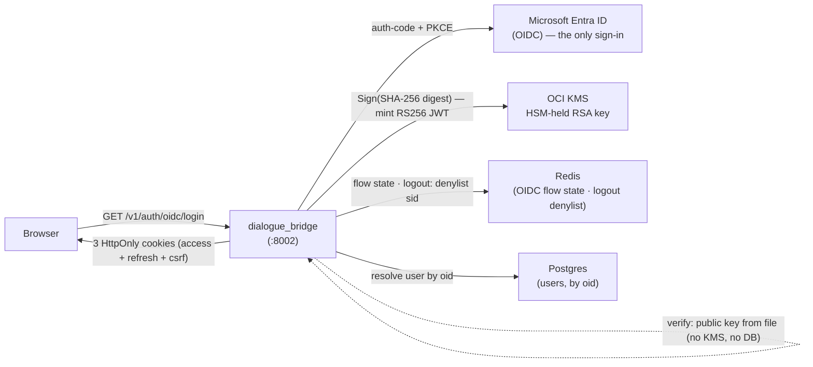
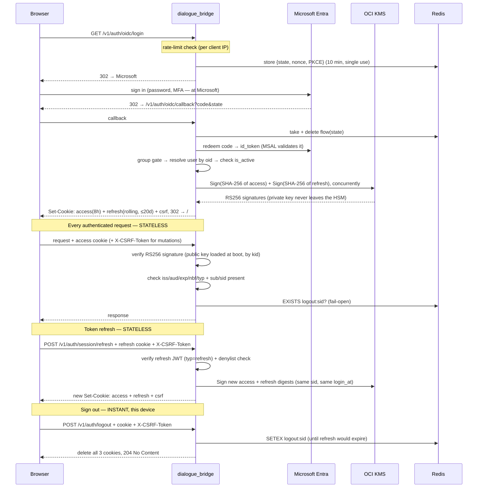
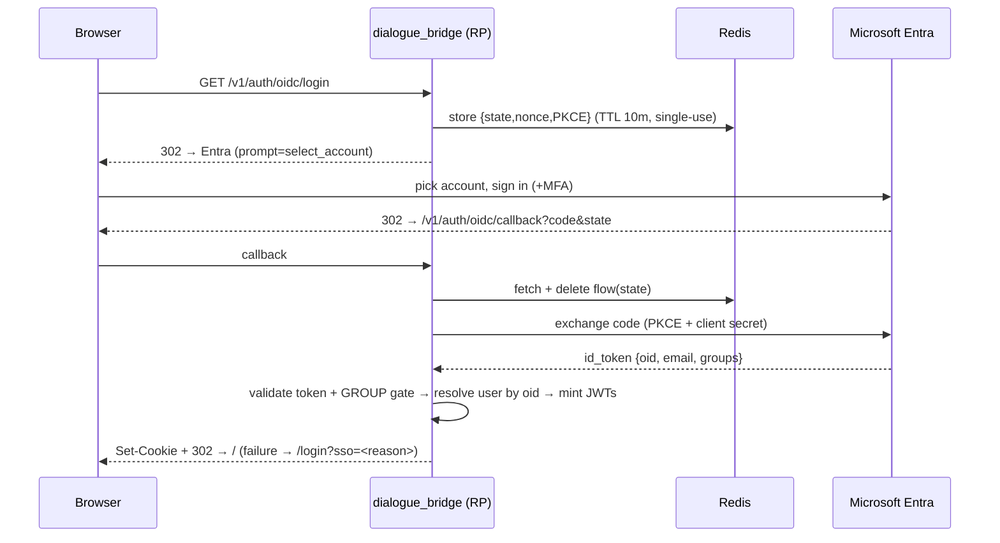
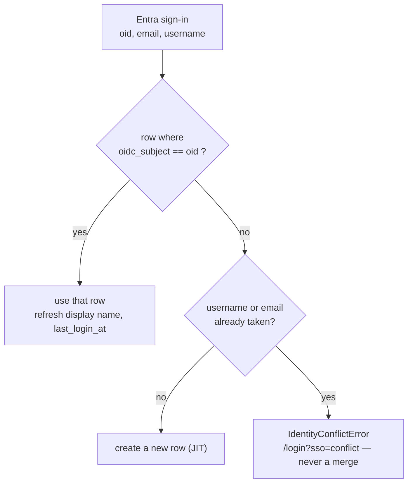
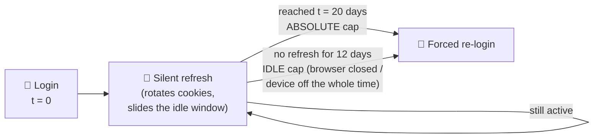
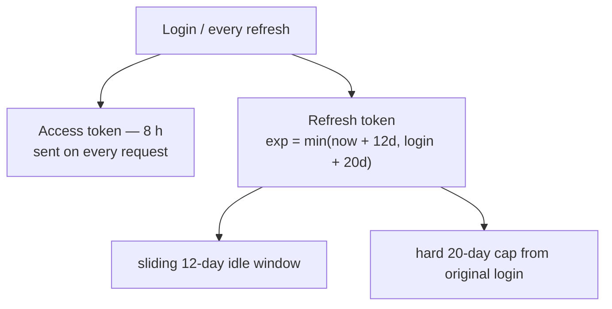
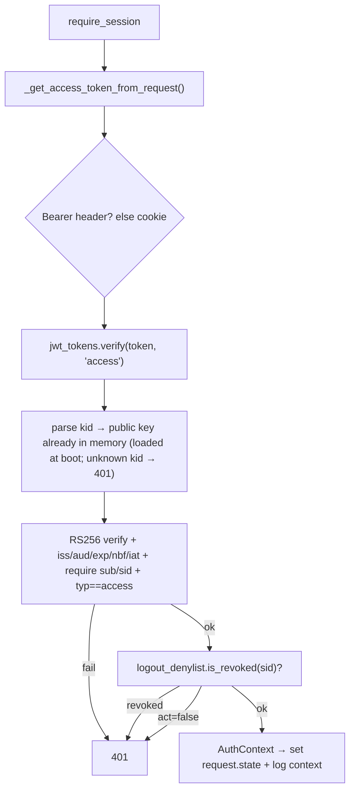
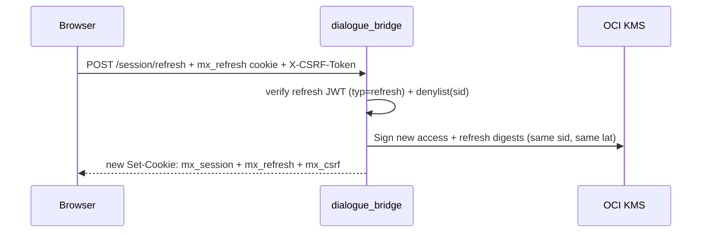
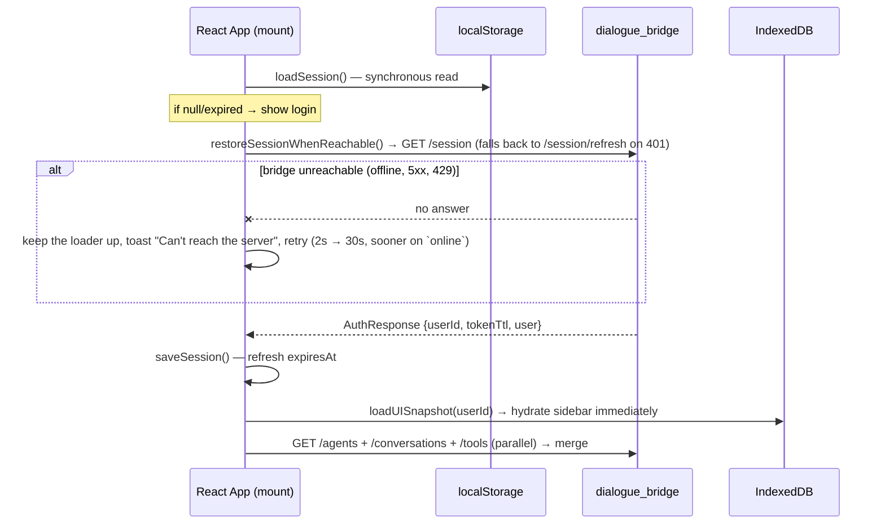
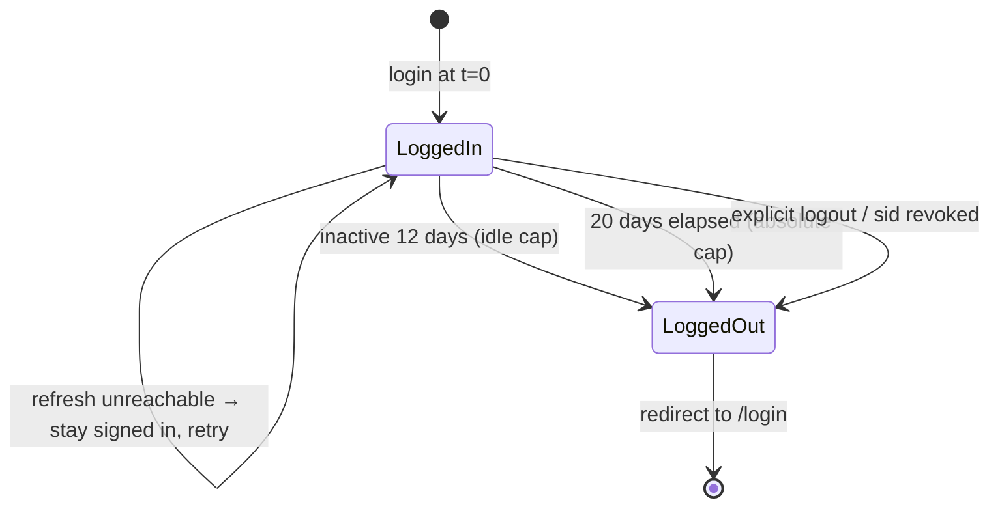

# Authentication Flow

Two different systems prove two different things. **Identity** is proven by **Microsoft Entra ID** — the only way to sign in (Phase 1): the password, MFA and any conditional-access policy all happen at Microsoft, never on our platform. **Session tokens** are signed by an **HSM-protected RSA key in OCI KMS** — the private key never leaves the HSM, and the bridge sends only a SHA-256 digest to be signed (Phase 3). The dialogue bridge is a thin **token issuer**: once Entra has proven who the user is, it mints a short-lived access JWT and a longer-lived refresh JWT and hands them to the browser as HttpOnly cookies.

Until plan 29 the platform also had username/password login through HashiCorp Vault, and Vault signed the session tokens through its Transit engine. Vault seals itself on every reboot, so after any restart nobody could log in until a human unsealed it. Both jobs are gone and so is Vault — see Phase 9.

Sessions are **stateless**. There is no session row in the database; every request is authorised by verifying the JWT signature against a public key **loaded from a file at boot** — no per-request database or KMS call. This is what lets the bridge scale horizontally behind a gateway: any instance on any VM can validate any token on its own. The only shared state is small and Redis-backed: a **logout denylist** that makes sign-out (and a stolen-token replay) take effect instantly, and a per-user **revoke-all watermark** behind "log out of all devices". Both are empty in the normal case and both fail open on the request hot path.

> **Why the two are independent:** the *app* only ever verifies "a bridge-issued JWT". That is why Entra could be added without touching a verifier, and why the signer could move from Vault Transit to KMS without changing the token format — only where the signature comes from.

---

## Services Involved



---

## Full Sequence



---

## Phase 1 — Microsoft Entra ID Sign-In (the only way in)

The bridge is an OIDC **Relying Party** (authorization-code + PKCE via Microsoft's MSAL library). Entra proves identity; the bridge mints its own session JWTs from that (Phase 3). There is no other login path: `POST /v1/auth/login` no longer exists, and the bridge **refuses to start** unless `ENTRA_TENANT_ID` + `ENTRA_CLIENT_ID` + `ENTRA_CLIENT_SECRET` are all set — with Entra unconfigured the login page would have no way in at all, so a mistyped env var crash-loops the new task and Swarm keeps the old one.



`GET /v1/auth/oidc/login` is rate-limited per resolved client IP via `fastapi-redis-sdk` (`AUTH_RATE_LIMIT_MAX_ATTEMPTS` / `AUTH_RATE_LIMIT_WINDOW_SECONDS`, Redis-counted); a `429` carries `Retry-After` + `X-RateLimit-*` headers. It bounds redirect-flow abuse — password brute force is no longer ours to throttle, because Entra owns the credential.

`GET /v1/auth/config` still answers `{"oidcEnabled": true}`. The current login page never asks; it exists so a browser still running the SPA from before this change — a tab left open across the deploy — keeps rendering the Microsoft button.

**Refusals** redirect to `/login?sso=<reason>` with no cookies set: `failed` (unknown/replayed state, token exchange error), `denied` (group gate), `conflict` (Phase 2), `disabled` (`is_active=false`).

**A refused "add another account" keeps its context: `/login?sso=<reason>&add=1`.** The callback reads the add-account intent (`consume_park_intent`) *before* validating the sign-in, so a refusal can carry it. Without `add=1` the login page is not in add mode, finds the first account's session still valid, restores it and reloads into the app — which wiped the error toast within a few hundred milliseconds, so a refused second account looked like "add account" silently did nothing. The login page strips only `sso` from the URL after showing the message (never `add`), and add mode shows a **Cancel — back to my workspace** link, because the user is still signed in there and must never be stranded on the login screen.

### Group gate

`ENTRA_ALLOWED_GROUP_IDS` (comma-separated group Object IDs) restricts who may sign in. The callback requires the id_token `groups` claim to intersect the allowed set, **fail closed**; a groups "overage" (too many groups for Entra to inline) is denied. With no password fallback any more, an overage is a lockout for that user — use a small dedicated security group, or App Roles. Empty = no restriction.

### Security notes

Real authorization-code + **PKCE**; `state`/`nonce`/PKCE held single-use in Redis (10-min TTL) as CSRF/replay defense; full id_token validation (signature vs Entra JWKS, `iss`/`aud`/`nonce`/`exp`) by MSAL. **Entra's own tokens are never stored** — the id_token authenticates once and is discarded; only the bridge's session JWT persists. The client secret is a file-backed `SecretStr` (`magenticx_entra_client_secret`) and **expires** — its date belongs in `docs/architecture/secrets.md`, because an expired secret is now a full login outage. MSAL is synchronous, so all of its network calls run via `asyncio.to_thread`. The bridge needs outbound HTTPS to the Microsoft identity platform.

**Local development** signs in with the same Entra app: its redirect URI list includes `http://localhost:8050/api/v1/auth/oidc/callback` (Entra allows `http://localhost` without TLS), and the `ENTRA_*` values live in `magenticx/.env`. There is deliberately no dev bypass — a flag whose only purpose is to skip authentication eventually gets set in production.

---

## Phase 2 — Resolving the User by `oid`

`upsert_user_from_identity` resolves the `users` row by the Entra **`oid`** (`oidc_subject`) and nothing else:



**Email is never a lookup key.** Microsoft's guidance is to identify a user by `oid` (scoped by tenant), because `email` and `preferred_username` are mutable and not guaranteed unique — merging accounts on them is the class of flaw publicly disclosed as "nOAuth" in 2023. So a first-time sign-in whose email already belongs to another row is **refused**, not attached to it; an administrator resolves it by setting that row's `oidc_subject` deliberately. A username collision is refused the same way (the check runs before the insert, with the unique constraint as a backstop, so it is a clean redirect and never a 500).

A missing email on an existing row is backfilled from Entra only if no other row holds it. The bridge then enforces `user.is_active` — a locally disabled user is refused (`?sso=disabled`) even though Microsoft authenticated them — and updates `last_login_at`.

`vault_user_id` still exists on `users` but nothing reads it: it is the record of which row belonged to which pre-plan-29 Vault account (Phase 9).

**The name the app shows is the user's to change.** Every sign-in rewrites `display_name` from the token's `name` claim, so a name chosen in **Edit profile** is kept in its own column, `preferred_name` (migration `0036`), which a sign-in never touches. The profile's `displayName` is `preferred_name` when set, else `display_name` (`UserTable.shown_name`); it also feeds the account switcher. `PATCH /v1/account/{user_id}/profile` with `{displayName}` saves it — auth, CSRF, then `profile_update_rate_limit` (20 per hour per user); `null` or blank goes back to Microsoft's name. The name is normalized (whitespace runs collapse), capped at 64 characters, and refused outright if it holds control, zero-width or direction-changing characters, which could make it render as something else next to other names. The value is never logged.

**The photo is the user's upload** — Microsoft's token carries none. `PUT /v1/account/{user_id}/avatar` (multipart `photo`; auth → CSRF → the same rate limit) reads the body in 64 KB chunks and refuses it past `AVATAR_MAX_UPLOAD_BYTES` (5 MB) before decoding; Pillow then accepts only PNG, JPEG or WebP **by content**, refuses a header claiming more than `AVATAR_MAX_PIXELS` (a decompression bomb), applies the EXIF orientation, crops a square and re-encodes a 256 px WebP into `user_avatars` (off the event loop). Nothing the user did not see survives: no EXIF, ICC or XMP, no polyglot payload. `DELETE` removes it. `GET` serves it only to its owner and to the accounts parked on the same browser (the switcher shows them) — anyone else gets 404, so the endpoint never reveals whether a photo exists — with `nosniff`, `Content-Security-Policy: default-src 'none'; sandbox` and `Cache-Control: private, immutable`. The profile carries `avatarUpdatedAt`; the UI builds `avatarUrl` from it at the edge (`avatarPathFor`, versioned `?v=`), so every avatar on screen picks up a new photo at once. Username, email, department and role stay read-only: they come from Microsoft.

---

## Phase 3 — Token Minting (KMS-signed JWTs)

Instead of creating a database session, the bridge mints two JWTs via `mint_tokens()`. Both are **RS256**, signed through `core/auth/signing.py`.

### Who signs: OCI KMS in production, a file key in local dev

| Backend | Where the private key is | Used by |
| --- | --- | --- |
| `kms` (default) | an **HSM** in OCI KMS — never exported, never in bridge memory | Dennis |
| `file` | a PEM file mounted into the container | local development only |

**KMS.** The bridge builds the JWT signing input — `base64url(header) + "." + base64url(payload)` — hashes it with SHA-256 **locally**, and sends only the 32-byte digest:

```text
KmsCryptoClient.sign(SignDataDetails(
    message            = base64(sha256(signing_input)),
    message_type       = "DIGEST",                   # claims never leave our infrastructure
    signing_algorithm  = "SHA_256_RSA_PKCS1_V1_5",    # == RS256; a PSS variant would be PS256 and fail verify()
    key_id             = OCI_KMS_KEY_ID,
    key_version_id     = <the version mapped to the active kid>))
```

The SDK is synchronous, so the call runs in a worker thread (as MSAL does for Entra) with explicit connect/read timeouts (`OCI_KMS_CONNECT_TIMEOUT_SECONDS` / `OCI_KMS_READ_TIMEOUT_SECONDS`) and **no retries** — a login fails fast rather than stalling through a backoff. Access and refresh are signed concurrently.

The bridge authenticates to KMS with the API key of a dedicated OCI principal whose **only** permission is `use keys` on the one signing key, **and only from Dennis** (an IAM network-source condition). KMS is a public endpoint, so that condition is what makes a leaked API key useless elsewhere — it is load-bearing, not optional (see plan 29 §5.4).

**File (local dev).** A laptop cannot reach KMS and must never hold the production API key, so local dev signs with a key from `SESSION_SIGNING_PRIVATE_KEY_FILE`. It is refused three ways outside development: the default backend is `kms`; settings refuse `file` unless `APP_ENV` is `development`/`test` (Dennis sets `APP_ENV=production`); and `test_dennis_signs_with_kms_and_never_the_file_backend` fails CI if the Dennis compose ever selects it.

### Every signature is checked before it is issued

Whatever the backend returns, the keyring verifies it against the **pinned public key** for the active `kid` before the token leaves the process. A wrong KMS key version, a swapped `.pem`, or any other mismatch becomes a clean signing error at login — never a token that every later request would reject.

**Signing fails closed.** A KMS error of any kind — refused, unreachable, timed out, malformed response — raises `SigningError` → `TokenError`, and no token is issued. There is no fallback signer.

### Keys, `kid`s, and rotation

The JWT header `kid` is a small integer. `SESSION_SIGNING_KEYS` maps each signing `kid` to a KMS key version (`100:ocid1.keyversion…`); `SESSION_SIGNING_ACTIVE_KID` names the one new tokens use. KMS kids start at **100**, so they are distinguishable at a glance from Vault Transit's `1, 2, …`.

Every `kid` the bridge accepts — each listed KMS version, plus any **verify-only** kid in `SESSION_SIGNING_LEGACY_KIDS` — needs its public key at `<SESSION_SIGNING_PUBLIC_KEYS_DIR>/<kid>.pem`. They are plain files (a public key is not a secret), bind-mounted on Dennis from `/opt/magenticx/dialogue_bridge/signing_keys/`, and parsed at boot: a missing, malformed or sub-2048-bit key **refuses to start** the container, so Swarm keeps the healthy old task.

**Rotation:** create a new KMS key version, export its public key as `101.pem`, add `101:<version ocid>` to `SESSION_SIGNING_KEYS`, set `SESSION_SIGNING_ACTIVE_KID=101`, deploy. Tokens with `kid 100` keep verifying; after **20 days** (`JWT_REFRESH_ABSOLUTE_TTL_SECONDS`) none can still be valid, and `100` is removed.

**The move off Vault Transit was a rotation.** The Transit public key was exported once, while Vault was still unsealed, and loaded as verify-only `kid 1` (`SESSION_SIGNING_LEGACY_KIDS=1`). Sessions minted by Vault before the cutover kept verifying — and refreshing, into KMS-signed `kid 100` tokens — so **nobody was logged out**. `1.pem` and the legacy setting were removed on 2026-10-10: every refresh re-signs with the active kid, so a `kid 1` token had to go unrefreshed since the cutover, and the 12-day idle limit had expired the last one by 2026-10-09.

### Token model

| Token | TTL (default) | Claims |
| --- | --- | --- |
| **access** | 8 h (`JWT_ACCESS_TTL_SECONDS`) | `sub` (user id), `sid` (login/session id), `typ="access"`, `act` (is_active), `lat` (login time), `iss`, `aud`, `iat`, `nbf`, `exp`, `jti`; `pdl` while the account awaits deletion |
| **refresh** | **rolling** — `exp = min(now + IDLE, lat + ABSOLUTE)`; defaults **12 d idle** (`JWT_REFRESH_IDLE_TTL_SECONDS`) / **20 d absolute** (`JWT_REFRESH_ABSOLUTE_TTL_SECONDS`) | `sub`, `sid`, `typ="refresh"`, `lat` (login time), `iss`, `aud`, `iat`, `nbf`, `exp`, `jti`; `pdl` while the account awaits deletion |

`sid` is a per-login id shared by both tokens (and stable across refresh) — the key the logout denylist and refresh-reuse detection use. The refresh window is **rolling**: each refresh slides `exp` forward by the idle window, but never past `lat + ABSOLUTE`. Net effect — an active user stays signed in up to the absolute cap; being idle longer than the idle window logs them out; the absolute cap forces a periodic full re-auth regardless of activity. The per-refresh `jti` is what makes rotation + reuse detection possible (Phase 6).

**Product target — "stay signed in for 20 days":** with the current defaults a logged-in user is kept signed in silently for up to **20 days** (absolute cap), after which they must re-authenticate. Going **12 days** without the client managing a single refresh (browser closed / device off the whole time) expires the refresh token early. The frontend refreshes both proactively (before the access token expires) and reactively (on any `401`), so an active session slides toward the 20-day cap without ever showing the login screen. Because the access token trails the refresh cap by at most one access TTL, the effective hard logout lands at 20 days + ≤ 8 h in the edge case of a session held open right at the boundary.



Two tokens, two jobs — the short access token is presented on every request; the long refresh token silently buys a new pair, its expiry re-derived on each refresh:



### Cookies

`issue_session_cookies()` sets three cookies (unchanged transport from the previous design):

| Cookie | HttpOnly | Expiry | Purpose |
| --- | --- | --- | --- |
| `mx_session` (or `__Host-mx_session`) | Yes | access TTL (8 h) | access JWT |
| `mx_refresh` (or `__Host-mx_refresh`) | Yes | rolling refresh TTL (≤ absolute cap, 20 d) | refresh JWT |
| `mx_csrf` (or `__Host-mx_csrf`) | **No** | rolling refresh TTL | CSRF double-submit value |
| `mx_device` (or `__Host-mx_device`) | Yes | absolute refresh TTL (20 d) | opaque id indexing this browser's *parked* sessions — only issued when multi-account is enabled (Phase 10) |

`__Host-` prefixing applies when `SESSION_COOKIE_SECURE=true` and no `SESSION_COOKIE_DOMAIN` is set. The access JWT lives in an HttpOnly cookie — JavaScript cannot read it (XSS-safe), and it is still verified with **zero** server state.

---

## Phase 4 — Per-Request Verification (stateless)

Every protected endpoint depends on `require_session`. There is **no database lookup and no KMS call** on this path.



`verify()` fails closed: the algorithm allow-list is **`RS256` only** (rejecting `alg:none` and HS/RS confusion), `iss`/`aud`/`exp`/`iat`/`nbf`/`sub` are required, and the `typ` claim must match — so an access token cannot be replayed at the refresh endpoint, or vice versa. Every accepted public key is loaded from a file when the keyring is built, so verification never makes a network call of any kind — a KMS outage cannot affect it. A `kid` the bridge was not configured with is rejected as "not recognised".

`require_current_user` returns a lightweight `AuthUser(id, is_active)` built **from the claims** (no DB) — and refuses a session carrying `pdl` with 403 (see *Re-authentication and accounts awaiting deletion* below). User-scoped endpoints add `require_bound_user_id`, which checks the `user_id` path parameter equals the token's `sub`. The two auth endpoints that return the full profile (`GET /session`, refresh) load the `UserTable` row from Postgres explicitly — that is the only place a user row is read on the auth path.

---

## Phase 5 — CSRF Protection

Unchanged. `require_csrf_protection` runs on every state-mutating endpoint: it compares the `X-CSRF-Token` header against the `mx_csrf` cookie with `secrets.compare_digest` (constant-time). It is skipped for safe methods and for Bearer-only clients (which cannot be targeted by browser CSRF). Because the access JWT rides in a cookie, CSRF protection is still required.

---

## Phase 6 — Token Refresh (stateless)

Access tokens expire after 8 hours. The browser calls `POST /v1/auth/session/refresh` with the refresh cookie (CSRF-protected). `require_refresh_session` verifies the refresh JWT (`typ=refresh`) and checks the denylist.

**Refresh-token rotation + reuse detection.** Every refresh rotates the refresh token (fresh `jti`); the `RefreshTokenGuard` tracks the single currently-valid `jti` per `sid` in Redis. On refresh the presented `jti` is classified: the current one — or the just-rotated-from one inside a short grace window that tolerates a legitimate concurrent/retried refresh — is **ok**; an older, already-rotated `jti` replayed past the grace is **reuse** (a stolen refresh token replayed after the real client already rotated). Reuse **revokes the whole session** (denylist the `sid`) so neither the attacker's nor the victim's copy survives — both must re-authenticate. The guard **fails open** on a Redis error (degrades to no reuse detection, never a lockout), consistent with the logout denylist.

`rotate_session()` mints a **new** access + refresh pair through the signing keyring (KMS on Dennis), preserving the original `sid` and `lat` (so the denylist still covers the session and the absolute cap is measured from the original login) while the refresh `exp` slides forward by the idle window. The new `jti` is then registered as current and the old one graced. No database row is written.



---

## Phase 7 — Sign Out (instant, per device)

`POST /v1/auth/logout` is CSRF-protected. Logout works in two layers:

1. **Cookie clear** — `clear_session_cookies()` deletes all three cookies, so that device immediately has no token. This alone logs the device out, with **zero server state**.
2. **Denylist (theft defense)** — `revoke_current_session()` reads the caller's token, extracts its `sid`, and writes it to the Redis denylist for the full refresh lifetime. This kills any **copy** of the token (e.g. one exfiltrated before logout) instantly, on every VM.

Logout always succeeds from the browser's perspective even if no valid token is present or Redis is unavailable (the denylist write is best-effort).

`revoke_current_session()` returns `(sid, user_id)` — the id comes from whichever token verified, **not** from a fresh `require_session`, because a logout commonly arrives with an already-expired access token. With multi-account enabled that identity is used to drop the account from the browser's parked index, so a signed-out account is never left listed as something to switch back into.

---

## Phase 8 — Client-Side Storage and Page Load Hydration

The browser keeps two stores so the UI rehydrates instantly. **Neither holds any token** — tokens live only in the HttpOnly cookies.

### localStorage — `mx_auth_session`

`saveSession()` writes one JSON key after login/refresh:

| Field | Source | Purpose |
| --- | --- | --- |
| `userId` | `AuthResponse.user_id` | IndexedDB key |
| `expiresAt` | `Date.now() + tokenTtl * 1000` | drives the auto-refresh timer (tokenTtl is the access TTL, ~8 h) |
| `user` | `AuthResponse.user` | profile display without a network call |
| `lastConversationId`, `selectedAgent`, `isPrivateMode` | UI state | deep-link / restore |

`loadSession()` returns `null` if absent or expired; `clearSession()` removes it; `updateSession()` is a read-merge-write.

### IndexedDB — `mx_ui_state`

A single `state` store keyed by `userId` holding a `UISnapshotSerializable` (agents, conversations, available tools, preferences, UI toggles). Icon components are stripped before storage and re-resolved on load. Bump the snapshot `version` and add a migration branch when the shape changes.

### Page Load Hydration



`restoreSession()` resolves `null` (→ login screen) **only when the bridge answers** that there is no session: a `401` on `GET /session`, then a `401`/`403` on the refresh. Anything else — a network error, a `5xx`, a `429` — throws, and `restoreSessionWhenReachable()` retries it. The page-load path and the login page's own restore both use the retrying form, because both often run at the worst moment: a tab restored at browser start, or the login page reached right after waking from sleep, fires before the network is back. The login page aborts its retries on unmount.

### Auto-Refresh Scheduling

Silent refresh has **two triggers**, both routed through the single `ensureFreshSession()` primitive ([shared/lib/sessionRefresh.ts](../../magenticx/agentic_ui/src/shared/lib/sessionRefresh.ts)):

1. **Proactive (timer).** `useSessionAutoRefreshEffect` schedules a `setTimeout` to fire **10 minutes** before `expiresAt` (a 2-minute margin is too thin on an 8-hour token). Because browsers throttle/suspend timers in a backgrounded tab (and a slept device pauses them), the hook also re-evaluates on **`visibilitychange`/`focus`**: via the same scheduler it refreshes immediately if the access token already expired or is about to, otherwise re-arms the drifted timer.

   ```mermaid
   sequenceDiagram
       participant T as Timer (useSessionAutoRefreshEffect)
       participant R as ensureFreshSession
       participant L as Web Lock "mx-session-refresh"
       participant B as Bridge

       Note over T: fires ~10 min before access expiry<br/>also on visibilitychange / focus
       T->>R: ensureFreshSession()
       R->>L: acquire cross-tab lock
       alt another tab already refreshed
           L-->>R: got lock, marker still fresh
           R-->>T: already-fresh → skip network, re-arm
       else this tab does the refresh
           R->>B: POST /session/refresh
           B-->>R: rotate cookies + new tokenTtl
           R-->>T: refreshed → re-arm timer
       end
   ```

2. **Reactive (401 interceptor).** Every API call goes through `requestRaw` ([shared/lib/http.ts](../../magenticx/agentic_ui/src/shared/lib/http.ts)); a `401` triggers **one** silent refresh and **one** retry of the original request (rebuilt so it picks up the rotated CSRF cookie) before the app gives up. The inference **WebSocket** mirrors this: a `4401` close refreshes once and reconnects with the fresh cookie. This is what stops a stale access token — after device sleep, or a request racing the expiry — from bouncing an otherwise-valid session to the login screen. Only when the bridge **refuses** the refresh (idle > 12 d, absolute > 20 d, the `sid` was revoked, or the CSRF check failed) does the app emit `mx:unauthorized` and return to login.

   ```mermaid
   sequenceDiagram
       participant C as Component (API call)
       participant H as http.ts (requestRaw)
       participant R as ensureFreshSession
       participant B as Bridge

       C->>H: GET /conversations
       H->>B: request (access cookie expired)
       B-->>H: 401
       H->>R: ensureFreshSession()
       R->>B: POST /session/refresh (refresh + CSRF cookie)
       alt refresh token still valid (<12d idle, <20d abs)
           B-->>R: 200 — rotate access/refresh/csrf
           R-->>H: refreshed
           H->>B: RETRY GET /conversations (fresh cookie)
           B-->>H: 200
           H-->>C: data — user noticed nothing
       else bridge unreachable (network error, 5xx, 429)
           R-->>H: unavailable
           H-->>C: ApiError(status 0) — this request fails, NO logout
       else refresh token dead / revoked
           B-->>R: 401
           R-->>H: failed
           H->>H: emitUnauthorized()
           H-->>C: logout + "Session expired" → /login
       end
   ```

   The inference WebSocket applies the same repair to a `4401` close — refresh once, then reconnect:

   ```mermaid
   sequenceDiagram
       participant W as Inference WS loop
       participant B as Bridge
       participant R as ensureFreshSession

       W->>B: connect (access cookie stale)
       B-->>W: close 4401
       alt first 4401 → try refresh
           W->>R: ensureFreshSession(force)
           R-->>W: refreshed
           W->>B: reconnect with fresh cookie
       else refresh unavailable
           W->>W: back off like a dropped socket; the refresh attempt is kept for later
       else refresh refused, or a 2nd 4401
           W->>W: emitUnauthorized() → logout
       end
   ```

`ensureFreshSession()` calls `POST /v1/auth/session/refresh` (on success the server rotates all three cookies and returns a fresh `tokenTtl`, re-arming the proactive timer). It is **single-flight** on two levels: an in-process promise singleton dedupes a burst of concurrent `401`s within a tab, and the **cross-tab Web Locks** lock (`mx-session-refresh`) ensures only one tab across the origin performs the network refresh while the rest pick up the rotated token from the shared session marker — so tabs never rotate the refresh token concurrently (which would otherwise trip server-side reuse detection). The auth endpoints themselves (`login`, `session/refresh`, `GET /session`) opt out of the interceptor via `skipAuthRetry` so a failed refresh can never recurse.

#### A refresh with no answer is not a logout

`ensureFreshSession()` has two failure results, and they must never be confused:

| Result | Means | What the app does |
| --- | --- | --- |
| `failed` | The bridge **answered** and refused: `401` (refresh token missing, expired or revoked) or `403` (CSRF double-submit failed) | The session is over — log out, back to `/login` |
| `unavailable` | **No usable answer**: a network error (offline, a laptop still re-joining Wi-Fi after sleep, Docker Desktop's port forward not back yet), a `5xx`/`502` while the bridge restarts, or a `429` | Stay signed in and retry. The proactive timer retries with backoff (2 s → 5 s → 15 s → 30 s, capped, never exhausted) and **immediately** on `online` or tab focus; it skips the timer while `navigator.onLine` is `false` and waits for `online`. The 401 interceptor fails only the one request with `ApiError(status 0)` — deliberately not `401`, which means "signed out" to `toastError` and every caller |

These used to be one result. Waking a laptop after more than 8 h made the tab visible a few seconds before the network came back; the refresh fetch rejected, the app treated it as a refused refresh token, and cleared the local session — while the refresh cookie on the server was still valid, so a page reload signed the user straight back in.

These three end-states — and only these — return the user to login; every transient access-token expiry in between is repaired silently:



### Logout Cleanup

`handleLogout()` clears `mx_auth_session`, deletes the per-`userId` IndexedDB snapshot, fires `logoutSession()` (`POST /v1/auth/logout`) fire-and-forget, and resets React state to `/login`.

---

## Phase 9 — How Password Login and Vault Were Retired (plan 29)

Until plan 29, username/password login ran alongside Entra: the bridge checked the password against HashiCorp Vault's userpass backend, and Vault's Transit engine signed every session token. Vault seals on every reboot, so a restart locked everyone out until someone unsealed it by hand. Both jobs were removed, and the Vault stack with them.

**Accounts were linked before the password path was removed.** The release that still had both doors resolved a login by provider subject *or* by normalized email, so a Vault-era row picked up its `oidc_subject` the first time its owner signed in with Microsoft (`auth_providers` then reads `entra,vault`). Plan 29 Phase A0 checked every active row's email against Entra, and Phase A1 had every user sign in with Microsoft once, until no active row lacked an `oidc_subject`. Only then did the release that resolves by `oid` alone ship — which is why its lack of an email match strands no one.

**Sessions survived the signer change.** The Vault Transit public key was exported while Vault was still unsealed and loaded verify-only as `kid 1` (Phase 3), so tokens Vault had signed kept verifying — and refreshing into KMS-signed `kid 100` tokens — until they aged out; `kid 1` was removed on 2026-10-10.

What remains of the old model: the `users.vault_user_id` column (unread, kept for diagnosis — dropping it is a destructive migration for no gain) Nothing else — the legacy `kid 1` key was removed on 2026-10-10.

---

## Phase 10 — Multiple accounts per browser (opt-in)

Off by default (`MULTI_ACCOUNT_ENABLED=false`); every endpoint below 404s while it is
disabled, so a deployment that does not want it cannot even probe it.

One browser can be signed in to several accounts while **exactly one is active per
request**. That invariant is the whole design: every authorization check, rate
limiter and audit line downstream keeps interpreting a request the same way, and
nothing anywhere has to ask "which of the caller's identities is this for?".

### Why parked sessions are server-side

The session cookies carry the `__Host-` prefix, which forces `Path=/`. Extra
accounts therefore cannot be parked in a cookie scoped to just the switch
endpoint: every parked JWT (~1 KB) would ride on every request, and the 4 KB
per-cookie ceiling caps a token map at about three accounts. So the active
account keeps using the normal cookies unchanged, and the dormant ones live in
Redis, indexed by the small opaque `mx_device` cookie:

```text
auth:parked:<device_id>  ->  hash { user_id: <AES-GCM sealed refresh token> }   TTL = refresh idle TTL
```

Two properties make that acceptable for a credential store:

* **Encrypted at rest** with `PARKED_TOKEN_KEY`, and the `(device_id, user_id)`
  pair is bound in as additional authenticated data — so a sealed blob cannot be
  replayed under a different device or user even by someone who can write Redis.
  Boot **fails closed** if the feature is on without the key.
* **Nothing identifying is stored** beside the token. Display names and emails for
  the switcher come from Postgres at request time, so a Redis dump does not also
  leak a roster of who is signed in on which browser.

### Endpoints

| Method | Path | Notes |
| --- | --- | --- |
| GET | `/v1/auth/accounts` | Active account + parked ones. **Never returns a token.** |
| POST | `/v1/auth/accounts/switch` | Promote a parked account; rate-limited; audited |
| POST | `/v1/auth/accounts/logout-all` | Sign out of every account on this browser |
| GET | `/v1/auth/oidc/login?park=true` | "Add another account" — a second Microsoft sign-in. The intent is stored against the flow's single-use `state` (the callback is a fresh GET from Microsoft and carries none of our query) and read back by `consume_park_intent`, which parks the outgoing session instead of replacing it |

**Three factors are required to switch**: a valid *active* session, the device
cookie, **and** a CSRF token. The device cookie alone must never suffice — that
would turn one stolen cookie into every parked account. `GET /accounts` carries
the same requirement, so the roster cannot be enumerated with a stolen device
cookie either. Neither route sits on `auth_rate_limit`: that is the per-IP
*credential* bucket protecting login and refresh, and an authenticated read
sharing it lets any chatty client starve sign-in.

### The switch

1. `take()` the parked refresh token — deleted as it is read, so it is single-use.
2. Verify it through the same `verify_token` + denylist path as a cookie-borne
   refresh, so a session revoked elsewhere cannot be promoted back.
3. Mint a fresh pair for the incoming account, preserving its `sid` so the
   denylist and the absolute refresh cap still apply to the original login.
4. Rotate the **outgoing** account's refresh token and park that.
5. Replace every cookie in one response.

Both directions rotate, which is why `RefreshTokenGuard` is not a problem here: a
parked token is never rotated *while* parked, so it stays the current `jti`; and
because each switch rotates it, a captured parked token is single-use and its
replay trips the reuse detector.

### Client side

The switch is driven by a **full-screen blocking interstitial** that is
load-bearing, not decoration: rendering it unmounts the entire workspace tree, so
nothing is left alive to receive a late response from the account being left and
paint it under the new identity. The sequence is: show interstitial → leave the
conversation route → `resetForAccountSwitch()` (blank every per-user store slice)
→ `POST /accounts/switch` → re-run the **same** post-login bootstrap → hide.

Two client-side rules that are easy to get wrong, and were:

* **The bootstrap only replaces what it fetches.** Archived and shared
  conversation lists, `selectedAgent`, starter suggestions, private mode and the
  pagination cursors are *not* fetched by it, so without `resetForAccountSwitch()`
  they survive a switch and are shown under the new identity.
* **"Add another account" ends in a hard reload**, not a router navigation. The
  workspace store is module-level, so a client-side navigate arrives at `/` still
  holding the previous account's `userId` — and every request keyed on that stale
  id is rejected as *"Token does not grant access to this user"*.

**Mobile renders the account menus inline, not as flyouts.** On desktop the
switcher and the per-account "Log out" are side submenus. A side submenu needs
room beside its parent, and on a phone there is none on either side — Radix only
shifts a side submenu up or down, never inward — so they hung off the screen. On
mobile (`useSidebar().isMobile`) the **profile header row is the switcher**:
tapping it expands the other accounts plus "Add another account" in place
(`AccountMenuItems`, real `DropdownMenu.Item`s) with the chevron turned down;
tapping again collapses it, and it always starts collapsed. The per-account
logout choices render inline under a "Log out" label. The menu content is capped
at the available height and scrolls, so a longer list cannot run off a short
screen. Help already rendered inline on mobile for the same reason.

### Logout semantics

Unchanged: logout always ends the **active** session and drops it from the parked
index. To sign out of a specific account, switch to it and then log out.
"Log out of all accounts" exists separately so a shared machine is not left
holding dormant logins.

### Known gaps

* **"Log out of all accounts" has no UI yet** — the endpoint is implemented and
  tested, but nothing calls it.
* **CSRF enforcement is tested by opting back in.** The suite overrides
  `require_csrf_protection` app-wide, so `test_multi_account.py`'s `real_csrf`
  fixture removes that override to prove a missing or mismatched token is refused
  on the switch/logout routes — and that a matching one gets through.

---

## Sharp Edges and Behavioral Notes

- **KMS is needed to MINT a token, not to verify one.** Login and refresh call KMS. Verification uses public keys loaded at boot — if KMS is unreachable, existing sessions keep working for the rest of their access-token lifetime (≤ 8 h), while new logins and refreshes fail closed. The bridge still boots while KMS is down: building the keyring reads files only.

- **Microsoft is a hard dependency of *signing in*, not of *being signed in*.** If Entra is unreachable, nobody can start a new session, but existing sessions keep working and refreshing — refresh never talks to Microsoft. The Entra client secret and the OCI signing API key both expire on a calendar date; either lapsing is a full new-login outage, so both dates are recorded in `docs/architecture/secrets.md`.

- **No database session state.** There is no `sessions` table lookup on any request, which is what makes the bridge horizontally scalable behind a gateway — any instance validates any token on its own. Moving a user between VMs never logs them out.

- **Instant logout requires shared state, by design.** A stateless token cannot be "un-issued", so per-device logout clears the cookie (zero state) and, for theft defense, denylists the `sid` in Redis. The denylist is checked per request (one O(1) `EXISTS`), **fails open** (Redis down → request still served on a valid signature; a *new* logout just isn't enforced until Redis recovers), and is empty in the common case.

- **`SHA_256_RSA_PKCS1_V1_5` is load-bearing.** RS256 *is* PKCS#1 v1.5. Any PSS algorithm would produce PS256 tokens that fail `algorithms=["RS256"]` verification — and the keyring's self-check would refuse to issue them.

- **The OCI network-source condition is load-bearing.** Vault was reachable only on an internal overlay; KMS is a public endpoint. Without the IAM network source restricting `use keys` to Dennis, a leaked signing API key would work from anywhere. Plan 29 Phase B0 proves it by requiring a Sign call from outside Dennis to be refused.

- **`APP_ENV=production` must be set on Dennis.** `APP_ENV` defaults to `development`, and the production-only boot checks — including refusing the dev file signer — key off it. It went unset in production for a long time, which silently disabled those checks.

- **Refresh-token rotation + reuse detection (Redis-backed).** Each refresh rotates the refresh token and records its `jti` per `sid`; replaying an already-rotated refresh token past a short grace window is treated as theft and **revokes the whole session**. Bounded server state (one key per active session, TTL = the absolute cap), and it **fails open** on a Redis outage — degrading to no reuse detection (the prior posture), never to a lockout. Concurrent refreshes can't false-trip it: the client refreshes **cross-tab single-flight** (Web Locks — only one tab across the origin calls `/session/refresh`; the others see the rotated token in the shared session marker and skip), so two tabs never diverge the tracked `jti`. The server-side grace window is the backstop for the rare browser without Web Locks.

- **`is_active` is read from the claim per request, and from the DB at login/refresh.** Mid-session deactivation therefore takes effect at the next refresh (≤8 h) or via an explicit denylist entry — there is no admin-disable path wired today.

- **`__Host-` prefix is security-critical in production.** Configure `SESSION_COOKIE_SECURE=true` with no `SESSION_COOKIE_DOMAIN`.

- **localStorage is not a security boundary.** It holds profile/navigation data, never tokens. XSS reading it leaks data, not session control (the JWT is HttpOnly).

- **The cookie-consent gate sits in front of the whole router, and its wallpaper `<Login/>` must stay inert.** Until consent is stored, `App.tsx` swaps the route table for a catch-all that renders `Login` behind a blur. That instance is decoration, but the component is not passive: its session-restore effect calls `window.location.assign("/")`. A user holding a valid session cookie but no persisted consent therefore reloaded forever and could never reach the Accept button. `Login` takes a `decorative` prop that disables the navigating effect, the `document.title` takeover, the auth-config fetch, and the query-string rewrite — **any future effect with a side effect must honour it too.** Relatedly, `saveCookieConsent` can fail silently where storage is blocked (Safari ITP, "block all cookies", enterprise policy), so consent is also held in-process for the life of the document.

---

## File Map

| Concept | File | What to look for |
| --- | --- | --- |
| Session signing keys | [magenticx/dialogue_bridge/core/auth/signing.py](../../magenticx/dialogue_bridge/core/auth/signing.py) | `KmsSigner`, `FileSigner`, `Keyring.sign()` (self-check), `build_keyring()`, `get_keyring()` |
| Normalized identity | [magenticx/dialogue_bridge/core/auth/providers.py](../../magenticx/dialogue_bridge/core/auth/providers.py) | `AuthIdentity` |
| JWT mint / verify | [magenticx/dialogue_bridge/core/auth/tokens.py](../../magenticx/dialogue_bridge/core/auth/tokens.py) | `mint_tokens()`, `verify()`, claim model |
| Session deps + cookies | [magenticx/dialogue_bridge/core/auth/session.py](../../magenticx/dialogue_bridge/core/auth/session.py) | `require_session`, `require_current_user`, `require_refresh_session`, `require_csrf_protection`, `issue_session_cookies`, `revoke_current_session` |
| Instant-logout denylist | [magenticx/dialogue_bridge/core/auth/session.py](../../magenticx/dialogue_bridge/core/auth/session.py) | `LogoutDenylist` (fail-open) |
| Auth endpoints | [magenticx/dialogue_bridge/router/auth.py](../../magenticx/dialogue_bridge/router/auth.py) | `session_me`, `refresh_session`, `logout`, `auth_config`, `oidc_login`, `oidc_callback` |
| Entra OIDC flow (MSAL) | [magenticx/dialogue_bridge/core/auth/oidc.py](../../magenticx/dialogue_bridge/core/auth/oidc.py) | `begin_login`, `complete_login`, group gate |
| User resolution | [magenticx/dialogue_bridge/core/database/models.py](../../magenticx/dialogue_bridge/core/database/models.py) | `upsert_user_from_identity` (by `oid` only), `IdentityConflictError` |
| Settings | [magenticx/dialogue_bridge/core/settings.py](../../magenticx/dialogue_bridge/core/settings.py) | `JWTSettings`, `SigningSettings` (KMS / file backend, kids), `EntraSettings` (OIDC — mandatory), the Entra boot guard in `Settings._finalize_secrets` |
| Signing tests | [tests/dialogue_bridge/test_session_signing.py](../../tests/dialogue_bridge/test_session_signing.py) | digest-only, self-check, KMS failures, legacy kid, boot guards, Dennis compose guard |
| Sign-in tests | [tests/dialogue_bridge/test_auth.py](../../tests/dialogue_bridge/test_auth.py) | `/login` gone, Entra boot guard, oid-only resolution, no merge by email, refusals |
| Rate limiting | [magenticx/dialogue_bridge/core/security/rate_limit.py](../../magenticx/dialogue_bridge/core/security/rate_limit.py) | `AUTHENTICATE_LIMIT`, `limiter` |
| localStorage marker | [magenticx/agentic_ui/src/shared/lib/authStorage.ts](../../magenticx/agentic_ui/src/shared/lib/authStorage.ts) | `StoredSession`, `saveSession()`, `loadSession()` |
| Silent-refresh primitive | [magenticx/agentic_ui/src/shared/lib/sessionRefresh.ts](../../magenticx/agentic_ui/src/shared/lib/sessionRefresh.ts) | `ensureFreshSession()` — single-flight + cross-tab refresh, shared by both triggers; `failed` vs `unavailable`; `sessionRetryDelay()` / `waitForSessionRetry()` backoff |
| Session restore (page load, login page) | [magenticx/agentic_ui/src/shared/lib/api/auth.ts](../../magenticx/agentic_ui/src/shared/lib/api/auth.ts) | `restoreSession()` (`null` only on a refusal), `restoreSessionWhenReachable()` (retries until the bridge answers) |
| 401 refresh-and-retry interceptor | [magenticx/agentic_ui/src/shared/lib/http.ts](../../magenticx/agentic_ui/src/shared/lib/http.ts) | `requestRaw` (reactive trigger; `skipAuthRetry` opt-out) |
| Auto-refresh scheduling | [magenticx/agentic_ui/src/features/auth/hooks/useSessionEffects.ts](../../magenticx/agentic_ui/src/features/auth/hooks/useSessionEffects.ts) | `useSessionAutoRefreshEffect` (proactive trigger, 10-min buffer) |
| Login / logout handlers | [magenticx/agentic_ui/src/features/auth/handlers/auth.ts](../../magenticx/agentic_ui/src/features/auth/handlers/auth.ts) | `handleLogin`, `handleLogout` |

---

## Log out of all devices

Per-device sign-out denylists one `sid`. Ending **every** session a user holds
cannot work that way: nothing maps a user to their session ids. `sid` is minted
at login and never recorded against its owner, so there is no set to iterate —
and building one (a Redis set per user, written at login, pruned on expiry) would
be new state existing only to be read on a rare action.

A **watermark** needs no index. Tokens already carry `iat`, so one timestamp per
user answers the question for every token ever issued:

```text
revoke at T   →  users.sessions_revoked_at = T        (durable, chat_db)
              →  auth:revoke_all:user:<sub> = T       (cache, Redis, TTL 20d)

verify        →  iat < watermark  →  401
```

`POST /v1/auth/sessions/revoke-all` writes the column, commits, then publishes
the cache key. **That order is load-bearing:** a crash between the two leaves the
revocation *applied* (the durable row is what the refresh path reads) rather than
silently lost. Reversed, a crash would leave the cache rejecting sessions the
database has no record of — which evaporates on the next Redis flush.

### Two speeds, on purpose

| Path | Frequency | Reads | Redis unavailable |
| --- | --- | --- | --- |
| Access token (`_resolve`) | every request | Redis watermark | **fail open** |
| Refresh (`/v1/auth/refresh`) | ~every 8 h | the `users` row | **fail closed** |

The access path has no database session — `require_current_user` takes only an
`AuthContext`, and authenticating a request is a signature check plus one Redis
lookup. Adding a query there would put Postgres on the hottest path in the
service, so it stays fail-open exactly like the denylist beside it.

The refresh path already loads the user row to check `is_active`, so reading the
durable watermark there is free — and it is what bounds the damage: during a
Redis outage a stolen access token survives **at most its remaining 8 hours** and
can never be renewed past that.

### Sharp edges

- **No leeway on the comparison.** Token verification allows `leeway_seconds` on
  `exp`/`iat` to absorb clock skew. Applying it to the watermark would let a
  token minted moments *before* the revoke survive it — the precise thing the
  button exists to prevent. `is_stale()` is the one place the comparison lives,
  so the two paths cannot drift on this.
- **Strictly `iat < watermark`.** A token minted in the same second as the revoke
  is kept. It has to be: signing straight back in can land in that second, and if
  that token were rejected so would its replacement be — the account would be
  unreachable forever.
- **The current device is included.** "Everywhere" that spared the browser you
  pressed it in is a surprise, and the button is usually pressed because the user
  believes they are compromised.
- **Parked accounts are a second home for a session.** `core/auth/parked.py`
  holds AES-GCM encrypted refresh tokens for multi-account sign-in, and
  `resolve_parked_refresh` checks the watermark too — otherwise the account
  switcher could restore a session that was just ended. The endpoint drops
  **this user's** parked entry on this device; other users parked in the same
  browser are untouched, because the watermark is keyed on the user.
- **`sessions_revoked_at` moves only on an explicit revoke.** If a login wrote
  it, every sign-in would log the user out of every other device.

### Not the same as `/v1/auth/accounts/logout-all`

Two routes, orthogonal scopes, easy to confuse:

| Route | Ends |
| --- | --- |
| `/v1/auth/accounts/logout-all` | every **account** on this **browser** |
| `/v1/auth/sessions/revoke-all` | every **browser** for this **account** |

## Re-authentication and accounts awaiting deletion (plan 32)

Deleting an account ([account-deletion](account-deletion.md)) added two things to the session model.

### A recent sign-in, without a database read

`lat` — the original sign-in time, preserved across every rotation — used to be on the refresh token only. It is now on the access token too, so a sensitive action can require a *recent* sign-in from the session alone. A token minted before the change has no `lat` and counts as too old (fail closed).

To refresh it, the SPA sends the user through `GET /v1/auth/oidc/login?reauth=true`:

| | Ordinary sign-in | Re-authentication |
| --- | --- | --- |
| Needs a session | no | **yes** (401 without one) |
| Entra `prompt` | `select_account` | **`login`** — the credentials are asked for again |
| Flow state in Redis | `auth:oidc:flow:<state>` (+ `auth:oidc:park:` for "add account") | + `auth:oidc:reauth:<state>` = the session's user id |
| Callback | resolves or creates the user by `oid` | the returned `oid` must equal the session user's **before** the user table is touched — a mismatch neither switches nor creates an account |
| Lands on | `ENTRA_POST_LOGIN_REDIRECT` | the same, with `?reauth=done` (or `?reauth=failed&reason=…`, the old session untouched) |

### The `pdl` claim: a frozen session

While an account has an open `account_deletions` row, every session minted for it — at sign-in (`finalize_login`), refresh, and account switch, each reading the row it already has a database session for — carries `pdl: true`. On the hot path nothing new is read:

| Dependency | `pdl` session |
| --- | --- |
| `require_current_user`, `require_bound_user_id`, `validate_userId` | **403** *"Your account is scheduled for deletion."* |
| `require_current_user_even_if_pending`, `require_bound_user_id_even_if_pending`, `validate_userId_even_if_pending` | allowed — used only by the deletion's status and cancel, and the data export |
| `require_session` (`/session`, sign-out, account switching) | allowed — `/session` returns `pendingDeletion` so the SPA shows the pending screen |
| `authenticate_websocket_user` | refused |

Cancelling the deletion does not re-mint the session; the SPA calls `/session/refresh`, which re-reads the row and mints tokens without `pdl`.
