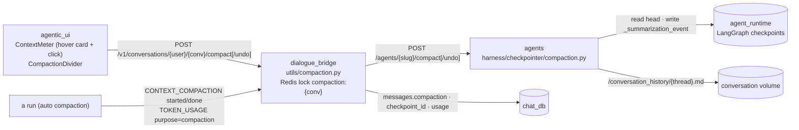
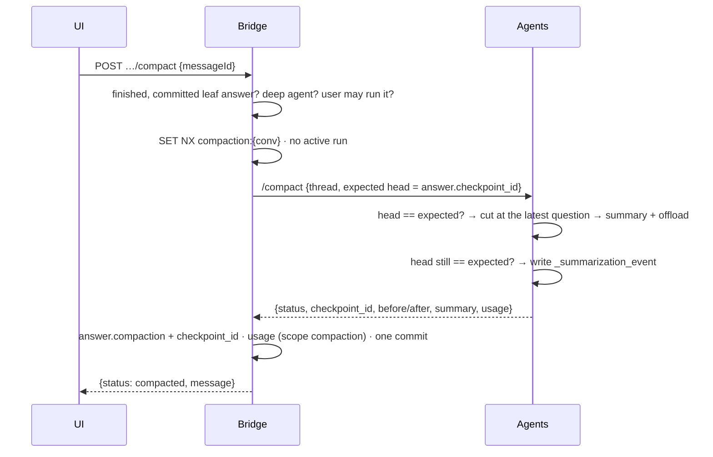

# Context compaction (manual and automatic)

A deep agent keeps the whole conversation in its model's context until the
context is nearly full. Then it **compacts**: it summarizes the older messages,
offloads the full history to `/conversation_history/<thread>.md` (still readable
to the agent), and works from `summary + recent messages`. deepagents stores a
compaction as one private key in the branch's LangGraph checkpoint,
`_summarization_event = {cutoff_index, summary_message, file_path}`.

Plan 34 makes compaction something the user can trigger and see:

- **Manual.** Clicking the composer's context ring compacts the conversation
  now, between turns, after the visible branch's latest answer. Hovering the
  ring opens its card. On touch screens a tap opens the card, and its
  **Compact now** button compacts. The compaction is recorded on that answer
  (`messages.compaction`). A toast offers **Undo** while nothing has been sent
  after it.
- **Automatic.** When the summarizer fires on its own (95% of the window)
  mid-answer, the run streams a new AG-UI event, `CONTEXT_COMPACTION`, and the
  answer's timeline shows the same divider inline.

Both appear as a divider in the chat ("Compacted chat · manual · 81K tokens
freed", over a wavy rule). Its row expands to show the counts and, for a
manual compaction, the summary. The summary call's spend is booked under its
own usage scope, `compaction`.

---

## Services Involved

---

## Phase 1 — Manual compaction

| Key fact | Value / detail |
| --- | --- |
| When | Once the context is past **5%** of the window — the ring's own reading (the last reply's prompt over the window). The ring's click is disabled until then, and the agents service enforces the same floor (`SUMMARIZATION_MANUAL_MIN_FRACTION`). |
| What can be compacted | Always the branch on screen: its latest message, if it is the agent's finished answer (`completed`, not an error) with a committed checkpoint and no children, on a **deep agent** the user may run. Anything else gets a 404, 409 or 422 with the reason. The ring's card shows the same reasons beforehand. |
| How much is kept | The **latest exchange**, whole: the cut is made at its question, so its tool calls and answer stay with it. Everything before it is summarized — on a second compaction, that is the previous summary plus everything after it. Automatic compaction cuts at the same place. The counts shown ("N messages summarized · M kept") count only what the person sees: questions and the answer closing each turn, never tool calls, tool results or an earlier summary. |
| What the summary reads | All of what is folded. deepagents trims it to the newest 4000 tokens by default, which left nothing to read once a single answer exceeded that and saved "Previous conversation was too long to summarize." as the summary; that and LangChain's other stand-in texts are refused as a failure. |
| Nothing to compact | Under the 5% floor, or when there is nothing older than the latest exchange (an earlier summary alone is not summarized again): the reply is `{status: "nothing_to_compact"}` and nothing is written. |
| Figures | `tokens_before` is the last reply's provider-reported `total_tokens` (or the previous manual compaction's `tokens_after`). `freed` is the summarizer's approximate count of the summarized messages minus the summary. `tokens_after = before − freed` is an estimate; the next answer reports the real prompt. |
| Spend | One `message_usage` row (`scope=compaction`, `agent_name=Compaction`) on the compacted answer. Conversation totals and daily rollups are incremented by tokens, one model call and model time, but **0 answers**. |
| Timeout / rate limit | The agents call is bounded by `HTTP_COMPACTION_READ_SECONDS` (240 s, below nginx's 300 s on `/api/`). `compaction_rate_limit` allows 10 per 600 s per user, shared with undo, and runs after auth and CSRF. |

---

## Phase 2 — Concurrency guards

A compaction rewrites the state a run would build on, so each side refuses the other:

| Guard | Where |
| --- | --- |
| Redis lock `compaction:{conversation_id}` (`SET NX EX 300`), held for the whole request | `utils/compaction_lock.py`. `create_inference_run_record` refuses a run with a 409 while it is held. A Redis error on the probe lets the run through, because the next guard still holds. |
| No active run (`queued` / `running` / `cancelling`) in the conversation | `utils/compaction.py` (409) |
| The branch's head must equal the answer's `checkpoint_id`, checked **before summarizing and again right before writing** | `harness/checkpointer/compaction.py`, which raises `CompactionConflict` (409) |
| The composer holds sends while compacting | `useConversationCompaction` adds to the send handler's `isSendingMessage` |

---

## Phase 3 — Undo

`POST …/compact/undo {messageId}` is allowed while the answer still has no
children and within 10 minutes of compacting (`UNDO_WINDOW`; the toast offers
it for 10 s). The agents service verifies that the compaction is still the
head, then writes back the parent checkpoint's `_summarization_event` (possibly
`None`) as a new head. The bridge moves `checkpoint_id` to that head. If the
answer had been compacted twice, its record goes back to the first compaction,
kept under `compaction.previous`; otherwise it gets `undone_at`. The spend
stays booked, because it happened.

---

## Phase 4 — Automatic compaction inside a run

| Step | Where |
| --- | --- |
| The summary call streams on `messages` with `lc_source=summarization` | The normalizer drops its text. On the first chunk from the orchestrator it emits `CONTEXT_COMPACTION {phase: started, trigger: auto}`, and once per call `TOKEN_USAGE {purpose: compaction}`. |
| deepagents returns `ExtendedModelResponse` with a new event | `ConfigurableSummarizationMiddleware.awrap_model_call` stamps `response_metadata["mx_compaction"] = {freed, summarized_messages, kept_messages}` on the reply |
| The reply settles in `updates` | The normalizer emits `CONTEXT_COMPACTION {phase: done, tokens_after = reply's input_tokens, tokens_before = after + freed, window}`, before that reply's `TOKEN_USAGE` |
| Bridge | The events land in `raw_events`. A `purpose: compaction` usage is grouped as `("compaction", "Compaction", model)`. |
| UI | The timeline reducer folds the event into a `compaction` block, which the block registry renders as the divider. A block still `running` when the run is no longer live never finished, and is not shown. |

---

## Sharp Edges and Behavioral Notes

- **The compaction lives on the answer, not on a message of its own.** The tree, branch threads and `nearest_committed_ai` need no change. Children of the compacted answer resume from (or fork from) the compacted head. Retrying the compacted answer forks from the answer before it, correctly without this compaction.
- **Edit/retry forks keep compactions.** `seed_thread_from_checkpoint` copies the source checkpoint's `_summarization_event` with a second write attributed to the `model` node (`carry_compaction`). A write through the graph's input drops private channels, and before plan 34 every fork of a compacted branch started from the full raw history again.
- **State is read through the graph, never the raw checkpoint.** Deep agents keep `messages` in a delta channel: one saved checkpoint holds only the latest change, and the full history exists only once `aget_state` replays it. Reading the raw checkpoint saw an empty conversation, so every manual compaction answered "nothing to compact". The tests run against a real deep-agent graph for this reason.
- **LangChain answers some failures with a stand-in text** instead of raising: `"Error generating summary: …"`, `"Previous conversation was too long to summarize."`, `"No previous conversation history."`. The manual path treats each as a failure (502) and writes nothing; saving one would replace the history with that sentence.
- **Sub-agents** run deepagents' stock summarizer. Their summary calls are booked to the sub-agent, and no divider is shown: their contexts are short-lived.
- **Shared links never carry the summary.** Share snapshots copy an explicit field list without `compaction`. Clones (fork, shared-continue) do not copy it either, because a clone starts a fresh thread. The data export does include it.
- **Agents without a summarizer** (every LangGraph agent, or a deep agent whose stack drops it) have no compaction point, so the ring explains it cannot compact.
- **No `/compact` command yet.** All composer slash commands will come in one dedicated plan.

---

## File Map

| Concern | File |
| --- | --- |
| Summarizer, stamp, manual twin | `magenticx/agents/harness/middlewares/summarization.py` |
| Compact / undo on a checkpoint | `magenticx/agents/harness/checkpointer/compaction.py` |
| Fork keeps compaction | `magenticx/agents/harness/checkpointer/fork.py` (`carry_compaction`) |
| Endpoints | `magenticx/agents/router/inference.py`, `magenticx/agents/utils/compaction.py`, `magenticx/agents/schema/inference.py` |
| AG-UI event | `magenticx/agents/harness/agui/{events,emitter,normalizer}.py` |
| Bridge flow, lock | `magenticx/dialogue_bridge/utils/compaction.py`, `utils/compaction_lock.py` |
| Bridge routes, DTOs | `magenticx/dialogue_bridge/router/conversations.py`, `schema/compaction.py`, `schema/messages.py` (`MessageCompactionOut`) |
| Column | `messages.compaction`, migration `0035_message_compaction` |
| Ring, card | `magenticx/agentic_ui/src/features/chat/components/ContextMeter.tsx`, `shared/ui/hover-card.tsx` |
| Divider | `…/chat/components/message_parts/CompactionDivider.tsx`, `ChatBody.tsx`, `block-registry.tsx` |
| Hook | `…/chat/hooks/useConversationCompaction.ts`, `useCanHover.ts` |
| Timeline | `magenticx/agentic_ui/src/features/inference/timeline.ts` (`foldCompaction`), `agui.ts` |
