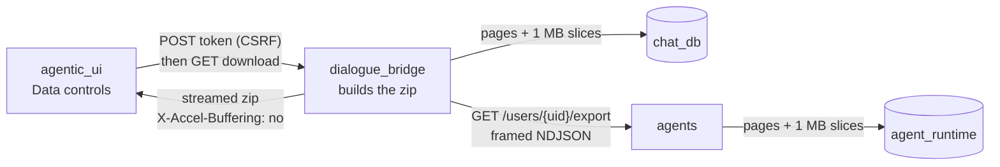
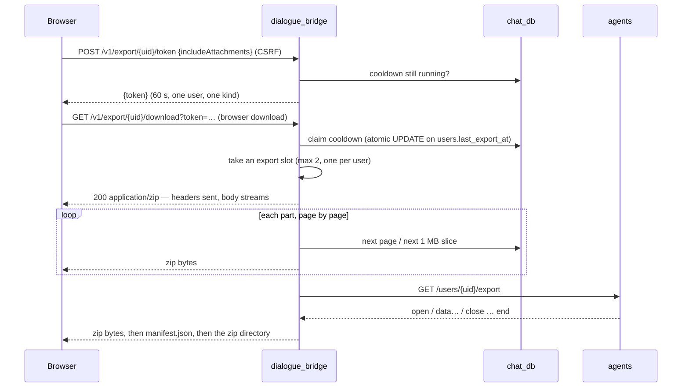
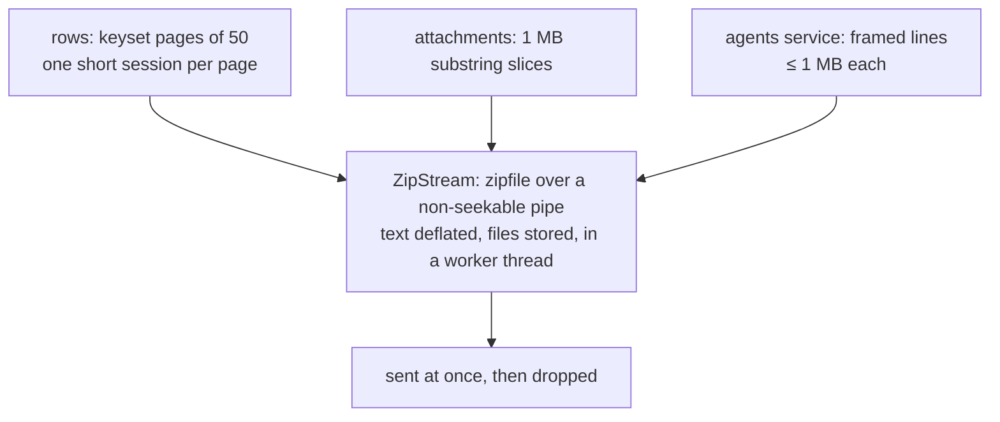

# Export My Data

A user can download everything mAgenticX holds about them — profile, settings, conversations, messages, attachments, scheduled tasks, custom agents and skills — as one `.zip`, from Settings → Data controls. The **dialogue_bridge** builds the archive; the **agents** service streams its part (custom agents and skills, which live in `agent_runtime`). The mental model is a **pipe, not a pile**: the archive is never assembled anywhere. A page of rows or a slice of a file is read, written into the zip, sent to the browser and dropped, so neither memory nor disk ever holds more than about a megabyte of it — which matters on Dennis, where 24 GB is shared by every stack on the box. Exports are on by default; `DATA_EXPORT_ENABLED=false` is the kill switch.

---

## Services Involved



---

## The Download — Full Sequence



---

## Phase 1 — Token, cooldown, slot

The download is a plain `GET` so the browser can save the stream straight to disk; fetching it through JavaScript would hold the whole zip in browser memory. A bare `GET` could be triggered by any other site on the user's cookies, so it needs a **one-time token** that only the CSRF-protected `POST` can mint: HMAC-signed with the general-purpose session secret, purpose-tagged `export` (so it can never stand in for a DOCX-preview token signed by the same key), bound to the user and the export kind, valid for 60 seconds.

The **cooldown** (one export per user per week, `EXPORT_COOLDOWN_MINUTES`) lives on `users.last_export_at`, not in Redis, because rate limiting fails open and this must not. It is claimed with an optimistic `UPDATE … WHERE last_export_at = <value just read>`, so two racing downloads cannot both win. If the export does not finish, the claim is **handed back** (in a shielded scope, so a client disconnect cannot cancel it), so a dropped connection does not lock the user out for a week. A week because a full export can be tens of GB of egress and disk reads on a VM every other stack shares (measured locally: 53.7 GB in 5 min 36 s).

**Slots** cap concurrency at `EXPORT_MAX_CONCURRENT` (2), one per user. They are leases, not a semaphore, renewed every time a chunk goes out: a lease whose stream never started (client gone before the first byte, so no `finally` ran) or stopped moving expires a stall timeout (+ 60 s) later instead of leaking a slot. Process-local, matching the bridge's single worker and replica.

---

## Phase 2 — Streaming the archive



**Rows** come in keyset pages (`EXPORT_PAGE_ROWS`), each one short indexed query on its own session — no transaction or connection is held between pages. Messages page on `(conversation_id, id)` through `ix_messages_conversation_id_id`, so each page is an ordered range scan with no sort and nothing spilled to a Postgres temp file. Keyed on `id` rather than `created_at` on purpose: a timestamp can come back at a different precision than it is bound at, which skips rows at a page boundary.

**Attachment bytes** come in `EXPORT_CHUNK_BYTES` (1 MB) `substring` slices, the way attachment downloads already work. Most attachments are stored uncompressed in TOAST (PDFs and images do not compress), so Postgres reads only the slice asked for.

**The zip** is built by `utils/zip_stream.py`: the standard library's `zipfile` writing into a pipe that holds only the bytes not yet sent. The pipe cannot seek, so each entry gets a trailing data descriptor; ZIP64 is on for every entry. Text entries are deflated (messages compress 5-10×), attachment files stored as-is, and every `zipfile` call runs in a worker thread so the bridge's single event loop keeps serving everyone else.

**Backpressure** is free: uvicorn pauses the generator when its write buffer passes 64 KB, so a slow download slows the export rather than filling memory. `X-Accel-Buffering: no` turns off response buffering in every nginx in front (ours already has `proxy_buffering off`; the shared NPM on Dennis honours the header), so the archive is never spooled to a temp file on the way out.

Measured locally: a 40 MB attachment streamed in 0.59 s with a 4.2 MB memory peak; a text-only export of a 296-message account took 0.25 s.

---

## Phase 3 — The agents service's part

`GET /users/{user_id}/export` (internal only) streams framed NDJSON: `{"op":"open","path":…,"encoding":"utf-8"|"base64"}`, `{"op":"data","text":…}` (≤ 1 MiB of text, a multiple of 4 so base64 slices decode on their own), `{"op":"close"}`, and a final `{"op":"end","counts":…}`. The bridge copies each frame into the zip. It accepts paths only under `agents/` and `skills/`, and every archive path is checked for `..`, absolute paths and control characters before an entry is created.

If the agents service cannot be reached **before** anything was written, the export continues without this part and `manifest.json` says so (`complete: false`, `missing: [...]`). After a frame has been written the zip cannot be rolled back, so a later failure aborts the whole export.

---

## The Archive

```text
README.md                            what each file is
account/profile.json                 profile (allowlisted columns)
account/preferences.json             settings
account/tool_preferences.ndjson
conversations/conversations.ndjson
conversations/messages.ndjson        one message per line, with conversation_id
conversations/attachments.ndjson     archive_path = where its file is (null in text-only)
conversations/reports.ndjson
conversations/shares.ndjson          which conversations were shared — never the link token
scheduled_tasks.ndjson
attachments/<id>/<safe name>         full export only
agents/agents.ndjson + agents/<slug>/<files>
skills/skills.ndjson + skills/<name>/<files> + skills/assignments.ndjson
manifest.json                        counts, sizes, missing parts — written last
```

---

## Sharp Edges and Behavioral Notes

- **Open during an account's deletion grace period.** The three export routes use `validate_userId_even_if_pending`, so a user whose account awaits deletion can still download their data — the pending screen offers it ([account-deletion](account-deletion.md)).

- **Allowlists, not `SELECT *`.** Every exported column is named in `utils/data_export.py`. A column added to any of these tables later is not exported until someone adds it there — so a future secret can never ship by accident.
- **Never exported:** session or refresh tokens, CSRF secrets, share-link tokens and snapshots, raw agent event logs (`messages.raw_events`), message embeddings, agent memories (the user's choice), and the shared copies of remote skills (exported as references with source, commit and licence).
- **A cut download is not a valid zip.** `manifest.json` and the zip directory are written last, so a stream that stops early fails to open rather than passing for a partial archive.
- **A client that stops reading is cut off.** Under backpressure a write simply waits — forever, if the client neither reads nor disconnects — and the generator, suspended at its `yield`, cannot notice. `StallGuardedStreamingResponse` bounds every write by `EXPORT_STALL_SECONDS` (5 min); past it the download is abandoned and the generator closed, which frees the slot and hands the cooldown back.
- **One export is capped at `EXPORT_MAX_BYTES_PER_SECOND`** (25 MiB/s, ~200 Mbit/s), so a fast client cannot take most of the uplink and disk reads of a VM every other stack shares. A slow client is already slower and is not delayed further.
- **`EXPORT_MAX_SECONDS` (6 h) is only a backstop.** It used to be the 30-minute limit that cut off large exports on ordinary connections; at the rate cap 6 h covers ~500 GiB.
- **The bridge has a 512 MB memory cap on Dennis** (`deploy.resources.limits.memory`). An export uses a few MB; the cap only matters if something runs away, and then only the bridge restarts.
- **The cooldown applies to both kinds of export.** A text-only export starts the week too.

---

## File Map

| Concern | File | What to look for |
| --- | --- | --- |
| Token, cooldown, slots, paging, the archive | [magenticx/dialogue_bridge/utils/data_export.py](../../magenticx/dialogue_bridge/utils/data_export.py) | allowlists, `claim_export`, `_ExportSlots`, `stream_export` |
| Streaming zip | [magenticx/dialogue_bridge/utils/zip_stream.py](../../magenticx/dialogue_bridge/utils/zip_stream.py) | `_Pipe`, `ZipStream`, `check_archive_path` |
| Routes | [magenticx/dialogue_bridge/router/export.py](../../magenticx/dialogue_bridge/router/export.py) | status, token, download |
| Settings | [magenticx/dialogue_bridge/core/settings.py](../../magenticx/dialogue_bridge/core/settings.py) | `ExportSettings` |
| Cooldown column + index | [magenticx/dialogue_bridge/core/database/migrations/versions/0028_export_cooldown_index.py](../../magenticx/dialogue_bridge/core/database/migrations/versions/0028_export_cooldown_index.py) | `users.last_export_at`, `ix_messages_conversation_id_id` |
| Agents-service stream | [magenticx/agents/utils/data_export.py](../../magenticx/agents/utils/data_export.py), [router/export.py](../../magenticx/agents/router/export.py) | frames, paging, slicing |
| UI | [magenticx/agentic_ui/src/features/settings/hooks/useDataExport.ts](../../magenticx/agentic_ui/src/features/settings/hooks/useDataExport.ts), [DataControlsTab.tsx](../../magenticx/agentic_ui/src/features/settings/components/profile_parts/DataControlsTab.tsx) | token → browser download |
