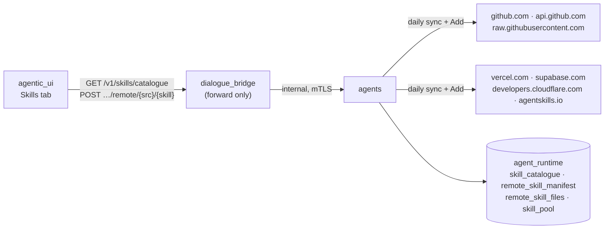
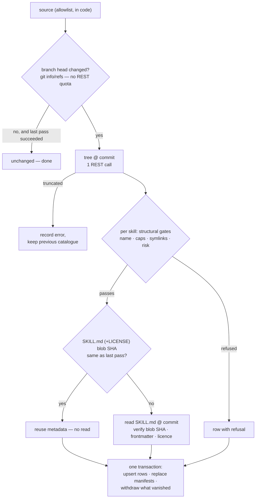
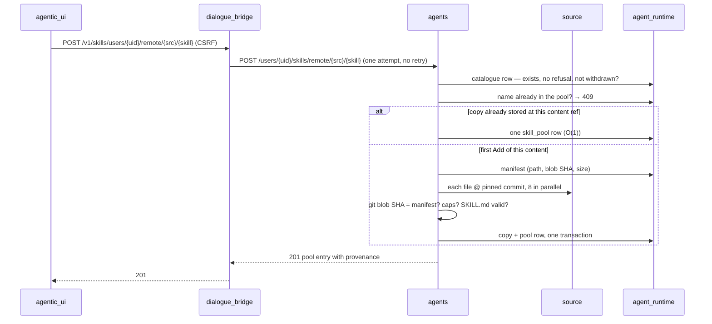

# Remote Skills — the Skill Catalogue

The skill catalogue a user searches in the Skills tab is a set of allowlisted public sources — NVIDIA, Anthropic, ECC, the sickn33 collection, and four publishers that serve a `/.well-known/agent-skills/index.json` — indexed once a day by the **agents** service into `agent_runtime`. The platform bundles no skills of its own any more (plan 30 deleted the 267 that used to ship in the image). The mental model is three separate moments: a **daily sync** that reads only metadata and keeps a searchable index; a **search** that is one full-text query against that index; and an **Add**, the only moment a skill's content is downloaded — pinned to one upstream commit, checked file by file against it, and stored once as a shared, immutable copy that every user who adds the same skill points at. The **dialogue_bridge** only forwards a search and an Add; only the agents service ever reaches a remote source.

---

## Services Involved

---

## Phase 1 — The daily sync

A lifespan task (`run_remote_skill_sync_loop`) runs a pass about two minutes after boot and then every 24 h ± 10 %, under a Postgres advisory lock so two replicas never sync at once. Sources are visited **one at a time**, so peak memory is one parsed tree (~50 MB for the largest), never several. Nothing in this phase downloads skill content.

The "did it change?" check reads git's smart-HTTP ref advertisement (`{repo}.git/info/refs?service=git-upload-pack`) rather than the REST API, because an anonymous conditional REST request **still costs quota even when GitHub answers 304** (measured). REST is spent only on the tree, and only when a source moved: at most four calls a day against an anonymous allowance of 60 an hour, so no GitHub token exists to leak.

A `.well-known` source is simpler: its index is one small JSON document; its sha256 is the source's version. Each entry must carry a `sha256:` digest, an artifact type of `archive` or `skill-md`, and a URL that resolves — relative URLs against the index — onto an allowlisted host.

---

## Phase 2 — The gates

Every skill the sync sees gets a row in `skill_catalogue`; one that fails a gate carries its `refusal` reason and is invisible to search and Add. Keeping refused rows is what lets the next pass skip re-reading them.

| Gate | Decided from | Refuses |
| --- | --- | --- |
| Name | tree | anything but lowercase ASCII alphanumerics with single hyphens, ≤ 64 chars |
| Structure | tree | symlinks, submodules, unsafe or > 6-deep paths, binary executables, > 128 files, > 2 MiB per file, > 8 MiB per skill, no `SKILL.md` |
| Publisher risk label | the source's own index (sickn33) | anything not `safe`/`none` — before a single file is read |
| `SKILL.md` | the file's bytes | no frontmatter, missing `name`/`description`, or a `name` that differs from the folder — deepagents would skip it silently |
| Licence | frontmatter, then the skill's own LICENSE file, then (ECC only) the repo licence | proprietary or "all rights reserved" wording, an unrecognised licence, or none at all |

The licence check is a **strict allowlist** of SPDX-style identifiers (MIT, Apache-2.0, BSD, ISC, MPL-2.0, CC-BY-4.0, CC0, …): an unrecognised licence is refused, because "probably fine" is not something a filter can promise. A `.well-known` skill has no licence of its own — the publisher distributes it from its own domain for agents to use — and the UI says so.

---

## Phase 3 — Search

`GET /v1/skills/catalogue?q=` is forwarded to `GET /skills/catalogue/search`, which runs one full-text query: a generated `tsvector` (name and folder id weighted highest, then category, then description) with a GIN index, each query term a prefix match so results appear while the user is still typing. Free text never reaches the SQL text — terms are reduced to `[a-z0-9]{2,32}` and bound as a parameter. An empty query is an alphabetical browse page whose `total` is the size of the whole catalogue. Rows are filtered to the current allowlist, so a source removed from the code stops being searchable at once.

The UI debounces keystrokes (250 ms) and aborts a superseded request, so a slow answer for `pos` can never overwrite the results for `postgres`.

---

## Phase 4 — Add

A copy is keyed by a **content ref** — the sha256 of the skill's sorted `path → blob SHA` list — not by commit, so an upstream commit that leaves a skill untouched does not create a second copy. A `.well-known` archive is verified against its sha256 and unpacked **in memory**: never `extractall`; no symlinks, hard links or devices; no absolute or `..` paths; a single top-level folder is stripped; gzip is inflated under a hard output ceiling so a few kilobytes cannot expand into gigabytes. The whole Add runs under a 60 s wall clock.

Once added, a skill **never changes underneath the user**: their pool row pins the content ref, and `read_files` resolves it from `remote_skill_files`. Nothing auto-updates.

---

## Sharp Edges and Behavioral Notes

- **`REMOTE_SKILLS_ENABLED` is the kill switch, on by default.** Set it false and no sync starts, no request leaves the service, search returns an empty page with `remote_enabled: false` (the UI explains it), and Add answers 503. Skills users already added keep working — reading a copy does not check the flag.
- **Refused looks the same as missing.** Add answers 404 for an unknown, refused or withdrawn skill alike, so the reason a skill was refused is not an oracle.
- **A failed source keeps its last good catalogue.** A truncated tree, an unreachable host, or a file read that still fails after one retry aborts *that source's* pass and records `last_error` on `remote_skill_sources`; its rows are untouched. A bytes-do-not-match-the-tree failure is treated the same way, never as a per-skill refusal.
- **Withdrawn, not deleted.** A skill that disappears upstream is marked `withdrawn_at`. Users who hold it keep their copy; nobody new can add it.
- **One name per pool.** The pool's key is `(user_id, skill_name)` and the agent sees `/skills/<name>/`, so two sources publishing the same folder name cannot both be held — the second Add is a 409.
- **Scripts are stored, never run.** Skills ship scripts (hundreds per large source). They are inert while sandboxed execution is off, and must stay sandbox-only when plan 11 turns it on.
- **Legacy `global` pool entries.** A pointer into the bundled catalogue an older image seeded onto the volume. Still read from `global/skills/<category>/<name>/` so nothing a user holds breaks silently; no code path creates one.
- **Licence strings are self-declared by publishers.** The gate filters on them; it does not certify them.

---

## File Map

| Concern | File | What to look for |
| --- | --- | --- |
| Allowlist + every gate | [magenticx/agents/harness/skill_registry/remote/sources.py](../../magenticx/agents/harness/skill_registry/remote/sources.py) | `SOURCES`, `ALLOWED_HOSTS`, `evaluate_licence`, `check_skill_md`, caps |
| Outbound HTTP | [magenticx/agents/harness/skill_registry/remote/client.py](../../magenticx/agents/harness/skill_registry/remote/client.py) | redirect allowlist per hop, byte ceilings, `head_commit` via `info/refs` |
| Daily sync | [magenticx/agents/harness/skill_registry/remote/sync.py](../../magenticx/agents/harness/skill_registry/remote/sync.py) | `sync_source`, `run_sync_pass`, `run_remote_skill_sync_loop`, `content_ref_for` |
| Add-time download | [magenticx/agents/harness/skill_registry/remote/fetch.py](../../magenticx/agents/harness/skill_registry/remote/fetch.py) | `fetch_remote_copy`, `unpack_archive`, `_gunzip_bounded` |
| Tables, search SQL, remote reads | [magenticx/agents/harness/skill_registry/store.py](../../magenticx/agents/harness/skill_registry/store.py) | `_DDL`, `search_catalogue`, `apply_source_sync`, `add_remote`, `read_files` |
| Add decision, provenance | [magenticx/agents/harness/skill_registry/user_registry.py](../../magenticx/agents/harness/skill_registry/user_registry.py) | `add_remote_to_user`, `search_catalogue`, `_provenance` |
| Agents routes | [magenticx/agents/router/skills.py](../../magenticx/agents/router/skills.py) | `/skills/catalogue/search`, `/skills/remote/sources`, `/users/{uid}/skills/remote/…` |
| Settings | [magenticx/agents/core/settings.py](../../magenticx/agents/core/settings.py) | `RemoteSkillsSettings` |
| Bridge forwarding | [magenticx/dialogue_bridge/utils/skills.py](../../magenticx/dialogue_bridge/utils/skills.py), [router/skills.py](../../magenticx/dialogue_bridge/router/skills.py) | `search_catalogue`, `add_remote_skill_to_user_pool` (never retried) |
| Bridge rate limits | [magenticx/dialogue_bridge/core/security/rate_limit.py](../../magenticx/dialogue_bridge/core/security/rate_limit.py) | `skill_catalogue_search_rate_limit`, `skill_remote_add_rate_limit` |
| UI search + Add | [magenticx/agentic_ui/src/features/settings/hooks/useCatalogueSearch.ts](../../magenticx/agentic_ui/src/features/settings/hooks/useCatalogueSearch.ts), [SkillsTab.tsx](../../magenticx/agentic_ui/src/features/settings/components/profile_parts/SkillsTab.tsx), [SkillProvenance.tsx](../../magenticx/agentic_ui/src/features/settings/components/profile_parts/SkillProvenance.tsx) | debounce + abort; provenance line; Add states |
