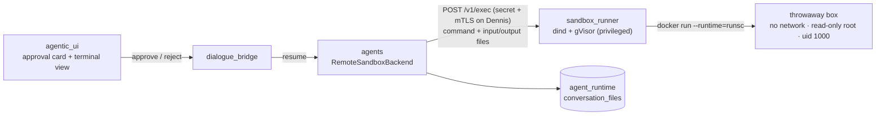
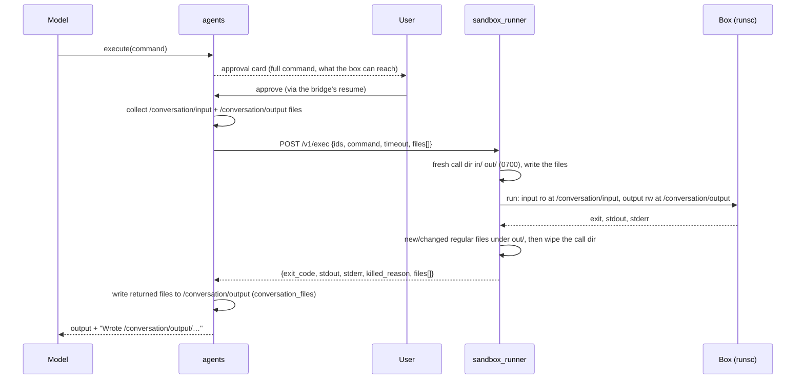

# Sandboxed Execution

Deep agents can run code with the `execute` tool: a shell command in a fresh, isolated box, approved by the user first. The **agents** service never runs anything itself. It sends the command, plus the conversation's files, to **sandbox_runner**, a separate service — the sibling project [sandbox](https://github.com/konstantinosmpouros/sandbox), with its own repo, composes and CI — with its own Docker daemon (docker-in-docker, like the MCP gateway) and gVisor's `runsc` runtime. The runner starts one throwaway container per call, under gVisor, so code in it never talks to the host kernel; it has no network, a read-only root, non-root uid, and hard limits. The files the box writes come back in the response and the agents service saves them to the conversation. The mental model: **the box is assumed hostile; the agents service only asks, the runner only runs, and nothing survives a call except the files it returns.**

---

## Services Involved

---

## One `execute` Call — Full Sequence

---

## Phase 1 — Availability and Approval

`execute` exists only when `SANDBOX_EXECUTION_ENABLED` is true **and** `SANDBOX_RUNNER_URL` is set (`settings.filesystem.sandbox_execution_active`); then every deep agent's default backend is `RemoteSandboxBackend`, which implements deepagents' `SandboxBackendProtocol`, so the framework offers the tool. With it off, the workspace factory still refuses to build a sandbox-capable default (the fail-closed guard). `execute` always asks: `resolve_interrupt_on` forces it after every other layer, at every depth and in Try-it trials, and a user definition with `hitl.execute: false` is refused.

| Key fact | Value / detail |
| --- | --- |
| Local stack | The flag defaults to `true`, the URL to empty, so `execute` is off until the runner runs: start the sandbox project (it joins this stack's `sandbox_net`) and set `SANDBOX_RUNNER_URL=http://sandbox_runner:8090` in `magenticx/.env`. Plaintext, like every local hop |
| Dennis | **On**: `docker-compose-denis.yaml` sets `SANDBOX_EXECUTION_ENABLED=true` and `SANDBOX_RUNNER_URL=https://sandbox_runner:8090`. The runner is its own plain-Compose project on the internal `sandbox` overlay, reached with mTLS (the same internal CA) and the proxy secret. Kill switch: set the flag `false` and release — `execute` disappears on the next agents start |
| Runner down | The call returns an error result; it never falls back to an unsandboxed backend |

---

## Phase 2 — The Box

| Control | Setting |
| --- | --- |
| Runtime | `--runtime=runsc` (gVisor, `systrap` platform: Dennis has no `/dev/kvm`) |
| Network | `--network none` |
| Filesystem | `--read-only` root; `/tmp` tmpfs `noexec` 64 MiB; `/conversation/input` read-only; `/conversation/output` the only durable write |
| Identity | `--user 1000:1000`, `--cap-drop ALL`, `no-new-privileges`, env `PATH`/`HOME`/`LANG` only |
| Limits | 60 s default / 300 s max, 1 GiB memory (no swap), 1 CPU, 128 processes, 64 KiB per output stream returned, 100 MiB disk per call |
| Files | ≤ 100 files and 20 MiB in; ≤ 25 MiB per file and 50 MiB out; only new or changed regular files return (symlinks, FIFOs and devices are skipped and logged) |
| Libraries | Python 3.12 + pandas, numpy, openpyxl, matplotlib, python-docx, python-pptx, reportlab, Pillow; no `pip install` |

Kill reasons come back in plain words: `timeout`, `memory`, `output_limit`, `disk_limit`, `error`. Every call writes one `sandbox_exec` audit record (hashed user id, command sha256 and an 80-character prefix, exit, duration, kill reason, byte and file counts), never output or file content.

---

## Sharp Edges and Behavioral Notes

- **`noexec` on the bind mounts does not hold under gVisor.** It holds on `/tmp`, but gVisor ignores it on `/conversation/input` and `/conversation/output`, so a script written to `output/` and `chmod +x`-ed runs. Accepted: `sh` and `python` can run anything in the box already; the boundary is gVisor, the network and the limits, not exec bits.
- **A fork bomb kills the whole sandbox** under gVisor (its own threads count against the process cap), exit 2 within a second — contained, unlike runc's clean `fork()` failure.
- **The box sees the same paths as the agent** (`/conversation/input/…`, `/conversation/output/…`), because the files are copied in, not mounted from the host: conversation files live in `agent_runtime` (plan 36), not on disk.
- **The runner is privileged** (its inner `dockerd`), the second such service after the MCP gateway: no host port, a single-peer internal network, no secrets but its own TLS material.
- **Requests can be large**: 20 MiB of files is about 27 MB of JSON; the agents client waits `SANDBOX_RUNNER_TIMEOUT_SECONDS` (default 330).

---

## File Map

| Concept | File | What to look for |
| --- | --- | --- |
| Runner project (layout, tests, Dennis runbook) | [sandbox](https://github.com/konstantinosmpouros/sandbox) | the sibling project that owns everything under `runner/`, `box/`, `spike/` |
| Runner API | [sandbox/runner/router/exec.py](https://github.com/konstantinosmpouros/sandbox/blob/main/runner/router/exec.py) | `POST /v1/exec`, `GET /health` |
| Box flags | [sandbox/runner/utils/docker_args.py](https://github.com/konstantinosmpouros/sandbox/blob/main/runner/utils/docker_args.py) | every `--` control, the mounts |
| Call lifecycle | [sandbox/runner/utils/exec_service.py](https://github.com/konstantinosmpouros/sandbox/blob/main/runner/utils/exec_service.py), [utils/workspace.py](https://github.com/konstantinosmpouros/sandbox/blob/main/runner/utils/workspace.py) | call dir, files in/out, kill reasons, cleanup |
| Runner limits | [sandbox/runner/core/settings.py](https://github.com/konstantinosmpouros/sandbox/blob/main/runner/core/settings.py) | `SANDBOX_*` |
| Image | [sandbox/runner/Dockerfile](https://github.com/konstantinosmpouros/sandbox/blob/main/runner/Dockerfile), [box/](https://github.com/konstantinosmpouros/sandbox/tree/main/box) | gVisor pin + checksum, the box |
| Agents backend | [magenticx/agents/harness/filesystem/sandbox_backend.py](../../magenticx/agents/harness/filesystem/sandbox_backend.py) | `RemoteSandboxBackend.aexecute`, file staging, result text |
| Wiring + guard | [magenticx/agents/harness/filesystem/workspace.py](../../magenticx/agents/harness/filesystem/workspace.py) | sandbox default when active, fail-closed otherwise |
| Forced approval | [magenticx/agents/harness/tools/gates.py](../../magenticx/agents/harness/tools/gates.py) | `resolve_interrupt_on` |
| Prompt guidance | [magenticx/agents/harness/prompt_engineering/prompts/capabilities_prompt.py](../../magenticx/agents/harness/prompt_engineering/prompts/capabilities_prompt.py) | `_SANDBOX` |
| UI | [magenticx/agentic_ui/src/features/chat/components/message_parts/ToolCallViews.tsx](../../magenticx/agentic_ui/src/features/chat/components/message_parts/ToolCallViews.tsx), [lib/approvalPresentation.ts](../../magenticx/agentic_ui/src/features/chat/lib/approvalPresentation.ts) | terminal view, the execute approval |
| Proof | [sandbox/spike/run_spike.sh](https://github.com/konstantinosmpouros/sandbox/blob/main/spike/run_spike.sh), [sandbox/.github/workflows/pipeline.yml](https://github.com/konstantinosmpouros/sandbox/blob/main/.github/workflows/pipeline.yml) | ARM64 / x86 containment + timing |
