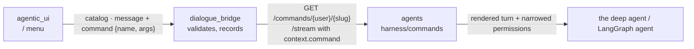
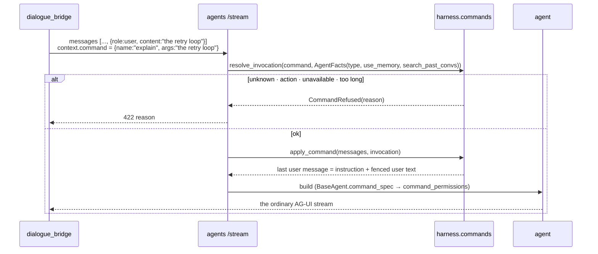

# Slash Commands

Typing `/` at the start of the composer opens a menu of commands (plan 35). There are two kinds. An **action** (`/compact`, `/new`, `/files` …) runs in the app — it calls an existing endpoint or opens a panel and never starts a model turn. A **prompt** command (`/explain`, `/fix`, `/code-review` …) starts an ordinary agent turn whose user message is rewritten into an instruction the **platform** wrote, followed by what the user typed. The browser only ever sends a command's name and its argument; the instruction lives in the agents service, which checks every invocation itself even after the bridge has. A command lasts exactly one turn, and it can only take capabilities away from that turn (`read-only`), never add one. The general commands are the same for every agent; skills that opt in become commands only on the agents they are enabled on (phase 6). **Status:** phases 0–3 are built — every output file stored, the agents-service side, the bridge, the composer's menu; `/plan` (P4), `/files` (P5) and skill commands (P6) follow.

---

## Services Involved

---

## A Prompt Command — Full Sequence

`/explain the retry loop`, from the agents service's point of view (phase 1).

---

## The Command Files

Every general command is a folder under `harness/commands/builtin/<name>/` holding one `COMMAND.md`: YAML frontmatter plus, for a prompt command, the instruction as the body. It is the shape of a skill's `SKILL.md` on purpose — phase 6 lets a skill declare itself a command with the same keys. The parser is strict: an unknown key, kind or requirement fails the load (a test loads them all), so a typo can never turn one command into another.

| Key | Meaning |
| --- | --- |
| `name` | What follows `/`: lowercase words joined by hyphens; must equal the folder name |
| `description` | One line for the menu |
| `kind` | `action` (no body) or `prompt` (body required) |
| `argument-hint` | Placeholder shown after the command, e.g. `[what to explain]` |
| `requires` | Any of `deep_agent`, `memory`, `past_conversations` |
| `read-only` | Prompt only: the turn cannot write files |

| Group | Commands |
| --- | --- |
| Actions | `compact` · `new` · `memories` · `skills` · `rename` · `share` · `export` · `usage` · `files` |
| Built-in tools | `remember` · `forget` · `recall` · `chart` · `artifact` · `create-skill` (`plan` arrives with phase 4) |
| General | `explain` · `fix` · `code-review` (read-only) · `test` · `document` · `summarize` · `translate` · `rewrite` · `brainstorm` · `compare` |

---

## Availability

Every command is listed for every agent. One the agent cannot run carries the reason instead of disappearing, so the menu can explain itself: `/compact` and the tool commands need a deep agent, `/remember` and `/forget` need memory on, `/recall` needs past-conversation search on — the same `use_memory` / `search_past_convs` flags the tools themselves are gated on (`AgentFacts.for_run`). `GET /commands/{user_id}/{agent_slug}` (internal-caller only; `agent_owner_id`, `use_memory`, `search_past_convs` as query parameters) returns them all with `available` / `unavailableReason`; the bridge proxies it.

---

## The Turn

`render_command` builds the user message: `The user ran the /<name> command.`, the instruction, a note that what follows is the subject and not a change to the instructions, then the user's text between `<command_input>` markers. The markers are escaped inside the text, so an argument can never close the fence and continue in the platform's voice. `apply_command` rewrites only the **last user message** (its text part, when the content is a list with images; the images stay); earlier messages and the input list are untouched. The rewritten message is what the checkpoint keeps, so later turns still know what was asked — but the next message carries no command and runs with the agent's full capabilities.

`command_permissions` is the only place a command touches capabilities: `read-only` appends `FilesystemPermission(write, "/**", deny)` to the agent's own write-deny ladder in `build_deep_agent`. Nothing returns fewer rules than the agent already has.

---

## The Bridge

A user message may carry `command: {"name"}` (`schema.CommandInvocation`, extra keys refused, the name command-shaped). Its **argument is the message content**, which may be empty (`/summarize`); the browser never sends an instruction. On send, edit and new, `utils/commands.check_invocation` asks the agents service for this (user, agent)'s catalog — with the user's `use_memory` / `search_past_convs` — and refuses (422) an unknown command, an action, or one the agent cannot run, **before anything commits**. The message stores `messages.command = {"name"}` (migration `0040`). `command_context()` turns it into the run context's `{"command": {"name", "args": content}}`, which rides the shared request block — so the HITL `/resume` legs carry it too, and a retry (same user message) re-runs it. A retry is not re-checked by the bridge (it was when sent); the agents service checks every run.

`GET /v1/commands/{user_id}/{agent_id}` (auth → `commands_rate_limit`, 120/min per user) is the `/` menu: the catalog passed through, a private agent of another user refused (403), 503 when the agents service cannot answer. Forks copy `command`; share snapshots carry it and the import keeps only a well-formed `{"name"}` on a user message.

---

## The Composer

A command lives **in the text**. A `/word` the caret is in or right after — at the start of the draft or after whitespace, so `a/b` and URLs never trigger it — opens the menu above the composer (`SlashCommandMenu`, shadcn `Command`/cmdk), mid-sentence too. The caret never leaves the textarea: `useSlashCommands` tracks it (`onChange` and `onSelect`) and drives the selection — ↑ ↓ move, Enter or Tab pick, Esc closes for that token — while cmdk only mirrors it and handles the mouse. Items come from `GET /v1/commands/{user}/{agent}` for the agent the next message goes to (cached a minute per agent): runnable first, prefix matches first; an unavailable command stays, dimmed, with its reason, and picking it only explains. The menu's height is the room between the composer and the chat header (`useSpaceAbove`, re-measured every frame while it is open), so it never reaches the header. An action the app cannot run yet (`/files` until phase 5) is never offered.

| Picked | What happens |
| --- | --- |
| A prompt command, or an action that takes text (`/rename`) | The `/word` at the caret is replaced by `/name ` in place (`applyPick`). It stays in the text, **highlighted** by `DraftHighlight` — a mirror of the draft laid under the textarea (same box, font and wrapping), whose own text turns transparent while a command is present; the caret and selection stay the textarea's |
| An action without text (`/compact`, `/share` …) | It runs at once through `createCommandActions` — exactly what its button calls — and its token leaves the draft |

The draft's command is **the first runnable `/name` in it** (`findCommand`), one per message; the hook keeps `composer.pendingCommand` equal to it, so what is highlighted is what is sent — deleting the `/name` deletes the command. **The `/name` is a UI affordance only, never part of the prompt:** on send, `message.content` is the draft *without* it and the command travels as `message.command = {name}` in the `new`, `send` and `shared_continue` payloads (and on the optimistic bubble); a command alone sends no text. The draft itself is kept whole, so a failed start restores it — highlight included. The agent never looks for commands in the text. An action command (`/rename Quarterly plan`) runs with the text around it instead of sending. An edit keeps the message's command. The bubble shows the command highlighted in front of the text (`markCommand` in `Content.tsx`).

---

## Sharp Edges

- **A HITL resume carries the command too.** A resume rebuilds the agent from the context the bridge sends; without `context.command`, a paused `/code-review` would continue without its read-only rule. The command rides the request block shared by `/stream` and `/resume`.
- **`full_seed` re-sends older turns plain.** A turn that rebuilds the whole history (new branch without a committed checkpoint) sends earlier command messages as their typed text only; only the current turn is rendered.
- **Actions never reach a run.** The agents service refuses one in a run context (`runs in the app`); the UI calls the action's own endpoint.
- **A LangGraph agent gets the rendered message too** — `apply_command` runs before either kind of agent; only `read-only` is deep-agent specific (LangGraph agents have no filesystem to deny).

---

## File Map

| Concern | File | Notes |
| --- | --- | --- |
| Package | [magenticx/agents/harness/commands/](../../magenticx/agents/harness/commands/) | `spec.py`, `registry.py`, `render.py`, `policy.py` |
| Built-in commands | [magenticx/agents/harness/commands/builtin/](../../magenticx/agents/harness/commands/builtin/) | one `COMMAND.md` per folder |
| Catalog endpoint | [magenticx/agents/router/commands.py](../../magenticx/agents/router/commands.py) | `GET /commands/{user_id}/{agent_slug}` |
| Run integration | [magenticx/agents/router/inference.py](../../magenticx/agents/router/inference.py), [base_agent.py](../../magenticx/agents/harness/abstractions/base_agent.py), [deep_agent.py](../../magenticx/agents/harness/abstractions/deep_agent.py) | check + rewrite in `/stream`; `command_spec`; permissions |
| Bridge | [magenticx/dialogue_bridge/utils/commands.py](../../magenticx/dialogue_bridge/utils/commands.py), [router/commands.py](../../magenticx/dialogue_bridge/router/commands.py) | catalog proxy, `check_invocation`, `command_context` |
| UI | [useSlashCommands.ts](../../magenticx/agentic_ui/src/features/chat/hooks/useSlashCommands.ts), [SlashCommandMenu.tsx](../../magenticx/agentic_ui/src/features/chat/components/SlashCommandMenu.tsx), [slashCommands.ts](../../magenticx/agentic_ui/src/features/chat/lib/slashCommands.ts), [commandActions.ts](../../magenticx/agentic_ui/src/features/chat/handlers/commandActions.ts) | menu + chip, the rules, the actions |
| Tests | [tests/agents/test_commands.py](../../tests/agents/test_commands.py), [tests/dialogue_bridge/test_commands.py](../../tests/dialogue_bridge/test_commands.py), [tests/agentic_ui/slash-commands.test.tsx](../../tests/agentic_ui/slash-commands.test.tsx) | files, availability, refusals, fence, policy, endpoints; storing, refusing, context, menu, copies |
| Plan | [plans/35-slash-commands.md](../../plans/35-slash-commands.md) | phases 0–6 |
