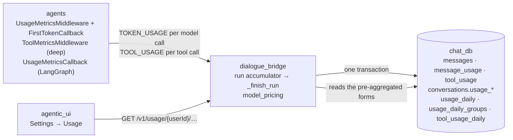
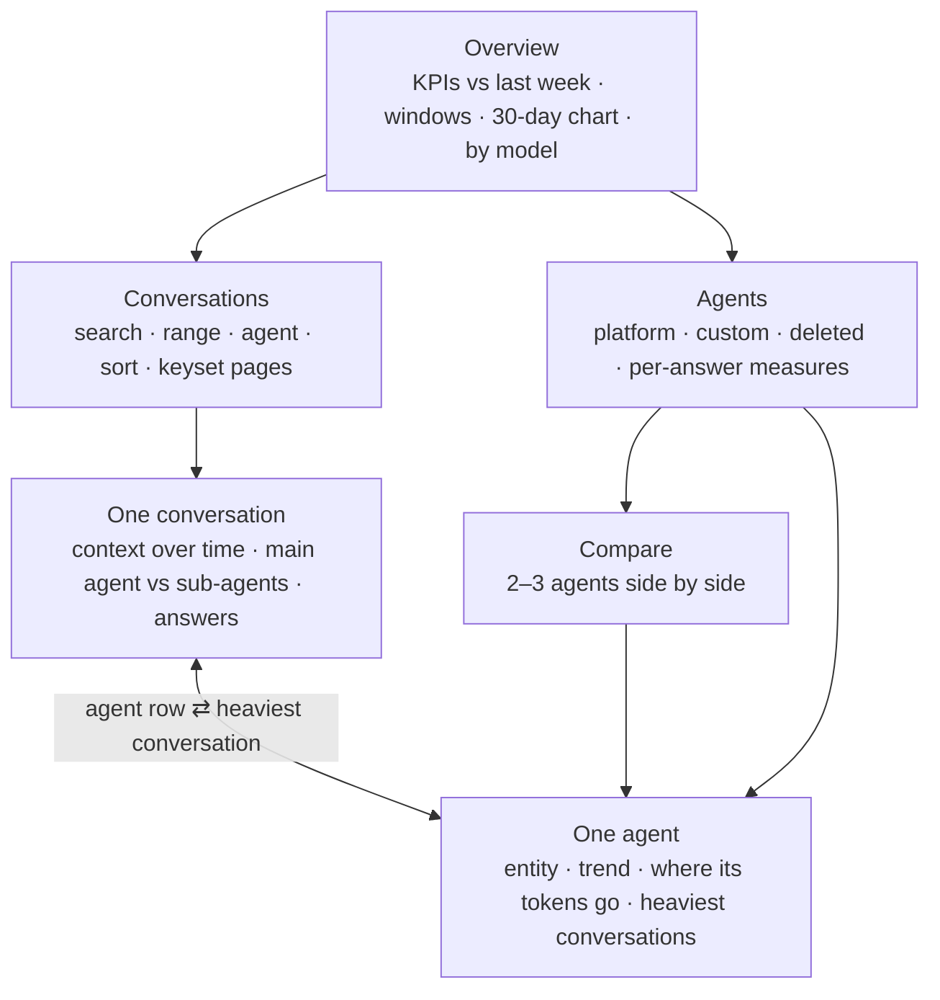
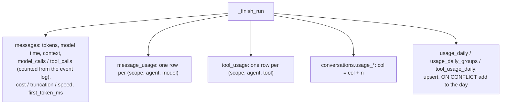

# Usage analytics (Settings → Usage)

The Usage tab is a dashboard you drill into. Its five pages are owned by the
**dialogue_bridge**, which records the data and serves it. They show what a
user's agents spent, how fast they answered, how well the prompt cache worked,
and where the tokens went. The data starts in the **agents** service: every
model call reports one `TOKEN_USAGE` event with its tokens, model, model time
and context fill. Deep agents report through `UsageMetricsMiddleware` and the
normalizer; LangGraph agents report through a LangChain callback. When an
answer finishes, the bridge writes that usage four ways in one transaction:

1. on the answer itself;
2. as a per-agent and per-model split (`message_usage`);
3. as running totals on the conversation;
4. as per-day rollups for the user.

Each page reads one of these pre-aggregated forms and never sums the user's
answers, so every page stays a few milliseconds whatever the account's size.
The **agentic_ui** renders the pages inside the settings panel and validates
every payload against a Zod contract.

Plan 41 adds four per-inference metrics on the same path: **truncation** (calls
cut off at the output-token limit), **tool metrics** (calls, errors, duration,
output size per tool, from a new `TOOL_USAGE` event), **cost** (priced by the
bridge from a configurable price table) and **speed** (time to first token per
call, output tokens per second, and the answer's own wait for its first words).
They are booked in the same transaction, into the same four forms, plus two new
tables, `tool_usage` and `tool_usage_daily` (migration `0041`).

---

## Services Involved

---

## The pages

| Page | Endpoint | Reads |
| --- | --- | --- |
| Overview | `GET /v1/usage/{userId}/summary` | `usage_daily`, `usage_daily_groups`, `tool_usage_daily` (top 12 tools, all time), a count over `conversations` |
| Conversations | `GET …/conversations?sort=&range=&agentId=&q=&cursor=&limit=` | `conversations.usage_*` (keyset on the sort index) |
| One conversation | `GET …/conversations/{conversationId}` | that conversation's answers, `message_usage` and `tool_usage` rows |
| Agents | `GET …/agents?range=&kind=` | `usage_daily`, `usage_daily_groups`, a count over `conversations` |
| One agent | `GET …/agents/{agentKey}?range=` | the same, filtered to the agent, plus its `tool_usage_daily` rows in range |

The UI keeps the pages as a stack in `UsageTab`. Each page sets the panel's one
header: its title, a back link to where you came from, and the refresh action.
The time range is chosen once and shared, so drilling in keeps the period.

---

## Phase 1 — Every model call reports itself

Usage is measured where the call happens, because the bridge only ever sees
events. Deep agents carry `UsageMetricsMiddleware`, which stamps each reply
with its model, model time and context fill; the normalizer folds that into the
`TOKEN_USAGE` it already emits from `usage_metadata`. LangGraph agents stream in
`custom` mode, and their chains' replies never reach the normalizer. For them,
`LangGraphAgent` adds `UsageMetricsCallback` to the run config. LangChain
carries the callback into every chain a node invokes, even one called without
its config. The callback times each chat-model call and reads the provider's
usage when the call ends. The stream loop then drains those calls as
`TOKEN_USAGE` frames between chunks.

| Key fact | Value / detail |
| --- | --- |
| Call identity | the AIMessage id (deep agents) or `lg-<callback run id>` (LangGraph); the bridge dedupes on it |
| Context fill | deep agents only: provider prompt tokens over the model profile's `max_input_tokens`. A LangGraph pipeline has no single growing context, so it reports none. |
| Streamed calls | `ChatOpenAI` reports usage on streams by default (langchain-openai ≥ 0.3.35, default base URL) |

Plan 41 adds three things to what each call reports (field reference:
[agui-protocol](../development/agui-protocol.md)):

- **Truncation.** `TOKEN_USAGE.finish_reason` and `truncated` — `true` for
  `length` / `max_tokens` / `max_output_tokens`, i.e. the model stopped at its
  output-token ceiling. That stop is an HTTP 200 with no exception, so it is
  also logged as `model_call_truncated`. Deep and LangGraph agents alike.
- **Time to first token.** `TOKEN_USAGE.ttft_ms`, from the call's start to its
  first streamed text or tool-call chunk. Only a LangChain callback sees chunks,
  so `UsageMetricsMiddleware` opens a `first_token_scope()` (a record in a
  `ContextVar`) around the call and `FirstTokenCallback`, added to the deep
  agent's run config, stamps it. LangGraph agents measure it in
  `UsageMetricsCallback.on_llm_new_token`. A call that did not stream reports
  none.
- **Tool calls.** One `TOOL_USAGE` per settled tool call: `tool_name`,
  `duration_ms`, `status` (`ok` / `error`), `output_chars` — never arguments or
  output. Deep agents: `ToolMetricsMiddleware` stamps the ToolMessage and the
  normalizer emits the event after `TOOL_CALL_END`. LangGraph agents:
  `UsageMetricsCallback.on_tool_*`, drained with `drain_tools()`.

`build_deep_agent` guarantees the platform stack on the main agent and every
declared sub-agent (`_ensure_platform_middleware`): `RetryOnRateLimitMiddleware`
outermost, then `ToolMetricsMiddleware` directly outside `ToolErrorMiddleware`
(so a tool that raised counts as an error), and `UsageMetricsMiddleware`
innermost. Because the rate-limit retry sits outside, `latency_ms` and `ttft_ms`
time only the attempt that answered, never a 429 wait.

| Key fact | Value / detail |
| --- | --- |
| Tools with no `TOOL_USAGE` | `write_todos`, `task`, `present_artifact`, `render_chart` — the normalizer consumes their results silently |
| `output_chars` | text length of the result; text blocks only for a list; `0` for a `Command` result |
| `status: error` | `ToolMessage(status="error")`, `ToolErrorMiddleware` conversions included; LangGraph: `on_tool_error` (a `GraphBubbleUp` pause is not reported) |
| LangGraph TTFT | only for the calls a node streams (usually its answer generation) |

---

## Phase 2 — The bridge books a finished answer

The accumulator (`InferenceRunRuntime`) sums each call once, keyed by its
message id. It also groups the call by **(scope, agent, model)**:
- **Scope** is `main` for a call at the top level, or `subagent` for one
  wrapped in `SUBAGENT_EVENT`, or `compaction` for the main agent's summary
  call when it compacts (`TOKEN_USAGE` with `purpose: compaction`, plan 34).
- **Agent** names the sub-agent through a `task_id → subagent_type` map built
  from `TASK_SUBAGENT`.
- A call first seen bare and then wrapped moves to its sub-agent; it is never
  counted twice.

`TOOL_USAGE` is folded the same way (`_accumulate_tool_usage`): deduped by
`tool_call_id`, grouped by **(scope, agent, tool)**, `errors` += 1 when
`status == "error"`.

Each settled `TOKEN_USAGE` also gets plan 41's derivations (`_call_metrics`),
added to the run totals and to its group:

| Counter | Rule |
| --- | --- |
| `cost_micros` | `call_cost_micros(model, input, cached, output)` from `utils/model_pricing.py` (see **Pricing** below); integer micro-USD (1 USD = 1,000,000) |
| `unpriced_calls` | +1 when the model (or no model at all) has no price; it then adds no cost |
| `truncated_calls` | +1 when `truncated` is `true` |
| `ttft_ms`, `ttft_calls` | the call's `ttft_ms` and +1, only when it reported one (it streamed) |
| `gen_ms`, `gen_output_tokens` | `max(latency_ms − ttft_ms, 0)` and its `output_tokens`, streamed calls only — tokens/s = `gen_output_tokens / gen_ms × 1000` never mixes in a call that delivered everything at once |

The answer's own **first token** (`first_token_ms`) is measured by the bridge,
not the agents: from the runtime's creation as the run task starts to the first
non-empty top-level text delta (the main agent's; a sub-agent's text arrives
wrapped). A `HITL_INTERRUPT` registered before any text leaves it `NULL` — the
wait was the human's — and so does an answer with no text.

When the answer finishes, `_finish_run` writes everything in the transaction
that finalises the answer.

What migration `0041_inference_metrics` added (no backfill; old rows stay
`NULL` / `0`):

| Table | New columns |
| --- | --- |
| `messages` | `cost_micros` (BIGINT), `unpriced_calls`, `truncated_calls`, `first_token_ms`, `ttft_ms`, `ttft_calls`, `gen_ms`, `gen_output_tokens` — all nullable, `NULL` on an answer that spent nothing (`first_token_ms` is kept whenever there was text) |
| `message_usage`, `usage_daily_groups` | `cost_micros` (BIGINT), `unpriced_calls`, `truncated_calls`, `ttft_ms`, `ttft_calls`, `gen_ms`, `gen_output_tokens` |
| `conversations` | `usage_cost_micros` (BIGINT), `usage_truncated_calls` |
| `usage_daily` | `cost_micros` (BIGINT), `unpriced_calls`, `truncated_calls`, `first_token_ms` (sum), `first_token_answers` (+1 only when measured) |
| `tool_usage` (new) | one row per answer × scope × agent × tool: `message_id`, `conversation_id`, `user_id` (CASCADE), `agent_id` (main agent, SET NULL), `main_agent_name`, `scope`, `agent_name`, `tool_name`, `calls`, `errors`, `duration_ms`, `output_chars`, `created_at` (the answer's) |
| `tool_usage_daily` (new) | PK `(user_id, day, agent_key, tool_name)`, `agent_id`, `agent_name`, `calls`, `errors`, `duration_ms`, `output_chars` — the same upsert-add as `usage_daily` |

Every counter outside `messages` is `NOT NULL DEFAULT 0`.

### Pricing

`utils/model_pricing.py` prices each call when the answer finishes, so the cost
is fixed at the moment it was spent and never re-priced on read. Prices are USD
per 1M tokens — `input`, `cached_input`, `output` — with an optional
`long_context` tier (`above_input_tokens`, `input`, `cached_input`, `output`)
that replaces all three for a call whose own input exceeds it.

- **Formula:** `(input − cached)·p_in + cached·p_cached + output·p_out`, tokens ×
  USD per 1M = micro-USD, rounded. Reasoning tokens are already inside
  `output_tokens` and are never added again.
- **Lookup:** exact name → without a `provider:` prefix → without a
  `-YYYY-MM-DD` snapshot suffix. No match = unpriced.
- **Defaults (USD / 1M, 2026-10):** `gpt-6-luna` 0.10 / 0.01 / 0.50 (above
  272,000 input tokens 0.20 / 0.02 / 0.75), `gpt-5` 1.25 / 0.125 / 10.00,
  `gpt-4.1` 2.00 / 0.50 / 8.00, `gpt-4.1-mini` 0.40 / 0.10 / 1.60, `gpt-4o`
  2.50 / 1.25 / 10.00, `gpt-4o-mini` 0.15 / 0.075 / 0.60, `o4-mini`
  1.10 / 0.275 / 4.40, `o3-mini` 1.10 / 0.55 / 4.40.
- **Override:** `MODEL_PRICES_JSON` or `MODEL_PRICES_JSON_FILE` (see
  [configuration](../architecture/configuration.md)). An entry replaces a
  model's whole default, adds a model, or — with `null` — removes a price.
  Parsed when the module is imported: bad JSON or an unknown field stops the
  bridge at startup rather than pricing every answer wrong.

> **Prices are estimates. Verify them against your invoice.** Only `o4-mini`
> and `gpt-4.1-mini` come from OpenAI's own model pages; the rest are from
> third-party price tables. The `gpt-6-luna` sources conflict: one lists
> $0.20 input / $1.20 output instead of the $0.10 / $0.50 used here. Correct any
> figure through `MODEL_PRICES_JSON` without a release.

| Key fact | Value / detail |
| --- | --- |
| Call counts | `utils/run_activity.count_run_activity`, the same rules as the UI's `countRunActivity`: model calls = distinct `TOKEN_USAGE` message ids; tool calls = distinct `TOOL_CALL_START` ids; sub-agents included |
| Concurrency | every total is `col = col + n` or `ON CONFLICT … DO UPDATE SET col = col + excluded.col`, so nothing is read back first and no update is lost |
| Runs with no usage | an answer that spent nothing (e.g. failed before its first call) writes no rows and leaves its call counts `NULL` |
| Tool rollup key | `tool_usage_daily` keys on the main agent and the tool only: a sub-agent's calls of a tool count under the agent that delegated them (the scope/agent split lives in `tool_usage`) |

---

## Phase 3 — Pages read pre-aggregated data

Messages carry no `user_id`, so summing a user's answers is a join over
everyone's messages. That is why each page reads a pre-aggregated form
instead. The Overview and Agents pages sum the daily rollups: a few rows per
user, per day, per agent. The conversation list pages over the running totals
on `conversations`, on `ix_conversations_user_usage_total` or
`ix_conversations_user_usage_updated`. One conversation reads only its own
answers.

| Key fact | Value / detail |
| --- | --- |
| Load test (local, 2026-10-08) | One user with 5,000 conversations, 200,000 answers and 600,000 usage rows. p95: Overview 8.8 ms, conversation list 2.9–7.1 ms, one conversation 3.3 ms, agents 4.3 ms, one agent 10.9 ms; 1.4 ms per list page. Before the rollups, the Overview, agents and one-agent pages took 0.55–0.8 s. |
| Coverage | `detailed_answers` / `detailedInputTokens` count only answers with call counts and model time (plan 33 onward). Every ratio divides by them, so older answers never drag an average down. |
| Ratios shown | cache hit = cached ÷ detailed input; time / answer = model ms ÷ detailed answers; calls / answer; tools / answer; time / call |
| Too few answers | an agent needs 5 detailed answers in range before per-answer measures are shown |
| Rate limit | `usage_analytics_rate_limit`, per user, 60 / 60 s, applied after auth (it keys on the path's `{user_id}`) |
| Plan 41 denominators | avg first token = `firstTokenMs ÷ firstTokenAnswers`; avg TTFT per call = `ttftMs ÷ ttftCalls`; tok/s = `genOutputTokens ÷ genMs × 1000`; tool error rate / avg time / avg output = `errors` / `durationMs` / `outputChars ÷ calls`. Each counts only what was measured, so older answers never drag an average down (`usageMetrics.ts`). |
| API fields | additive, default `0` / `null`: `UsageWindow` (+ daily points, agent entities) `costMicros`, `unpricedCalls`, `truncatedCalls`, `firstTokenMs`, `firstTokenAnswers`; `UsageModelBreakdown` / `UsageAgentGroup` (`CallMetrics`) `costMicros`, `unpricedCalls`, `truncatedCalls`, `ttftMs`, `ttftCalls`, `genMs`, `genOutputTokens`; `UsageToolBreakdown {toolName, calls, errors, durationMs, outputChars}` on `UsageSummary.perTool`, `UsageAgentDetail.tools`, `UsageConversationDetail.tools`; `UsageAnswerPoint` and `MessageOut` / the inference-run DTO carry the answer's figures |

What each surface shows for plan 41:

| Surface | Shows |
| --- | --- |
| Reply usage card (`MessageUsage.tsx`) | "Est. cost" (with "partly unpriced" / "not priced"), "First token" (the answer's `firstTokenMs`), "Output speed" (tok/s) — each only when recorded; a "Cut off at the output limit" warning in the card and an amber mark beside the gauge. When token usage is hidden, `TruncatedMark` still flags a cut-off answer in the action bar (`ActionBars.tsx`). |
| Overview | KPI tiles "Cost · 7 days" and "First token" (per-answer average) vs the week before; a truncation note for the last 30 days (count and % of model calls); per model: cost, avg first token per call, tok/s and a cut-off mark; a **Tools** section (calls, error rate, avg time, avg output), top 12 all time |
| Agents / Compare | cost under each row's tokens, a "Highest cost" sort, a cut-off mark; Compare adds "Cost" and "Cut off at the limit" rows |
| One agent | "Cost" and "Cut off" KPI tiles (with the rate), a Cost column in the agent · model table, its **Tools** in range |
| Conversations | cost under each row's tokens, a cut-off mark |
| One conversation | "Cost" and "First token" (average over the shown branch's answers that measured one) tiles, truncation note, Cost column per group, cost / first token / cut-off mark per answer, **Tools** for every answer (replaced ones included) |

Money is formatted by `formatCost` (`shared/lib/utils.ts`): `$12.34`, up to four
decimals below a dollar (`$0.0123`), `< $0.0001`, always USD. `describeCost`
never shows `$0.00` for a model with no price: "—" with "not priced", or the
priced part with "partly unpriced". A total of 0 with nothing unpriced (answers
from before pricing) also shows "—".

---

## Sharp Edges and Behavioral Notes

- **Old answers have tokens only.** Answers from before plan 33 have no call counts, model time or sub-agent split. Totals include them; the split, the "Model split" ranking and per-answer ratios cover newer answers only, and the pages say so ("recorded from Oct 8 onward"). One conversation counts its old answers' calls from their event logs on the fly, for up to 200 answers (`callsComplete` turns false beyond that).
- **Replaced answers count.** Totals include every answer, including ones a retry or an edit replaced, because they were spent. "Replaced" means off the latest branch. The composer's context card uses the same rule.
- **Compaction is spend, not an answer.** The summary call of a compaction is its own `compaction` group ("Compaction") in every split. A manual compaction adds its tokens, one model call and its model time to the conversation totals and the day, with 0 answers; see [context-compaction](context-compaction.md).
- **Forks start at zero.** A fork copies messages without their token counts, so its usage begins with its first new answer and nothing is counted twice.
- **Deleted conversations keep their spend in the rollups.** The daily rollups outlive a deleted conversation on purpose: the spend happened. So the Overview can exceed the sum of the listed conversations. The account purge deletes the rollups explicitly; `message_usage` and the conversation totals go with their rows.
- **Deleted agents are kept by name.** When an agent is deleted, its rollup rows keep their key but `agent_id` goes NULL, so readers identify an agent by `agent_id`, or by `agent_name` once it is deleted. Such an agent appears as "Deleted", with key `name:<label>`.
- **Agents are entities, never someone else's.** The kind (platform or custom) and engine come from `agents`. Another user's custom agent is never described, even if this user once ran it, and its profile is a 404.
- **Conversations per agent use the current agent.** Per-agent conversation counts and "heaviest conversations" use each conversation's current `agent_id` and its totals, not a distinct count over answers. A conversation that switched agents is rare.
- **Private chats are never listed or titled.** They count in every total, and the conversation list shows them as one aggregate row.
- **Compaction markers are inferred.** On the context chart, a drop of more than 30% between consecutive answers is marked "likely compacted".
- **The cursor is opaque but unsigned.** It only narrows the caller's own, already-scoped rows. Every field is validated, so a forged cursor gets a 400, never a query error.
- **The truncation rate reads low across the rollout.** It divides `truncatedCalls` by all model calls in range, including calls recorded between plan 33 and plan 41, before truncation was counted. Over a range that spans the change the rate is understated, never overstated.
- **Cost is a floor while anything is unpriced.** A call on a model with no price adds to `unpriced_calls`, not to cost; the pages say "partly unpriced". Cost is fixed when the answer finishes: changing `MODEL_PRICES_JSON` never re-prices stored answers.
- **First token is `NULL` after a HITL approval.** An interrupt registered before the answer's first text settles `first_token_ms` as unmeasured, and the averages skip it (`first_token_answers` is not incremented). It is measured from the run task's start, so it includes everything before the first text: attachment seeding, every model and tool call, sub-agents.
- **deepagents' built-in `general-purpose` sub-agent is not measured.** It is not in the `subagents` list `build_deep_agent` augments, so it gets none of the platform middleware: no `TOOL_USAGE`, no `finish_reason` / `truncated` / `ttft_ms`, no rate-limit retry (a pre-existing gap). Its tokens still arrive through `usage_metadata`.
- **Speed figures cover streamed calls only.** A call that did not stream reports no `ttft_ms`, so it adds nothing to `ttft_calls`, `gen_ms` or `gen_output_tokens`. A LangGraph agent typically streams only its answer generation.
- **The tool rollup keys on the main agent.** `tool_usage_daily` has no scope: on Overview and one agent, a sub-agent's tool calls count under the agent that delegated them. Only `tool_usage` (one conversation, the export) keeps the split.
- **Manual compactions are priced too.** `_book_compaction_usage` prices the summary call like any other and adds it to the `Compaction` group, the conversation total and the day (with 0 answers). The one-conversation page's tiles sum its answers, so a manual compaction's cost shows in its group row and the list / Overview totals, not in the Cost tile.
- **The account purge deletes `tool_usage_daily` explicitly**, like the other rollups; `tool_usage` goes with its messages. The data export adds the plan 41 columns to `messages.ndjson` / `message_usage.ndjson` and a `conversations/tool_usage.ndjson` (never tool input or output).

---

## File Map

| Concern | File |
| --- | --- |
| Per-call metrics (deep agents) | `magenticx/agents/harness/middlewares/usage_metrics.py` (incl. `finish_reason` / `truncated`) |
| Time to first token (deep agents) | `magenticx/agents/harness/middlewares/first_token.py` (`first_token_scope`, `FirstTokenCallback`); attached in `harness/abstractions/deep_agent.py` (`_stream_config`) |
| Per-tool-call metrics (deep agents) | `magenticx/agents/harness/middlewares/tool_metrics.py` (`ToolMetricsMiddleware`); `TOOL_USAGE` from `harness/agui/normalizer.py` (`_tool_usage`) |
| Platform middleware guarantee | `magenticx/agents/harness/abstractions/deep_agent.py` (`_ensure_platform_middleware`); rate-limit retry in `harness/middlewares/rate_limit.py` |
| Per-call metrics (LangGraph agents) | `magenticx/agents/harness/agui/usage_callback.py` (`drain`, `drain_tools`), `magenticx/agents/harness/abstractions/langgraph_agent.py` (`_stream_config`, `_pending_frames`) |
| Events | `magenticx/agents/harness/agui/events.py` (`TokenUsageEvent`, `ToolUsageEvent`), `emitter.py` (`token_usage`, `tool_usage`) |
| Stream hooks | `magenticx/agents/harness/abstractions/base_agent.py` (`astream`, `_config_with_callback`) |
| Accumulator, booking | `magenticx/dialogue_bridge/utils/inference_runs.py` (`InferenceRunRuntime`, `_call_metrics`, `_accumulate_tool_usage`, `_note_first_text`, `_record_usage_breakdown`) |
| Pricing | `magenticx/dialogue_bridge/utils/model_pricing.py`; `PricingSettings` in `core/settings.py` |
| Manual compaction booking | `magenticx/dialogue_bridge/utils/compaction.py` (`_book_compaction_usage`) |
| Call counting | `magenticx/dialogue_bridge/utils/run_activity.py` |
| Daily rollups writer | `magenticx/dialogue_bridge/utils/usage_rollups.py` (`add_answer_to_rollups`, `tools=`) |
| Queries | `magenticx/dialogue_bridge/utils/usage.py` |
| Routes, DTOs | `magenticx/dialogue_bridge/router/usage.py`, `magenticx/dialogue_bridge/schema/usage.py`; answer DTOs `schema/messages.py`, `schema/inference.py` |
| Tables | `magenticx/dialogue_bridge/core/database/models.py`; migrations `0032`–`0034`, `0041` |
| Purge, export | `magenticx/dialogue_bridge/utils/account_deletion.py`, `utils/data_export.py` |
| UI pages | `magenticx/agentic_ui/src/features/settings/components/profile_parts/UsageTab.tsx`, `…/profile_parts/usage/*` (`UsageParts.tsx`: `ToolsSection`, `TruncationNote`, `TokensWithCost`, `TruncatedMark`) |
| UI data | `…/settings/hooks/useUsageQuery.ts`, `useUsageConversationList.ts`, `…/settings/lib/usageMetrics.ts` |
| Reply card | `magenticx/agentic_ui/src/features/chat/components/message_parts/MessageUsage.tsx`, `ActionBars.tsx`; `shared/ui/ai-elements/context.tsx` (`ContextMetricRow`) |
| Formatting | `magenticx/agentic_ui/src/shared/lib/utils.ts` (`formatCost`, `describeCost`, `formatSeconds`, `formatTokensPerSecond`) |
| Contracts, API | `magenticx/agentic_ui/src/shared/lib/schemas.ts`, `shared/lib/api/usage.ts` |
| Composer card | `magenticx/agentic_ui/src/features/chat/components/ContextMeter.tsx` |
