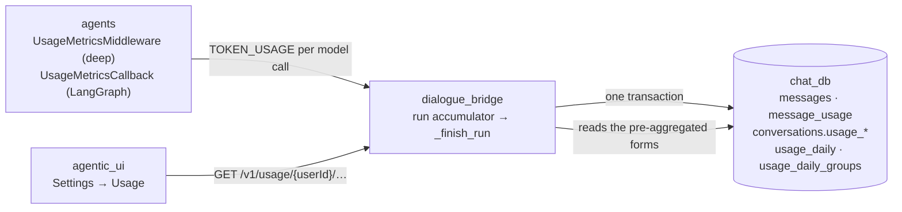
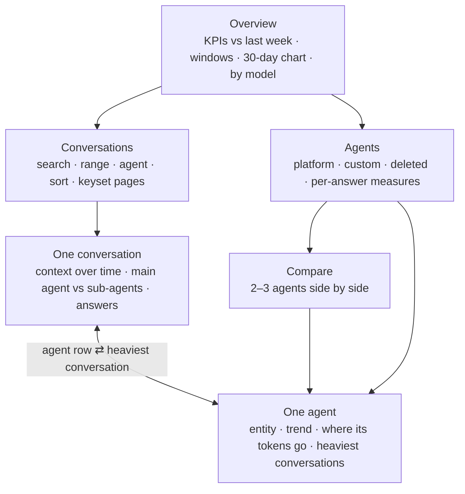
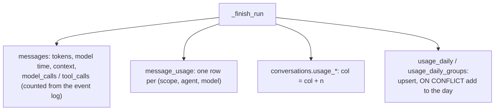

# Usage analytics (Settings → Usage)

The Usage tab is a dashboard you drill into. Its five pages are owned by the
**dialogue_bridge**, which records the data and serves it. They show what a
user's agents spent, how fast they answered, how well the prompt cache worked,
and where the tokens went. The data starts in the **agents** service: every
model call reports one `TOKEN_USAGE` event with its tokens, model, model time
and context fill. Deep agents report through `UsageMetricsMiddleware` and the
normalizer; LangGraph agents report through a LangChain callback. When an
answer finishes, the bridge writes that usage four ways in one transaction:

1. on the answer itself;
2. as a per-agent and per-model split (`message_usage`);
3. as running totals on the conversation;
4. as per-day rollups for the user.

Each page reads one of these pre-aggregated forms and never sums the user's
answers, so every page stays a few milliseconds whatever the account's size.
The **agentic_ui** renders the pages inside the settings panel and validates
every payload against a Zod contract.

---

## Services Involved

---

## The pages

| Page | Endpoint | Reads |
| --- | --- | --- |
| Overview | `GET /v1/usage/{userId}/summary` | `usage_daily`, `usage_daily_groups`, a count over `conversations` |
| Conversations | `GET …/conversations?sort=&range=&agentId=&q=&cursor=&limit=` | `conversations.usage_*` (keyset on the sort index) |
| One conversation | `GET …/conversations/{conversationId}` | that conversation's answers and `message_usage` rows |
| Agents | `GET …/agents?range=&kind=` | `usage_daily`, `usage_daily_groups`, a count over `conversations` |
| One agent | `GET …/agents/{agentKey}?range=` | the same, filtered to the agent |

The UI keeps the pages as a stack in `UsageTab`. Each page sets the panel's one
header: its title, a back link to where you came from, and the refresh action.
The time range is chosen once and shared, so drilling in keeps the period.

---

## Phase 1 — Every model call reports itself

Usage is measured where the call happens, because the bridge only ever sees
events. Deep agents carry `UsageMetricsMiddleware`, which stamps each reply
with its model, model time and context fill; the normalizer folds that into the
`TOKEN_USAGE` it already emits from `usage_metadata`. LangGraph agents stream in
`custom` mode, and their chains' replies never reach the normalizer. For them,
`LangGraphAgent` adds `UsageMetricsCallback` to the run config. LangChain
carries the callback into every chain a node invokes, even one called without
its config. The callback times each chat-model call and reads the provider's
usage when the call ends. The stream loop then drains those calls as
`TOKEN_USAGE` frames between chunks.

| Key fact | Value / detail |
| --- | --- |
| Call identity | the AIMessage id (deep agents) or `lg-<callback run id>` (LangGraph); the bridge dedupes on it |
| Context fill | deep agents only: provider prompt tokens over the model profile's `max_input_tokens`. A LangGraph pipeline has no single growing context, so it reports none. |
| Streamed calls | `ChatOpenAI` reports usage on streams by default (langchain-openai ≥ 0.3.35, default base URL) |

---

## Phase 2 — The bridge books a finished answer

The accumulator (`InferenceRunRuntime`) sums each call once, keyed by its
message id. It also groups the call by **(scope, agent, model)**:
- **Scope** is `main` for a call at the top level, or `subagent` for one
  wrapped in `SUBAGENT_EVENT`, or `compaction` for the main agent's summary
  call when it compacts (`TOKEN_USAGE` with `purpose: compaction`, plan 34).
- **Agent** names the sub-agent through a `task_id → subagent_type` map built
  from `TASK_SUBAGENT`.
- A call first seen bare and then wrapped moves to its sub-agent; it is never
  counted twice.

When the answer finishes, `_finish_run` writes everything in the transaction
that finalises the answer.

| Key fact | Value / detail |
| --- | --- |
| Call counts | `utils/run_activity.count_run_activity`, the same rules as the UI's `countRunActivity`: model calls = distinct `TOKEN_USAGE` message ids; tool calls = distinct `TOOL_CALL_START` ids; sub-agents included |
| Concurrency | every total is `col = col + n` or `ON CONFLICT … DO UPDATE SET col = col + excluded.col`, so nothing is read back first and no update is lost |
| Runs with no usage | an answer that spent nothing (e.g. failed before its first call) writes no rows and leaves its call counts `NULL` |

---

## Phase 3 — Pages read pre-aggregated data

Messages carry no `user_id`, so summing a user's answers is a join over
everyone's messages. That is why each page reads a pre-aggregated form
instead. The Overview and Agents pages sum the daily rollups: a few rows per
user, per day, per agent. The conversation list pages over the running totals
on `conversations`, on `ix_conversations_user_usage_total` or
`ix_conversations_user_usage_updated`. One conversation reads only its own
answers.

| Key fact | Value / detail |
| --- | --- |
| Load test (local, 2026-10-08) | One user with 5,000 conversations, 200,000 answers and 600,000 usage rows. p95: Overview 8.8 ms, conversation list 2.9–7.1 ms, one conversation 3.3 ms, agents 4.3 ms, one agent 10.9 ms; 1.4 ms per list page. Before the rollups, the Overview, agents and one-agent pages took 0.55–0.8 s. |
| Coverage | `detailed_answers` / `detailedInputTokens` count only answers with call counts and model time (plan 33 onward). Every ratio divides by them, so older answers never drag an average down. |
| Ratios shown | cache hit = cached ÷ detailed input; time / answer = model ms ÷ detailed answers; calls / answer; tools / answer; time / call |
| Too few answers | an agent needs 5 detailed answers in range before per-answer measures are shown |
| Rate limit | `usage_analytics_rate_limit`, per user, 60 / 60 s, applied after auth (it keys on the path's `{user_id}`) |

---

## Sharp Edges and Behavioral Notes

- **Old answers have tokens only.** Answers from before plan 33 have no call counts, model time or sub-agent split. Totals include them; the split, the "Model split" ranking and per-answer ratios cover newer answers only, and the pages say so ("recorded from Oct 8 onward"). One conversation counts its old answers' calls from their event logs on the fly, for up to 200 answers (`callsComplete` turns false beyond that).
- **Replaced answers count.** Totals include every answer, including ones a retry or an edit replaced, because they were spent. "Replaced" means off the latest branch. The composer's context card uses the same rule.
- **Compaction is spend, not an answer.** The summary call of a compaction is its own `compaction` group ("Compaction") in every split. A manual compaction adds its tokens, one model call and its model time to the conversation totals and the day, with 0 answers; see [context-compaction](context-compaction.md).
- **Forks start at zero.** A fork copies messages without their token counts, so its usage begins with its first new answer and nothing is counted twice.
- **Deleted conversations keep their spend in the rollups.** The daily rollups outlive a deleted conversation on purpose: the spend happened. So the Overview can exceed the sum of the listed conversations. The account purge deletes the rollups explicitly; `message_usage` and the conversation totals go with their rows.
- **Deleted agents are kept by name.** When an agent is deleted, its rollup rows keep their key but `agent_id` goes NULL, so readers identify an agent by `agent_id`, or by `agent_name` once it is deleted. Such an agent appears as "Deleted", with key `name:<label>`.
- **Agents are entities, never someone else's.** The kind (platform or custom) and engine come from `agents`. Another user's custom agent is never described, even if this user once ran it, and its profile is a 404.
- **Conversations per agent use the current agent.** Per-agent conversation counts and "heaviest conversations" use each conversation's current `agent_id` and its totals, not a distinct count over answers. A conversation that switched agents is rare.
- **Private chats are never listed or titled.** They count in every total, and the conversation list shows them as one aggregate row.
- **Compaction markers are inferred.** On the context chart, a drop of more than 30% between consecutive answers is marked "likely compacted".
- **The cursor is opaque but unsigned.** It only narrows the caller's own, already-scoped rows. Every field is validated, so a forged cursor gets a 400, never a query error.

---

## File Map

| Concern | File |
| --- | --- |
| Per-call metrics (deep agents) | `magenticx/agents/harness/middlewares/usage_metrics.py` |
| Per-call metrics (LangGraph agents) | `magenticx/agents/harness/agui/usage_callback.py`, `magenticx/agents/harness/abstractions/langgraph_agent.py` (`_stream_config`, `_pending_frames`) |
| Stream hooks | `magenticx/agents/harness/abstractions/base_agent.py` (`astream`) |
| Accumulator, booking | `magenticx/dialogue_bridge/utils/inference_runs.py` (`InferenceRunRuntime`, `_record_usage_breakdown`) |
| Call counting | `magenticx/dialogue_bridge/utils/run_activity.py` |
| Daily rollups writer | `magenticx/dialogue_bridge/utils/usage_rollups.py` |
| Queries | `magenticx/dialogue_bridge/utils/usage.py` |
| Routes, DTOs | `magenticx/dialogue_bridge/router/usage.py`, `magenticx/dialogue_bridge/schema/usage.py` |
| Tables | `magenticx/dialogue_bridge/core/database/models.py`; migrations `0032`–`0034` |
| UI pages | `magenticx/agentic_ui/src/features/settings/components/profile_parts/UsageTab.tsx`, `…/profile_parts/usage/*` |
| UI data | `…/settings/hooks/useUsageQuery.ts`, `useUsageConversationList.ts`, `…/settings/lib/usageMetrics.ts` |
| Contracts, API | `magenticx/agentic_ui/src/shared/lib/schemas.ts`, `shared/lib/api/usage.ts` |
| Composer card | `magenticx/agentic_ui/src/features/chat/components/ContextMeter.tsx` |
