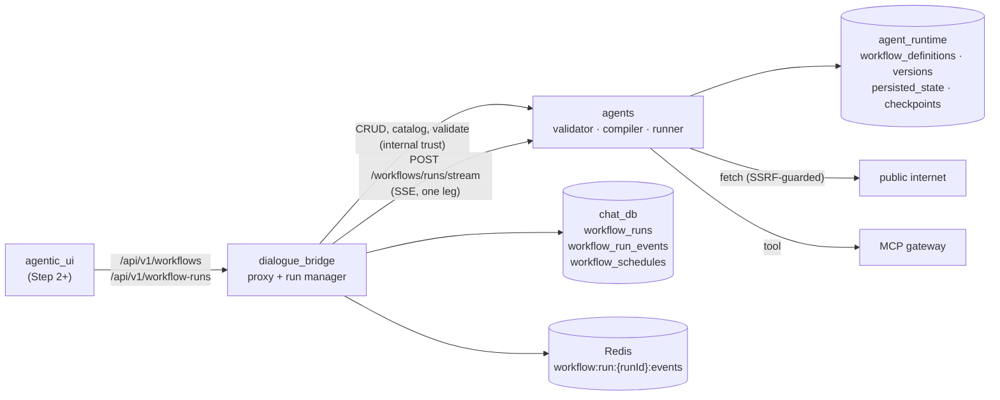
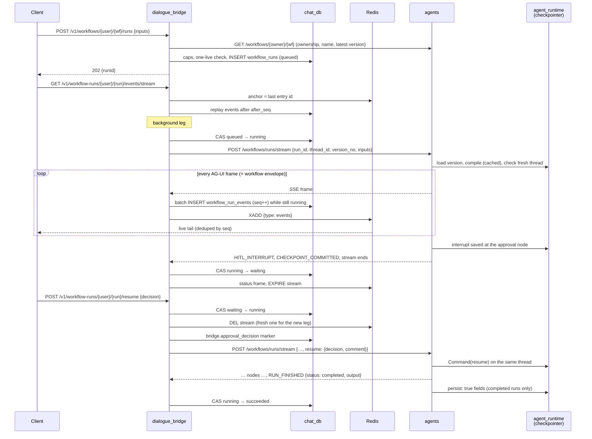
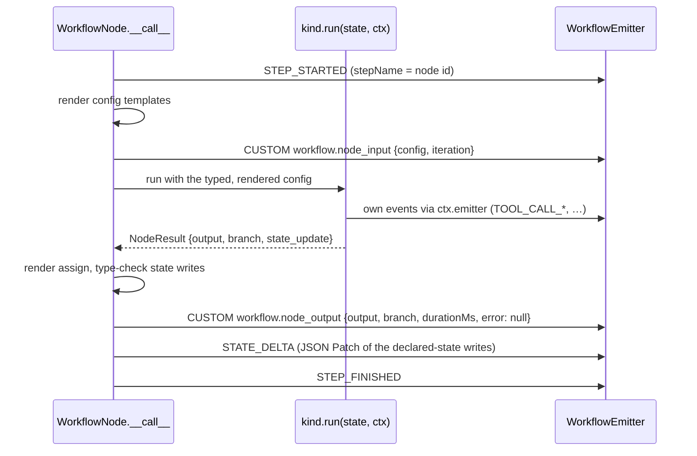
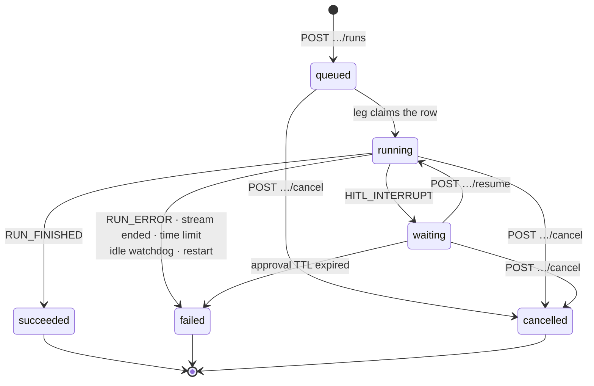
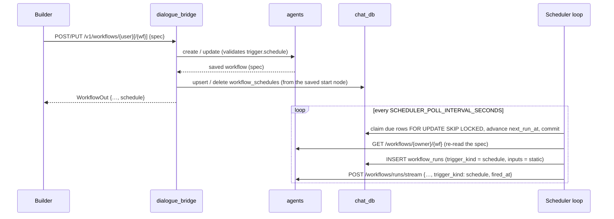

# Workflows

A **workflow** is a LangGraph graph described as data: typed run inputs, declared state fields with reducers, nodes from a closed catalogue, and the edges between them. It is **not an agent** (no `agent_definitions` row, no model loop of its own) and a **run is not a conversation** (no conversation, no messages). The **agents** service owns the definitions (`agent_runtime`) and the engine: it validates a spec, compiles it onto the durable checkpointer and streams a run as AG-UI frames. **dialogue_bridge** owns the runs: a `workflow_runs` row per run and every AG-UI event the engine emitted, in order, in `workflow_run_events`, fanned out live through Redis. The mental model: **the spec is data, the engine executes it one node at a time, every frame says which node execution it belongs to, and the bridge keeps the whole event log so history and live views are the same thing.** A workflow starts by hand (`trigger.manual`) or also on a clock (`trigger.schedule`, materialised by the bridge as a `workflow_schedules` row — see [Schedules](#schedules--triggerschedule)). This is plan 38, Step 1 (engine + runs storage, API only; the workflow view and builder come in Steps 2–3) plus the Step 4 `trigger.schedule` node.

---

## Services Involved



| Concept | Meaning | Stored as |
| --- | --- | --- |
| Workflow | The editable definition: owner, name, draft spec | `agent_runtime.workflow_definitions` |
| Version | Immutable spec snapshot; a run pins one | `agent_runtime.workflow_versions` |
| Persisted state | `persist: true` state fields carried to the next completed run | `agent_runtime.workflow_persisted_state` |
| Run | One execution of one version, on its own LangGraph thread | `chat_db.workflow_runs` |
| Leg | One streaming call to the agents service — the start, or one resume | (in memory, bridge) |
| Execution | One time a node ran inside a run: `<nodeId>#<n>` | `workflow_run_events.execution_id` |
| Schedule | A workflow's clock, from its `trigger.schedule` start node | `chat_db.workflow_schedules` (the spec is the source of truth) |

---

## A Run — Full Sequence

A manual run with one approval pause: two legs on the same LangGraph thread.



---

## Phase 1 — The Spec (`WorkflowSpec` v1)

The spec owns only the *shape*; every model refuses unknown keys, so a typo is an error, not a silently ignored field. Graph rules live in the validator, and each node kind validates its own `config`.

```json
{
  "version": 1,
  "name": "…",
  "description": "",
  "inputs": [{"name": "job_url", "type": "string", "required": true, "default": null, "description": ""}],
  "state":  [{"name": "history", "type": "array", "reducer": "append", "default": null, "persist": false}],
  "nodes":  [{"id": "poll", "kind": "fetch", "label": "Poll", "config": {…}, "position": {"x": 0, "y": 0}}],
  "edges":  [{"id": "e1", "source": "start", "target": "poll", "branch": null}]
}
```

| Part | Rules |
| --- | --- |
| Value types | `string`, `number` (a boolean is not a number), `boolean`, `object`, `array` |
| `inputs` | Supplied by whoever starts the run, read as `{{input.<name>}}`. Unknown inputs refused; a required input without a default must be present; every value must match its type. Missing optional → `null` |
| `state` | Declared fields, read as `{{state.<name>}}`. `reducer`: `overwrite` (replace), `append` (array only; a list extends, anything else is one item), `merge` (object only; shallow). Start value = `default`, else the type's zero value |
| `persist` | Field loaded from `workflow_persisted_state` at a fresh run's start (only if the stored value still fits the declared type) and written back when the run **completes**; a failed or paused run leaves the previous values |
| `nodes` | `id` matches `^[A-Za-z][A-Za-z0-9_-]{0,63}$` (no dots, no leading `_`); `kind` from the catalogue; `position` is layout only |
| `edges` | `branch` is required exactly when the source branches (`^[a-z][a-z0-9_]{0,31}$`) |
| Names | Inputs and state fields are identifiers `^[A-Za-z_][A-Za-z0-9_]{0,63}$`; reserved: `input`, `nodes`, `iterations`, `trace`, `state`, `output` |

**Engine-owned state keys** (besides the declared fields), all plain JSON so they checkpoint under the msgpack allow-list:

| Key | Holds |
| --- | --- |
| `input` | The validated run inputs, written once |
| `nodes` | `{nodeId: {output, branch, executionId}}` — each node's **latest** result (full history is the event log) |
| `iterations` | `{nodeId: n}` — executions per node |
| `trace` | `{loops: [executionId…], last}` — the active loop stack (innermost last) and the last execution |

A worked example lives in the test fixture [`fetch_loop_approval.json`](../../tests/agents/fixtures/workflows/fetch_loop_approval.json): manual → fetch → condition → approval | loop (back to fetch) → end.

---

## Phase 2 — Node Catalogue (Step 1)

Closed: a kind is a `WorkflowNode` subclass registered in `nodes/__init__.py`; nothing user-supplied becomes a node class. `GET /workflows/catalog` returns each kind's label, group, branches and its `Config` JSON Schema (the builder's form), derived from the classes so it cannot drift from the validator.

Every config also accepts **`assign`** (≤ 32 entries): `{stateField: template}`, rendered *after* the node ran, so it may read the node's own result as `{{output.<path>}}`. It may only write declared state fields; each write is type-checked against the field (a mismatch fails the node with code `state`).

| Kind | Group | Config | Output | Branches |
| --- | --- | --- | --- | --- |
| `trigger.manual` | trigger | — | The run's inputs | — |
| `trigger.schedule` | trigger | `schedule_kind`, `schedule_spec`, `timezone`, `inputs`, `enabled` — not templated (see [Schedules](#schedules--triggerschedule)) | `{trigger, firedAt, inputs}` | — |
| `tool` | tools | `tool: {source: native\|mcp, name}`, `args` (templated), `timeout_seconds` (default 60, ≤ 300) | `{result}` — parsed JSON when the tool returned JSON text, else text; ≤ 1 MiB | — |
| `fetch` | data | `method: GET\|POST`, `url` (≤ 2048), `headers` (≤ 32), `query` (≤ 32), `body` (POST only), `timeout_seconds` (default 15, ≤ 30), `response_type: auto\|json\|text` | `{status, ok, url, contentType, body}` | — |
| `condition` | flow | `mode: all\|any`, `rules` (1–20) | `{result: bool}` | `true` / `false` |
| `router` | flow | `cases` (1–16): `{name, mode, rules}`, tried in order | `{case}` | each case name + `default` |
| `loop` | flow | `max_iterations` (default 5, ≤ 20), `mode`, `while` (0–20 rules; empty = until the cap) | `{iteration, continue}` | `continue` / `done` |
| `approval` | flow | `message` (≤ 2000), `payload` (templated, shown with the question) | `{decision, comment}` | `approved` / `rejected` |
| `end` | output | `outputs` (≤ 32, templated); empty = the whole declared state | The mapped result; also the run's `RUN_FINISHED` result | — (no outgoing edges) |

Node-specific behaviour:

- **`tool`** — MCP tools resolve against the live gateway catalogue (same load path as a chat run); native tools only from `WORKFLOW_NATIVE_TOOLS` = `search_past_conversations`. Most native tools need a conversation or are approval-gated writes, and a workflow has neither yet, so they stay out; put an `approval` node in front of a side effect. The call streams as ordinary `TOOL_CALL_START/ARGS/RESULT/END` (call id `<runId>:<executionId>`). Failure codes: `tool_timeout`, `tool_too_large`, `tool_unavailable`, `tool_failed`.
- **`fetch`** — a non-2xx status is **data**, not a failure. `Host`, `Content-Length`, `Transfer-Encoding`, `Connection`, `Upgrade`, `TE`, `Trailer` cannot be set; header values with line breaks are refused; templated values are trimmed and empty ones dropped. Failure codes: `ssrf_blocked`, `dns`, `fetch_timeout`, `fetch_too_large`, `fetch_redirects`, `fetch_parse`, `fetch_config`, `fetch_failed`. See Phase 7.
- **`router`** — case names are branch names; `default` is reserved and a name may not repeat.
- **`loop`** — on its n-th execution it takes `continue` while `n ≤ max_iterations` and `while` holds, else `done`. `continue` pushes this execution on the loop stack (replacing its previous iteration and any inner frames above it); `done` pops it. The counter is per run, not per entry: a loop nested in another loop's body does not restart on the outer loop's next iteration (v1 limit).
- **`approval`** — always pauses (Phase 5).

### Rules (`condition`, `router`, `loop.while`)

The only way a workflow branches. A rule is `{path, op, value}`: a bare path (same roots as templates, no braces), a fixed operator, a literal (which may itself be a template).

| Op | Semantics |
| --- | --- |
| `eq` / `ne` | Equality, except a boolean only equals a boolean (`true ≠ 1`) |
| `gt` `gte` `lt` `lte` | Number vs number or string vs string; any other pairing is `false` |
| `contains` | Substring (string), membership (array), key (object) |
| `exists` | Path resolves and is not `null` |
| `empty` | Missing, `null`, `""`, `[]` or `{}` |

A missing path **raises** (the node fails, code `template`) for every op except `exists` / `empty` — a mistyped rule fails loudly instead of quietly taking the wrong branch. `all` over an empty list is true, `any` is false.

---

## Phase 3 — Templating

Path substitution only: no expressions, filters, Jinja or `eval`. Fetched text containing `{{state.secret}}` is substituted once, as text, and never rendered again (`re.sub` with a function never rescans its output).

| Rule | Detail |
| --- | --- |
| Roots | `input.<name>`, `state.<name>`, `nodes.<id>.output[.<path>]` (the rest of a node record is bookkeeping); `output[.<path>]` only inside `assign` |
| Path | Dot-separated segments `[A-Za-z0-9_-]{1,64}`, ≤ 16 after the root. Dicts by key, lists by decimal index; nothing else is traversed |
| What is templated | String values only, recursively through dicts and lists — never keys, numbers or booleans |
| Whole-value placeholder | `"{{nodes.poll.output.body}}"` becomes the value with its type kept (a deep copy) |
| Embedded placeholder | Stringified: `null` → `""`, booleans `true`/`false`, objects/arrays as compact JSON |
| Unresolved path | `TemplateError` naming the path → the node fails with code `template` |

---

## Phase 4 — Validation and Compilation

Every save, every `/validate` and every compile runs the validator; the builder is never the authority. It reports **every** issue in one pass, each `{nodeId, path, message}` (`nodeId` null for a workflow-level issue), so the builder can pin each one on its node.

| Stage | Checks |
| --- | --- |
| 1. Size | ≤ 256 KiB of compact JSON and ≤ 50 nodes — before anything is parsed |
| 2. Shape | Pydantic models, unknown keys refused; ≤ 200 edges, ≤ 32 inputs, ≤ 32 state fields |
| 3. Names | Unique node / edge / input / state names; none reserved; no node id equal to a state name (LangGraph channels and nodes share a namespace); `append` needs `array`, `merge` needs `object`; defaults match their types |
| 4. Nodes | Known kind; valid `config`; the kind's own checks (`tool` ref allowed / in the gateway catalogue, `router` case names) |
| 5. Graph | Exactly one trigger (`trigger.manual` or `trigger.schedule`, counted by kind); edges between existing nodes; nothing into the trigger; nothing out of an `end`; a branch label exactly when the source branches, one of its branches, **at most one edge per (source, branch)** — a run follows one path at a time; every `loop` has a `continue` edge; every node reachable from the trigger; no cycle once every loop's `continue` edge is removed |
| 6. References | Every template and rule path names a declared input, state field or existing node; `assign` writes only declared fields |

The MCP check uses the gateway's cached manifests; when the catalogue cannot be read, MCP refs are not checked at save time (they still fail at run time).

**Compiler.** One LangGraph node per spec node (the node instance's wrapper); `START → trigger`. A branching node gets a conditional edge that reads the branch it recorded in `state.nodes[id].branch`; **a branch with no edge, or a node with no outgoing edge, ends the run** — not every branch has to be wired. The compiled graph is cached per `(workflow_id, version_no)` (LRU of 64, keyed on the checkpointer instance; a deleted workflow is forgotten). `recursion_limit = nodes × (1 + Σ loop max_iterations) + 10`, capped at 2000 — a correct run can never hit it; hitting it fails the run with `step_limit`.

**Versions.** Create stores the draft and version 1 in one transaction. A save locks the row, compares the canonical JSON of the new spec with the latest version and adds a version only when it changed. A run pins `version_no` at start (the bridge stores the latest it saw) and keeps it through resume. On run start the stored version is re-validated (without the live MCP catalogue); one that no longer validates is refused 422 "save it again".

---

## Phase 5 — Node Lifecycle and Events

`WorkflowNode.__call__` wraps every kind's `run()`, so no kind can skip or reorder the bracket. Every frame carries the run envelope.



| Case | Frames |
| --- | --- |
| Success | `STEP_STARTED` → `workflow.node_input` → own events → `workflow.node_output` → `STATE_DELTA` → `STEP_FINISHED` |
| Failure | Bracket still closes: `node_input` (`config: null` if templating failed) → `node_output {output: null, error: {code, message}}` → `STEP_FINISHED` (no `STATE_DELTA`) → run `RUN_ERROR` `node_failed` |
| Approval pause | `STEP_STARTED` → `node_input` → `CUSTOM HITL_INTERRUPT` (`metadata.source = "workflow.approval"`, `nodeId`, `executionId`); the step stays open. On resume the same execution (same `executionId`) re-runs from the top, as LangGraph re-runs an interrupted node |

`STATE_DELTA` mirrors the reducers so replaying the patches rebuilds the declared state: `overwrite` → `add /<field>`, `append` → `add /<field>/-` per item, `merge` → `add /<field>/<key>` per key.

**Envelope** — stamped on every frame through `AGUIEmitter._extra_fields()` (one `WorkflowEmitter` per node execution), so a node's own tool-call frames carry it without any call site adding it:

```json
"workflow": {"runId": "<run id>", "nodeId": "poll", "executionId": "poll#2", "parentExecutionId": "retry#1", "iteration": 2}
```

| Field | Meaning |
| --- | --- |
| `executionId` | `<nodeId>#<n>`, `n` = 1-based count of that node's executions in the run |
| `iteration` | That same `n` |
| `parentExecutionId` | The innermost active `loop` execution this one runs inside; `null` outside any loop |
| Run-level frames | `RUN_STARTED`, `workflow.run`, `CHECKPOINT_COMMITTED`, `RUN_FINISHED`, `RUN_ERROR` carry `runId` with the other fields `null` |

**Run stream** (`POST /workflows/runs/stream`):

| Order | Frame |
| --- | --- |
| 1 | `RUN_STARTED` |
| 2 | `CUSTOM workflow.run {workflowId, versionNo, resumed}` |
| 3 | Every node's bracket |
| 4a | Completed: `CUSTOM CHECKPOINT_COMMITTED {thread_id, checkpoint_id}` → `RUN_FINISHED {result: {status: "completed", output}}` (`output` = the last executed node's output, i.e. the `end` node's) |
| 4b | Paused: the node's `HITL_INTERRUPT`, then `CHECKPOINT_COMMITTED`, and the stream ends — no `RUN_FINISHED` |
| 4c | Failed: `RUN_ERROR {message, code}` — `node_failed`, `step_limit` or `run_failed` (generic; the traceback stays in the log) |

While a node is busy, `: keep-alive` goes out every 15 s. The graph runs in its own task; a client disconnect cancels the generator, which cancels the graph — **a closed connection stops the run**.

Error messages streamed to the owner name a node, a path or a rule — never a secret, a traceback or fetched data. An unexpected exception becomes `{code: "internal", message: "The node failed unexpectedly."}`; a config that no longer validates after templating is described by field location only (`config`). The node-failure log line carries ids and the error code, never config or data.

---

## Phase 6 — Runs (bridge)



| Status group | Statuses | Used for |
| --- | --- | --- |
| Live | `queued`, `running`, `waiting` | One per workflow per user — the unique partial index `uq_workflow_runs_one_live` (a racing start gets 409) |
| Active | `queued`, `running` | The per-user cap (`WORKFLOW_MAX_ACTIVE_RUNS_PER_USER`, 429); a waiting run holds no connection and is not counted |
| Terminal | `succeeded`, `failed`, `cancelled` | `finished_at` + `error` set |

**Start.** The upstream `GET` comes first, before the DB session is touched: it proves the workflow is the user's (404 otherwise) and pins `version_no` + `workflow_name` (denormalised so history reads after a rename). Then the active-run cap, the live check, `INSERT … queued` with a fresh `thread_id`, and a best-effort prune that keeps the newest `WORKFLOW_MAX_RUNS_PER_WORKFLOW` runs (never a live one).

**A leg** (`WorkflowRunManager`, one task per run per process):

| Step | Detail |
| --- | --- |
| Claim | CAS `queued → running` (a resume arrives already `running`) |
| Reader | `POST /workflows/runs/stream` with internal-trust headers, mTLS on Dennis; read timeout = `WORKFLOW_RUN_STREAM_IDLE_TIMEOUT_SECONDS`; frames into a bounded queue (1000) |
| Writer | Assigns `seq` (continuing from `event_count`), lifts `nodeId` / `executionId` / `parentExecutionId` out of the envelope into indexed columns, buffers |
| Persist | Every `WORKFLOW_RUN_PERSIST_BATCH` events or `WORKFLOW_RUN_PERSIST_INTERVAL_MS`: one transaction that bumps `event_count` **only while the row is still `running`**, inserts the batch, commits — **then** `XADD` to Redis. Persist-before-publish makes the stream gap-free |
| End | `RUN_ERROR` → `failed` (its message, ≤ 1000 chars); `HITL_INTERRUPT` → `waiting`; `RUN_FINISHED` → `succeeded`; a stream that just stops → `failed`; past `WORKFLOW_RUN_STREAM_MAX_SECONDS` → `failed` "time limit"; upstream HTTP error → `failed` "refused the run (HTTP n)" / "could not be reached" |

Every status write is a compare-and-set on the expected status. That is how a cancel or the watchdog — possibly on another replica — stops a leg: its next persist finds the row no longer `running` and stops (`_Superseded`).

**Bounds on what is stored:**

| Bound | Behaviour |
| --- | --- |
| `WORKFLOW_RUN_MAX_EVENTS` (20000) | Past it, one `bridge.events_truncated {maxEvents}` marker; afterwards only `RUN_STARTED` / `RUN_FINISHED` / `RUN_ERROR` and `HITL_INTERRUPT` are kept |
| `WORKFLOW_RUN_MAX_EVENT_BYTES` (64 KiB) | A larger event is stored as `{type, truncated: true, originalBytes, preview, name?, workflow?}` (preview = half the cap) |
| Envelope ids | Lifted columns truncated to 200 chars |

**Event stream** (`GET …/events/stream`, SSE). Anchor = the Redis stream's last entry id, taken **before** the DB is read; then a `status` frame, a DB replay of events after `after_seq` (or `Last-Event-ID`), then — while a leg is streaming — the live Redis tail deduplicated by `seq`, a catch-up replay, and a closing `status` frame. Each event frame carries `id: <seq>`, so a reconnecting `EventSource` resumes exactly. The tail closes on a status frame for `waiting` or a terminal status; `: keep-alive` every `WORKFLOW_RUN_STREAM_HEARTBEAT_SECONDS`. If Redis is down the stream replays history only. The router closes its DB session before streaming.

| Frame | Shape |
| --- | --- |
| Status | `{"type": "status", "run": WorkflowRunOut}` |
| Event | `{"type": "event", "event": {seq, type, nodeId, executionId, parentExecutionId, payload, createdAt}}` |

Redis key `workflow:run:<runId>:events`; a leg that closes (waiting or terminal) gets the usual terminal `EXPIRE`, and a resume `DEL`s it so the new leg starts a fresh stream (XADD would not clear the TTL).

---

## Phase 7 — Approval, Cancel, Watchdog

**Approval.** The `approval` node calls LangGraph `interrupt({type: "workflow.approval", nodeId, executionId, message, payload, allowedDecisions: ["approve", "reject"]})`. The checkpoint holds the pause, so nothing stays in memory: a `waiting` run survives a restart of either service. `POST …/resume {decision, comment?}` does CAS `waiting → running` (a second answer, or one racing the TTL or a cancel, gets 409), counts against the active cap, writes a `bridge.approval_decision {decision, comment?}` event carrying the paused node's `workflow` block (so the timeline puts it on that node), and starts a leg with `resume`. The agents service refuses a resume when the thread is not paused on a `workflow.approval` interrupt (409) and resumes with `Command(resume={interrupt_id: answer})`, so the answer can only reach that pause. The comment is trimmed (blank → none), ≤ 4000 chars at the bridge and ≤ 2000 at the engine.

**Cancel.** `POST …/cancel` writes `cancelled` first (CAS from any live status, error "Cancelled by the user."), then wakes this process's leg; a leg on another replica stops at its next persist. Buffered, unpersisted events are dropped. A finished run is returned unchanged. Deleting a workflow cancels its live runs and deletes its whole history.

**Watchdog** (`run_workflow_watchdog`, every `WORKFLOW_RUN_WATCHDOG_INTERVAL_SECONDS`; `updated_at` is the activity clock):

| Condition | Result |
| --- | --- |
| Active run with no persisted activity for `WORKFLOW_RUN_STREAM_IDLE_TIMEOUT_SECONDS` | `failed` "The workflow stopped responding." + local leg woken |
| `waiting` for longer than `WORKFLOW_APPROVAL_TTL_HOURS` | `failed` "The approval expired before anyone answered it." — the workflow's live slot is free again |
| Bridge startup | Every `queued` / `running` run → `failed` "interrupted by a service restart"; `waiting` runs are left alone |

---

## Phase 8 — `fetch` SSRF Guard

The agents service sits on the internal network next to Postgres, Redis, the bridge and the sandbox runner, and a fetch URL is owner-authored **and** templated from run data (a fetched page can supply the next URL). So:

| Control | Detail |
| --- | --- |
| Scheme | `http` / `https` only; no credentials in the URL (send them as a header) |
| Resolution | The host is resolved by the guard; **every** address must be public — a mixed answer is refused (fail-closed) |
| Pinning | The request goes **to the checked address** (host swapped for the IP; `Host` header and TLS SNI keep the name, so certificates verify). No second DNS lookup — no rebinding window. `trust_env=False`, so no env proxy reroutes it |
| Redirects | Not followed by the client: `fetch` follows ≤ 3 itself, each hop through the guard again. Credential headers (`Authorization`, `Cookie`, `Proxy-Authorization`) are dropped when a hop leaves the original origin; 303 (and 301/302 after POST) become GET without a body |
| Blocked | RFC 1918, ULA, loopback, link-local (incl. `169.254.169.254`), CGNAT `100.64.0.0/10`, multicast, reserved, unspecified, documentation/benchmark ranges, and IPv6 forms embedding a blocked IPv4 (mapped, NAT64, 6to4, Teredo) |
| Size / time | ≤ 30 s for the whole exchange; body read as a stream and refused past 1 MiB (a declared larger `Content-Length` is refused up front) — never truncated |
| Logging | Nothing about the request or response; only the outcome code |

---

## Phase 9 — The Visual Builder (agentic_ui, Step 3)

`/workflows/new` and `/workflows/:workflowId/edit` (route view `pages/WorkflowBuilderView.tsx`, page `features/workflows/components/builder/`). Laid out like the agent builder: top bar · step palette · canvas, with the inspector sliding over the canvas as a drawer. **Focus mode:** while the builder is open the app sidebar is collapsed (`useSidebarFocusMode`; still toggleable, restored on leave if it was open). Entry points: **New workflow** (header) and **Edit** (a card) in the Automations page's Workflows area (`/automations?view=workflows`), and **Edit** in the workflow view's header. Leaving a workflow never saved, or deleting one, returns to the Workflows area; leaving a saved one opens its view (`pages/WorkflowBuilderView.tsx`).

| Part | Behaviour |
| --- | --- |
| Draft | The spec itself, changed only by `lib/builder/draft.ts` (`draftReducer`) through `useWorkflowDraft` (undo / redo, typing coalesced). **Autosave**, as the agent builder's: while the draft has unsaved changes it is kept in `localStorage` (`workflow-draft:<userId>:<workflowId|new>`, `useWorkflowDraftAutosave`, ~700 ms after the last edit); an untouched workflow stores nothing. Opening the builder again offers it back ("Restore unsaved changes from 10:42?" — Restore puts it on the canvas as an undoable, unsaved edit; Discard forgets it); a save or a delete clears it. A new workflow starts **empty**: no name and no steps (the canvas says "Start with a trigger"); the builder's checks ask for a name and exactly one trigger on save. Every workflow has a title: the engine refuses a blank or spaces-only `name` too (`WorkflowSpec`, trimmed) |
| Palette | `GET /v1/workflows/catalog`, grouped by `group` (`lib/builder/palette.ts`), searchable; drag onto the canvas or click to add next to the selected step (connected to it when it can be). Trigger kinds are steps like any other: nothing is locked; a second trigger is flagged by the checks ("A workflow has exactly one trigger."). Every step, a trigger too, is deleted on the canvas — its card's delete (on hover, focus or selection), Backspace / Delete, or the right-click menu; the inspector has no delete button. A panel over the canvas's left edge (17rem), opened from the canvas's **Steps** button (top left) or the empty canvas's "Open the steps", closed by its own button or Esc; shut by default, the choice remembered per device (`usePaletteOpen`, localStorage). Always the full list — no icon rail. The canvas keeps its whole width: opening or shutting the palette never resizes it or moves the graph (framing, reveal and the zoom controls keep clear of it). Each group heading (chevron, count) folds its group, remembered per device (`usePaletteGroups`); a search opens every group with a match. A bottom sheet on a phone |
| Canvas menu | Right-click (desktop, `CanvasContextMenu`, a Radix dropdown opened at the pointer). Empty canvas: Add a step, **Tidy up** ("Line the steps up, left to right"), Fit to view, Select all, Undo, Redo, Clear canvas (asks first; Undo brings it back). A step: Edit step, Duplicate (a copy beside it, config and label included), Delete step. A connection or a multi-selection: delete. There is no Tidy up button on the canvas. On a phone (no right-click) Tidy up, Undo and Clear sit with the zoom controls, and Settings is only under the canvas (beside Add step), not in the top bar |
| Canvas | The shared `WorkflowNodeCard` / `WorkflowEdge` in edit mode. One source handle per branch (router: one per case + `default`); `canConnect` (`lib/builder/graph.ts`) refuses self, duplicate, a second edge per (source, branch), anything into the trigger or out of `end`, and a cycle not through a loop's `continue` — the validator's rules, at drop time. Snap grid, multi-select, Backspace/Delete, **Tidy up** (`lib/layout.ts`, columns `LAYOUT_GAP.x` = 160px apart past the card, rows 64px), positions saved in `nodes[].position`. Framing (`graphFitView`) keeps 56px round the graph, clear of the open drawer, and never zooms below 0.5. The graph is framed on first load, on Tidy up, by the fit-view control, and after a window resize (debounced, only while the user has not panned or zoomed) — never by the drawer or the palette |
| Inspector | Not a column: a drawer over the canvas's right edge, open while something is picked or **Settings** (top bar) is on; × or Esc closes it (and drops the pick); a click on the empty canvas drops a pick, which closes it too. It is an overlay: opening or closing it never re-frames or moves the graph, and nothing inside it (typing, a tooltip, the server's verdict) moves the view: the canvas frame clips without being a scroll container (`overflow: clip`), fields focus without scrolling anything but the inspector, the inspector keeps a steady scrollbar gutter, and an edit re-renders only the cards it changes. An issue sits under the field it is about (a bad template reference under the field holding it, not above the form). A picked step hidden under it is panned into view once, after the drawer has finished opening. Settings: name, description, inputs, state fields. A step: id (rename moves its edges and the `nodes.<id>` references), label, and a form generated from the kind's `configSchema` (`lib/builder/schemaForm.ts`): text / number / enum / boolean, nested objects, maps, `assign`, rule lists, router cases (a renamed case keeps its edge, a removed one drops it), JSON fallback; templated fields get a path helper (`input.*`, `state.*`, upstream `nodes.<id>.output…`). A `trigger.schedule` node gets its own editor instead of the generic form — see [Schedules → In the UI](#in-the-ui) |
| Validation | `checkSpec` (client mirror) on every change + `POST /validate` 800 ms after the last edit; both placed on nodes (card badge) and in the Issues menu; server paths (`nodes[i]…`) resolved against the spec they were checked on |
| Save | Client errors block; then validate; then create (→ edit route, same builder, no reload) or update (toast with the new version, or "No changes"). A 422's `detail.errors` are placed like validate's. Ctrl/Cmd+S. Delete asks in a dialog; leaving with unsaved changes asks first |

**The run view's graph** (`workflow_view_parts/WorkflowGraph.tsx`) draws the spec's own positions only when they read cleanly (`layoutIsClean`: no curve through a card, at least `CLEAN_MIN_GAP` — 120px between a forward edge's handles, 48px between cards), else the same `lib/layout.ts` layout Tidy up uses. It takes the larger share of the page (58% by default); the handle under it resizes the graph / timeline split (drag, arrow keys, double-click resets), clamped to 25–80% and remembered per device (`useGraphSplit`).

## Phase 10 — Where Workflows Live (agentic_ui)

Workflows are listed and created on the **Automations page**, the home of both kinds of automation (`features/automations/`, plan 38 §3.2): a segmented switch in its header picks the **Schedules** or **Workflows** area, kept in the URL as `?view=schedules|workflows` (default schedules; `automationsAreaFromParam` / `automationsAreaPath` in `lib/routes.ts`). The header's primary button follows the area ("New schedule" / "New workflow", from the kind registry's `createLabel`).

| Part | Behaviour |
| --- | --- |
| Kind | `workflow` is a kind in the registry (`lib/kinds.ts`, `AUTOMATION_KINDS`): the "Workflow" badge on its cards. `AutomationItem` is `ScheduleAutomationItem \| WorkflowAutomationItem` |
| Cards | `automations_parts/WorkflowCard.tsx`, in the schedule cards' chrome (`AutomationCardChrome.tsx`): name, description, `v<latestVersionNo>`, and when it runs — the schedule its `trigger.schedule` start node sets (`Workflow.schedule`, optional: a Scheduled / Paused / Finished chip, the cadence, the next run, the last scheduled run and how it went) or "Runs when you start it". No latest-run line for hand-run workflows: the runs list has no page size, so it would cost a request per card |
| Actions | **Open** → `/workflows/:id`; **Edit** → `/workflows/:id/edit`; **Run now** (`useWorkflowQuickRun`) reads the workflow and, with no required input (`needsRunInputs`), starts a run with `{}` and opens it — otherwise opens the workflow view, whose Run dialog asks; **Delete** behind an in-page confirm, then the list reloads; **Pause / Resume schedule** on a scheduled card (not a finished one), optimistic — see [Schedules → In the UI](#in-the-ui) |
| Empty / long | No workflows: a hero whose "Create your first workflow" opens `/workflows/new`. A search box (name, description) from 8 workflows |
| Scheduling | A workflow is scheduled only through its start node in the builder — never from the Schedules area, which stays agent + prompt |

The sidebar keeps a **Workflows** section for quick access — one entry per workflow, hidden while there are none, with no create button.

---

## Schedules — `trigger.schedule`

A workflow is scheduled by its **start node**: the user drops `trigger.manual` or `trigger.schedule` from the palette as the first node. The node's config in the spec is the **source of truth**; the bridge materialises it as one `workflow_schedules` row per workflow (migration `0045`), which its scheduler polls. Workflow schedules are **not** `scheduled_tasks` rows and never appear on Automations → Schedules (that list stays agent + prompt); they are edited in the builder and only paused / resumed through the API below.



### The node

`trigger.schedule` (group `trigger`, `isTrigger: true`, no branches). Its config mirrors the bridge's scheduled-task schedule model field for field, so the bridge hands it to the same `compute_next_run_at`:

| Field | Type | Rules |
| --- | --- | --- |
| `schedule_kind` | `"one_off"` \| `"interval"` \| `"cron"` | Required |
| `schedule_spec` | object, no other keys | Exactly the kind's one field: `run_at` (ISO 8601 date-time; no offset = UTC) for `one_off`, `interval_seconds` (integer, 300 – 31 622 400) for `interval`, `cron_expr` (5-field cron, ≤ 120 chars, checked with `croniter`) for `cron` |
| `timezone` | string \| null | IANA zone a cron expression is read in (default `UTC`); ignored by the other kinds; unknown zones refused |
| `inputs` | object (≤ 32 keys) | Literal run inputs of a scheduled fire. Every key a declared input, every value of its type; while `enabled`, every required input without a default must be given. **Not templated** — a `{{` stays text |
| `enabled` | boolean, default `true` | `false`: the workflow keeps the node but has no schedule (the bridge deletes its row) |
| `assign` | object | As every node |

A `one_off` moment in the past still validates — the stored version is re-validated at every run start, and "Run now" must keep working after the one-off fired; the bridge simply schedules nothing for it. The 300 s floor is the engine's copy of `SCHEDULER_MIN_INTERVAL_SECONDS`; the bridge clamps to its own setting if that is stricter.

**Output** (also when run by hand): `{trigger: "schedule" | "manual", firedAt: "<ISO 8601 Z>", inputs: {…}}`. A scheduled workflow can still be **run now**: the run request's inputs are laid over the node's static inputs (a `null` does not blank a static value), then validated as usual. The run request carries `trigger_kind` (`manual` | `schedule`) and `fired_at` (the run row's `created_at`); the engine puts them on the run config (`RunInfo.trigger_kind`, `RunInfo.fired_at`). Validation stage 5 counts triggers **by kind**, so a trigger whose config is invalid is still "the one trigger" and its config error is the only issue reported.

### Sync (definitions proxy)

`utils/workflow_schedules.sync_workflow_schedule`, after the agents service accepted a create or update — that call is the commit point:

| Saved start node | Row |
| --- | --- |
| `trigger.schedule`, `enabled` | Upserted. Same kind + spec + timezone → `next_run_at` and `status` kept (a re-save never resets the clock); new cadence → `next_run_at` recomputed, `paused` stays paused, `finished` becomes `active` again; no next slot → `finished` |
| `trigger.manual`, `enabled: false`, or a config the bridge cannot read / refuses (bad cron or zone) | Deleted (fail-closed: never a guessed schedule) |
| Workflow deleted | Deleted after the upstream delete, with the run history |

A database failure during sync is logged and the save still answers 200/201; the next save — or the next fire's re-read — heals the row.

### Fire

From the scheduled-tasks loop (`Scheduler._tick` → `run_due_workflow_schedules`), sharing its cadence, `SCHEDULER_ENABLED` switch and `SCHEDULER_CLAIM_BATCH_SIZE`:

1. **Claim** — `SELECT … WHERE status='active' AND next_run_at <= now() AND NOT EXISTS (open account deletion) ORDER BY next_run_at LIMIT :batch FOR UPDATE SKIP LOCKED`; per row `last_run_at = now`, `run_count += 1`, `next_run_at` = the next slot strictly after now (`NULL` + `finished` for a spent one-off); **commit before firing**. Missed slots during downtime fire once and resync — never backfilled.
2. **Re-read** the workflow upstream with no session open. 404 → the row is dropped. Upstream unavailable → `last_run_status = failed`. A spec whose schedule no longer matches the row (a failed sync, a disabled trigger) → the row is re-synced and nothing fires.
3. **Start** — `start_workflow_run(db, user, wf, inputs = node.inputs, trigger_kind="schedule", workflow=<the read>)` + `launch_or_fail`; `last_run_id` = the run, `last_run_status = started`. A live run (409) or the per-user active cap (429) → `skipped`; the slot is still consumed.

### API surface

`WorkflowOut` (list, get, create, update) carries `schedule` — `null` without one:

```json
"schedule": {"status": "active|paused|finished", "kind": "one_off|interval|cron",
             "spec": {"interval_seconds": 3600}, "timezone": null,
             "nextRunAt": "…Z", "lastRunAt": "…Z", "lastRunStatus": "succeeded"}
```

`lastRunStatus` is the newest fire's **run** status while that run exists (`queued` … `cancelled`, joined in the same query), else what the fire recorded (`skipped`, `failed`). One batched query per list, never one per workflow. `POST …/schedule/pause` and `…/schedule/resume` (CSRF, mutate bucket, scoped to the session's user; 404 when the workflow has no schedule) return the same object. Pause is idempotent and leaves `finished` alone; resume re-arms from the next future slot (a one-off whose moment passed comes back `finished`).

### In the UI

The schedule is edited only in the builder, on the start node; it is shown and paused / resumed on the workflow's card and in its view. The wording and preview are the Schedules area's own (`shared/lib/schedule.ts`: `describeSchedule`, `humanizeCron`, `nextCronRuns`, `schedulePreview`; `shared/ui/segmented.tsx`, `shared/ui/schedule-preview.tsx` — one copy for both editors).

| Part | Behaviour |
| --- | --- |
| Choosing the start | No switch inside the trigger: how a workflow starts is the trigger step on the canvas. Another start is another trigger from the palette (delete the old one). A new schedule node starts `interval` / 1 day / enabled (`defaultScheduleConfig`) |
| Editor | `ScheduleTriggerEditor` replaces the generic form (the kind's `assign` still comes from the schema): an **Enabled** switch; kind tabs **Once** (date-time picker, local time → ISO `run_at`) · **Every…** (amount + Minutes / Hours / Days → `interval_seconds`, kept as typed) · **Custom (cron)** (expression, presets *Weekdays at 09:00* / *Daily at 08:00* / *Hourly*, a timezone select → `timezone`); a live summary with the next runs; **Inputs for scheduled runs**, one typed field per declared input (text, number, yes / no / not set, JSON), required ones marked, a stale key listed with a remove button. Switching kind writes exactly the kind's one spec field (what each kind was set to is restored while the inspector is open); `timezone` is null except for cron |
| Checks | `scheduleConfigProblems` (`lib/builder/schedule.ts`), the engine's rules: a known kind, exactly the kind's one spec field, `run_at` a date, `interval_seconds` 300 – 31 622 400, `cron_expr` non-empty ≤ 120, a known IANA zone, inputs declared and of their type (≤ 32), every required input without a default set while enabled. Issues sit under their field, on the card's badge and in the Issues menu; the config is not templated, so no template-path checks run on it |
| Card subtitle | `WorkflowNodeCardData.subtitle`: in the builder from the node's config ("Every day", a cron's "· next 08:00", "Paused" when off) — the saved schedule's `nextRunAt` while the config still matches it (`savedScheduleMatches`); in the run view from `Workflow.schedule` (`workflowScheduleSubtitle`) |
| After a save | The save's answer is the bridge-synced workflow; the builder keeps its `schedule`, so the card shows the new next run, and the list reloads |
| Pause / resume | `pauseWorkflowSchedule` / `resumeWorkflowSchedule` (`shared/lib/api/workflows.ts`, `WorkflowScheduleSchema`) through `useWorkflowSchedulePause`: the card or header flips at once (`optimisticSchedule`), then shows the server's answer, or the old schedule and an error toast. On a workflow card (Automations → Workflows) and in the view header, whose line reads the cadence, next run, and the last scheduled run's status |

---

## Limits

| Limit | Value | Where |
| --- | --- | --- |
| Spec size / nodes / edges | 256 KiB / 50 / 200 (engine); 512 KiB at the bridge (`WORKFLOW_MAX_SPEC_BYTES`) | `spec.py`, bridge schema |
| Inputs / state fields / `assign` entries | 32 / 32 / 32 | `spec.py`, `nodes/base.py` |
| Rules per list / router cases | 20 / 16 | `rules.py`, `nodes/router.py` |
| Loop iterations | default 5, max 20 | `nodes/loop.py` |
| Run inputs | 64 KiB (engine 413; bridge `WORKFLOW_RUN_MAX_INPUT_BYTES`) | `schema/workflows.py` both sides |
| Tool | 60 s default / 300 s max; result ≤ 1 MiB | `nodes/tool.py` |
| Fetch | 15 s default / 30 s max; ≤ 3 redirects; ≤ 1 MiB | `nodes/fetch.py` |
| Step backstop | `recursion_limit` ≤ 2000 | `compiler.py` |
| Leg wall clock / idle | 3600 s / 900 s | bridge `WorkflowSettings` |
| Approval TTL | 24 h | `WORKFLOW_APPROVAL_TTL_HOURS` |
| Schedule interval | ≥ 300 s (engine), clamped to `SCHEDULER_MIN_INTERVAL_SECONDS` (bridge); ≤ 366 days | `nodes/trigger_schedule.py`, `utils/workflow_schedules.py` |
| Schedules per workflow | 1 (`workflow_schedules` PK) | migration `0045` |
| Active runs per user / live runs per workflow | 5 / 1 | `WORKFLOW_MAX_ACTIVE_RUNS_PER_USER`, unique index |
| Runs kept per workflow | 200 | `WORKFLOW_MAX_RUNS_PER_WORKFLOW` |
| Events per run / bytes per event | 20000 / 64 KiB | `WORKFLOW_RUN_MAX_EVENTS`, `WORKFLOW_RUN_MAX_EVENT_BYTES` |
| Rate limits (per user, per 60 s) | read 60 · mutate 20 · builder 120 · run 6 | `WORKFLOW_*_RATE_LIMIT_*` |

---

## API

Public (bridge, behind `/api` on nginx). Every `{user_id}` route runs `validate_userId` and acts as the session's user; someone else's workflow or run is a 404. Mutations need CSRF.

| Method | Path | Rate bucket | Does |
| --- | --- | --- | --- |
| GET | `/v1/workflows/catalog` | builder | Node kinds + config JSON Schemas |
| POST | `/v1/workflows/validate` | builder | Dry run → `{ok, errors[]}` |
| GET / POST | `/v1/workflows/{user_id}` | read / mutate | List; create (201, or 422 with node-addressed errors). Each item carries `schedule` |
| GET / PUT / DELETE | `/v1/workflows/{user_id}/{workflow_id}` | read / mutate | Get; save (new version only if changed; re-syncs the schedule); delete (upstream first, then the schedule and the run history) |
| POST | `/v1/workflows/{user_id}/{workflow_id}/schedule/pause` · `…/resume` | mutate | Pause / resume the workflow's schedule → `WorkflowScheduleOut`; 404 without one |
| POST | `/v1/workflows/{user_id}/{workflow_id}/runs` | run | Start → 202 `{runId}`; 409 live run, 429 cap |
| GET | `/v1/workflows/{user_id}/{workflow_id}/runs?cursor=` | read | Runs newest first, keyset-paged (`WORKFLOW_RUNS_PAGE_SIZE`), `nextCursor` |
| GET | `/v1/workflow-runs/{user_id}/{run_id}?after_seq=` | read | Run + inputs + events (≤ 5000 per page, `hasMoreEvents`) |
| GET | `/v1/workflow-runs/{user_id}/{run_id}/events/stream?after_seq=` | read | SSE: history, then live |
| POST | `/v1/workflow-runs/{user_id}/{run_id}/resume` | run | `{decision: approve\|reject, comment?}` → 202 run; 409 not waiting |
| POST | `/v1/workflow-runs/{user_id}/{run_id}/cancel` | mutate | Cancel a live run |

Internal (agents, `require_internal_caller`): `GET /workflows/catalog`, `POST /workflows/validate`, `POST /workflows/runs/stream` (body adds `trigger_kind: manual|schedule` and `fired_at`; the bridge must not send them to an engine older than this change — the request model forbids unknown keys, so release agents with or before the bridge), `GET|POST /workflows/{owner_user_id}`, `GET|PUT|DELETE /workflows/{owner_user_id}/{workflow_id}`. The bridge forwards upstream 400/404/409/413/422/429 with their `detail`; anything else becomes 502/503.

---

## Sharp Edges and Behavioral Notes

- **A fresh run needs a fresh thread.** The runner refuses (409) a start on a thread that already holds state — LangGraph would merge the new input into the old run, execution counts included. The bridge always mints a new `thread_id` per run.
- **One path at a time.** No fan-out in v1: at most one edge per `(source, branch)`; an unwired branch simply ends the run.
- **`nodes.<id>.output` is the latest execution only.** Inside a loop, earlier iterations' outputs are only in the event log; accumulate them with an `append` state field if a later node needs them.
- **Persisted state is written on completion only.** A failed, cancelled or paused run leaves the previous values; a later version that changed a field's type ignores a stale value of the old type.
- **Closing the agents stream cancels the run.** The bridge's leg *is* the run while it streams; a bridge restart fails active runs (startup cleanup), but `waiting` ones resume fine because their state is in the checkpoint.
- **Tool and MCP availability is re-checked at run time.** A spec saved while the gateway was down skipped the MCP check; a missing tool fails the node with `tool_unavailable`.
- **Approval expiry is `failed`, not `cancelled`.** The plan proposed `cancelled`; the code fails the run with an "approval expired" error.
- **Comments are bounded twice.** Bridge accepts ≤ 4000 chars, the engine keeps the first 2000.
- **Truncated events keep their place.** A capped event still has its `seq`, `type`, `name` and `workflow` block, so the timeline stays aligned; only the body is a preview.

---

## File Map

| Concept | File | What to look for |
| --- | --- | --- |
| Spec shape + caps | [magenticx/agents/harness/workflows/spec.py](../../magenticx/agents/harness/workflows/spec.py) | `WorkflowSpec`, `StateFieldSpec`, `MAX_*`, `RESERVED_NAMES` |
| State + reducers | [magenticx/agents/harness/workflows/state.py](../../magenticx/agents/harness/workflows/state.py) | `build_state_type`, `initial_state`, `coerce_inputs`, `state_patch` |
| Templating | [magenticx/agents/harness/workflows/templating.py](../../magenticx/agents/harness/workflows/templating.py) | `parse_path`, `render`, `BASE_ROOTS` / `ASSIGN_ROOTS` |
| Rules | [magenticx/agents/harness/workflows/rules.py](../../magenticx/agents/harness/workflows/rules.py) | `Rule`, `evaluate_rule` |
| Validator | [magenticx/agents/harness/workflows/validator.py](../../magenticx/agents/harness/workflows/validator.py) | `validate_spec`, `_graph_issues`, `_find_cycle` |
| Compiler | [magenticx/agents/harness/workflows/compiler.py](../../magenticx/agents/harness/workflows/compiler.py) | `compile_workflow`, `recursion_limit_for`, `get_compiled` |
| Runner | [magenticx/agents/harness/workflows/runner.py](../../magenticx/agents/harness/workflows/runner.py) | `prepare_run`, `PreparedRun.stream`, `RunRefused` |
| Events + envelope | [magenticx/agents/harness/workflows/events.py](../../magenticx/agents/harness/workflows/events.py), [harness/agui/emitter.py](../../magenticx/agents/harness/agui/emitter.py) | `WorkflowEmitter`, `WorkflowEnvelope`; `AGUIEmitter._extra_fields` |
| Node base + lifecycle | [magenticx/agents/harness/workflows/nodes/base.py](../../magenticx/agents/harness/workflows/nodes/base.py) | `WorkflowNode.__call__`, `_describe` |
| Node kinds | [magenticx/agents/harness/workflows/nodes/](../../magenticx/agents/harness/workflows/nodes/) | `NODE_KINDS`, one module per kind |
| SSRF guard | [magenticx/agents/harness/workflows/ssrf.py](../../magenticx/agents/harness/workflows/ssrf.py) | `resolve_target`, `is_blocked_address`, `BLOCKED_NETWORKS` |
| Store (DDL on boot) | [magenticx/agents/harness/workflows/store.py](../../magenticx/agents/harness/workflows/store.py) | `WorkflowStore`, `_DDL`, `purge_user`, `page_*` |
| Agents routes | [magenticx/agents/router/workflows.py](../../magenticx/agents/router/workflows.py), [utils/workflows.py](../../magenticx/agents/utils/workflows.py), [schema/workflows.py](../../magenticx/agents/schema/workflows.py) | `open_workflow_run`, `WorkflowRunRequest` |
| Bridge routes | [magenticx/dialogue_bridge/router/workflows.py](../../magenticx/dialogue_bridge/router/workflows.py) | `router` (`/v1/workflows`), `runs_router` (`/v1/workflow-runs`) |
| Definitions proxy | [magenticx/dialogue_bridge/utils/workflows.py](../../magenticx/dialogue_bridge/utils/workflows.py) | `_call`, `_FORWARDED_STATUSES` |
| Run manager, stream, watchdog | [magenticx/dialogue_bridge/utils/workflow_runs.py](../../magenticx/dialogue_bridge/utils/workflow_runs.py) | `WorkflowRunManager`, `stream_run_events`, `reap_workflow_runs` |
| Bridge DTOs + settings | [magenticx/dialogue_bridge/schema/workflows.py](../../magenticx/dialogue_bridge/schema/workflows.py), [core/settings.py](../../magenticx/dialogue_bridge/core/settings.py) | `WorkflowRunOut`, `WorkflowSettings` |
| Tables | [magenticx/dialogue_bridge/core/database/migrations/versions/0044_workflow_runs.py](../../magenticx/dialogue_bridge/core/database/migrations/versions/0044_workflow_runs.py) | `workflow_runs`, `workflow_run_events` |
| Schedule node | [magenticx/agents/harness/workflows/nodes/trigger_schedule.py](../../magenticx/agents/harness/workflows/nodes/trigger_schedule.py) | `ScheduleTriggerConfig`, `ScheduleSpec`, `static_inputs`, `MIN_INTERVAL_SECONDS` |
| Schedules (bridge) | [magenticx/dialogue_bridge/utils/workflow_schedules.py](../../magenticx/dialogue_bridge/utils/workflow_schedules.py), [0045_workflow_schedules.py](../../magenticx/dialogue_bridge/core/database/migrations/versions/0045_workflow_schedules.py) | `desired_schedule`, `sync_workflow_schedule`, `claim_due_workflow_schedules`, `fire_workflow_schedule`, `set_schedule_paused` |
| Schedule trigger (UI) | [lib/builder/schedule.ts](../../magenticx/agentic_ui/src/features/workflows/lib/builder/schedule.ts), [builder_parts/ScheduleTriggerEditor.tsx](../../magenticx/agentic_ui/src/features/workflows/components/builder/builder_parts/ScheduleTriggerEditor.tsx), [shared/lib/workflowSchedule.ts](../../magenticx/agentic_ui/src/shared/lib/workflowSchedule.ts), [shared/lib/schedule.ts](../../magenticx/agentic_ui/src/shared/lib/schedule.ts), [hooks/useWorkflowSchedulePause.ts](../../magenticx/agentic_ui/src/features/workflows/hooks/useWorkflowSchedulePause.ts) | `scheduleConfigProblems`, `scheduleNodeSubtitle`, `setSchedulePausedOptimistic` |
| Automations page, Workflows area | [magenticx/agentic_ui/src/features/automations/components/AutomationsPage.tsx](../../magenticx/agentic_ui/src/features/automations/components/AutomationsPage.tsx), [automations_parts/WorkflowsArea.tsx](../../magenticx/agentic_ui/src/features/automations/components/automations_parts/WorkflowsArea.tsx), [automations_parts/WorkflowCard.tsx](../../magenticx/agentic_ui/src/features/automations/components/automations_parts/WorkflowCard.tsx), [pages/AutomationsView.tsx](../../magenticx/agentic_ui/src/pages/AutomationsView.tsx) | `area`, `onRunWorkflow`; `useWorkflowQuickRun` |
| Design | [plans/38-automations.md](../../plans/38-automations.md) | §3.2, §3.4–3.5, §3.9, §5 |
